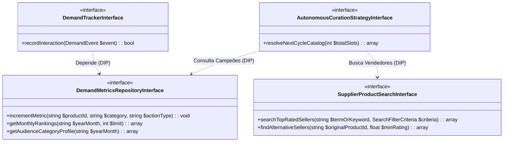

# 📐 Contratos de Arquitetura SOLID: Motor de Demanda & Filtros (DomainDrop)

> **Diretriz de Design:** Todos os componentes do subsistema de inteligência de demanda, filtros de pesquisa do SDK e rotação autônoma devem aderir estritamente aos princípios **SOLID** (com foco em **SRP**, **OCP** e **DIP**), alta coesão e baixo acoplamento através de contratos explícitos no namespace `DomainSystem\Plugins\domain_drop\Contracts\*`.

---

## 1. Diagrama de Contratos & Injeção de Dependência (DIP)



---

## 2. Especificação dos Contratos (PHP 8.2+)

### 2.1. Contrato de Rastreamento de Interações (SRP)
Responsabilidade única: validar e despachar eventos de intenção do usuário (`click_details`, `click_buy`).

```php
namespace DomainSystem\Plugins\domain_drop\Contracts;

use DomainSystem\Plugins\domain_drop\DTO\DemandEvent;

interface DemandTrackerInterface
{
    /**
     * Registra evento assíncrono garantindo controle anti-ruído de sessão.
     */
    public function recordInteraction(DemandEvent $event): bool;
}
```

---

### 2.2. Contrato de Persistência, Pulso em Tempo Real e Livro de Presença Mensal (ISP / DIP)
Responsabilidade única: persistir contadores em tempo real para o velocímetro/gráfico ao vivo e consolidar o fechamento mensal como um "livro de presença / auditoria contínua de demanda".

```php
namespace DomainSystem\Plugins\domain_drop\Contracts;

interface DemandMetricsRepositoryInterface
{
    /**
     * Incrementa atomicamente os contadores em tempo real (hoje e período YYYY-MM).
     */
    public function incrementMetric(
        string $productId,
        string $productTitle,
        string $categorySlug,
        string $actionType
    ): void;

    /**
     * Retorna o pulso de demanda em tempo real (últimas 24h / dia corrente) para os gráficos ao vivo.
     * @return array<string, mixed> Ex: ['live_clicks' => 84, 'top_hourly_products' => [...]]
     */
    public function getLivePulseMetrics(): array;

    /**
     * Retorna o fechamento consolidado do período (Livro de Presença e Auditoria de Demanda).
     * @return array<int, array{product_id: string, title: string, demand_score: int, buy_clicks: int, detail_clicks: int, conversions: int}>
     */
    public function getMonthlyRankings(string $yearMonth, int $limit = 20): array;

    /**
     * Agrupa o volume de interesse por categoria para montar o perfil da audiência.
     * @return array<string, int> Ex: ['eletronicos' => 450, 'casa-utilidades' => 280]
     */
    public function getAudienceCategoryProfile(string $yearMonth): array;
}
```

---

### 2.3. Contrato de Filtros & Busca no Fornecedor (AliExpress SDK) (OCP / LSP)
Permite trocar o fornecedor (AliExpress, Shopee, Armazém Próprio) sem alterar o motor de curadoria.

```php
namespace DomainSystem\Plugins\domain_drop\Contracts;

use DomainSystem\Plugins\domain_drop\DTO\SearchFilterCriteria;
use DomainSystem\Plugins\domain_drop\DTO\DropshipProductCandidate;

interface SupplierProductSearchInterface
{
    /**
     * Busca produtos no fornecedor aplicando filtros rigorosos de armazém nacional e reputação.
     * @return array<int, DropshipProductCandidate>
     */
    public function searchTopRatedSellers(string $keyword, SearchFilterCriteria $criteria): array;

    /**
     * Busca fornecedores alternativos bem avaliados para o mesmo produto caso o original pause o anúncio.
     * @return array<int, DropshipProductCandidate>
     */
    public function findAlternativeSellers(string $originalProductId, float $minRating = 4.5): array;
}
```

---

### 2.4. Contrato da Estratégia de Curadoria Autônoma de 24 Horas
Orquestra o ciclo: combina novidades das categorias da vez com vagas reservadas para os produtos campeões de demanda.

```php
namespace DomainSystem\Plugins\domain_drop\Contracts;

interface AutonomousCurationStrategyInterface
{
    /**
     * Resolve a lista final de produtos para a vitrine do ciclo de 24h.
     * Garante X% de produtos campeões de demanda + Y% de produtos de rotação de catálogo.
     * @return array<int, DropshipProductCandidate>
     */
    public function resolveNextCycleCatalog(int $totalSlots = 24): array;
}
```

---

## 3. Injeção de Dependências no Container do OS 2.0 (`Plugin.php`)

Nenhum controller ou serviço instancia classes diretamente com `new`. Tudo é amarrado via Inversão de Controle no `osBoot()`:

```php
// src/Plugins/domain_drop/Plugin.php

public function osBoot(OsRuntimeInterface $runtime): void
{
    // Repositório de Métricas
    $runtime->singleton(DemandMetricsRepositoryInterface::class, function () use ($runtime) {
        return new PdoDemandMetricsRepository($runtime->getLink('core.db'));
    });

    // Motor de Rastreamento
    $runtime->singleton(DemandTrackerInterface::class, function () use ($runtime) {
        return new SessionGuardedDemandTracker(
            repository: $runtime->make(DemandMetricsRepositoryInterface::class),
            session: $runtime->getLink('core.session')
        );
    });

    // Estratégia de Curadoria 24h Autônoma
    $runtime->singleton(AutonomousCurationStrategyInterface::class, function () use ($runtime) {
        return new DemandWeighted24hCurationStrategy(
            metricsRepo: $runtime->make(DemandMetricsRepositoryInterface::class),
            supplierSearch: $runtime->make(SupplierProductSearchInterface::class)
        );
    });
}
```

---

## 4. Garantia dos Princípios SOLID

| Princípio | Aplicação Prática no Módulo |
| :--- | :--- |
| **S - Single Responsibility** | `DemandTracker` só valida e dispara eventos; `DemandMetricsRepository` só cuida de SQL; `CurationStrategy` só orquestra a lógica da vitrine. |
| **O - Open/Closed** | Novas regras de pontuação ou novos filtros de fornecedor são criados por novas implementações de interface, sem editar o código existente. |
| **L - Liskov Substitution** | Qualquer implementação de `SupplierProductSearchInterface` (ex: Mock para testes, AliExpress SDK real ou outro marketplace) pode ser injetada sem quebrar o sistema. |
| **I - Interface Segregation** | Interfaces curtas, objetivas e especializadas (ex: o painel de gráficos só enxerga `DemandMetricsRepositoryInterface`, não precisa conhecer o SDK do AliExpress). |
| **D - Dependency Inversion** | Os controllers dependem apenas das interfaces, resolvidas via `OsRuntimeInterface` / Container. |
