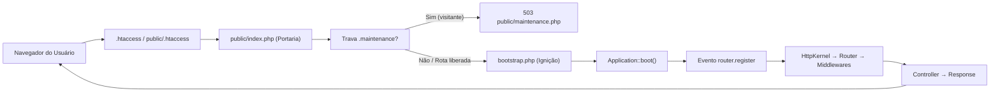

# Capítulo 00 — Introdução: O Mapa do Território e Vocabulário Base

> ⬅️ [Voltar ao Índice](README.md) | ➡️ [Próximo: Capítulo 01 — O "Start" no Servidor](01-start-servidor.md)

---

## 1. O que é o Domain System (e por que ele funciona como um "SO")

O **Domain System (v2.7.0)** é uma plataforma web escrita em **PHP 8.2+ puro**, sem frameworks pesados (como Laravel ou Symfony) no núcleo. Ele junta CMS, loja/dropshipping (`domain_drop`), pagamentos (`commerce`), escola online (`academy`) e construtor visual (`flextheme`).

Em vez de misturar todo o código em um único bloco, ele imita a arquitetura de um **Sistema Operacional (SO)**: existe um núcleo pequeno e rígido (o **Kernel**) que não conhece detalhes da loja nem dos cursos; ele apenas fornece energia, regras de segurança, comunicação e "tomadas" (**contratos**) onde módulos externos se plugam.

### Analogia: O Prédio Comercial Inteligente

- **Portaria Única (`public/index.php`):** ninguém entra pela janela; todo visitante (requisição) passa pela recepção.
- **Administração Central / Kernel (`src/Core/Application.php`):** existe apenas **uma** administração comandando o prédio inteiro (padrão *Singleton*).
- **Infraestrutura Essencial (`src/SystemApps/`):** energia, água, fechaduras e login (`auth`, `Database`, `installer`, `SystemAdmin`, `SystemUpdater`). Sem isso o prédio não abre.
- **Salas Alugadas / Plugins (`src/Plugins/`):** a loja virtual, a escola e os pagamentos são "inquilinos" independentes.
- **Fachada e Decoração (`themes/`):** muda a aparência visual sem quebrar a estrutura elétrica.
- **Disjuntor Elétrico (`src/Core/Error/CircuitBreaker.php`):** se um plugin dá curto-circuito repetidas vezes, o sistema desarma apenas aquela sala para não derrubar o prédio inteiro.

---

## 2. Mapa das Pastas do Projeto

| Caminho | Papel no Sistema | Em linguagem simples |
| :--- | :--- | :--- |
| `.htaccess` e `public/.htaccess` | Regras do servidor web | Redirecionam todo acesso para `public/index.php` e bloqueiam listagem de pastas. |
| `public/index.php` | Front Controller | Primeiro arquivo PHP executado quando o usuário acessa qualquer URL. |
| `bootstrap.php` | Ignição (Bootloader) | Lê `.env`, ativa o autoload de classes, liga proteção de erros e cria o Kernel. |
| `src/Core/` | Núcleo (Kernel) | Contém `Application`, `HttpKernel`, `Router`, `Container`, `EventDispatcher`, `Security`, `Contracts` e `ErrorHandler`. |
| `src/SystemApps/` | Apps vitais do SO | Login (`auth`), banco (`Database`), instalador (`installer`), admin, monitor e atualizador. |
| `src/Plugins/` | Módulos plugáveis | Regras de negócio opcionais: `domain_drop`, `academy`, `commerce`, `flextheme`, `pages`, `seo`, etc. |
| `themes/` | Camada visual | Templates do painel administrativo (`themes/admin/`) e temas públicos. |
| `config/` | Estado e configurações | Arquivos JSON com plugins ativos e plugins desarmados pelo disjuntor. |
| `composer.json` | Mapa de classes (PSR-4) | Ensina ao PHP em qual pasta encontrar cada classe automaticamente. |
| `tests/` | Testes automatizados | Testes PHPUnit de unidade, integração e arquitetura. |

---

## 3. Mini-Dicionário de Sobrevivência (Padrões de Projeto e SOLID sem jargão)

- **Front Controller (Portaria Única):** padrão em que **todas** as requisições web entram por um único arquivo PHP (`public/index.php`). Facilita centralizar segurança, manutenção e roteamento.
- **Bootstrap (Ignição):** etapa inicial que prepara o terreno (lê `.env`, registra autoload, arma monitoramento de erros) antes de atender o pedido.
- **Singleton (Exemplar Único):** garante que uma classe crítica (como `Application`, o Kernel) tenha **apenas 1 instância** ativa. Pense na Rainha da Colmeia: duas rainhas causariam conflito.
- **Container de Injeção de Dependências (DI — O Almoxarifado):** em vez de cada classe criar suas dependências com `new`, ela pede ao `Container` (`src/Core/Container/Container.php`), que entrega o serviço pronto ou reutiliza o mesmo exemplar.
- **Contrato / Interface (`src/Core/Contracts/`):** pense numa **tomada elétrica de 3 pinos**. O núcleo exige apenas o formato dos métodos (o contrato), permitindo trocar implementações (ex.: SQLite por MySQL) sem quebrar o sistema.
- **Event Dispatcher (Rádio Comunicador):** permite ao Kernel anunciar *"acabei de dar boot!"* (`kernel_post_boot`) ou *"registrem suas rotas!"* (`router.register`) sem saber quais plugins estão instalados.
- **Router & Middleware (Recepcionista e Seguranças):** o `Router` casa a URL com o `Controller`; os `Middlewares` são barreiras no corredor (login, permissão, CSRF).
- **Circuit Breaker (Disjuntor):** detecta falhas repetidas em um plugin e o desarma automaticamente para manter o site no ar.

### Arquitetura SOLID em 5 frases simples

| Letra | Nome Técnico | Tradução para a vida real | Exemplo no Domain System |
| :---: | :--- | :--- | :--- |
| **S** | Single Responsibility (SRP) | Cada classe faz **uma** coisa bem feita. | `HttpKernel` coordena HTTP; `Router` só casa rotas; `ErrorRenderer` só desenha erros. |
| **O** | Open/Closed (OCP) | Fácil adicionar novidades sem editar o núcleo. | Novos recursos entram como plugins em `src/Plugins/` sem editar `Application.php`. |
| **L** | Liskov Substitution (LSP) | Peças substitutas cumprem exatamente o mesmo papel. | Qualquer implementação de `SessionManagerInterface` funciona igual no Kernel. |
| **I** | Interface Segregation (ISP) | Contratos pequenos e focados, sem métodos inúteis. | `src/Core/Contracts/` separa contratos pequenos por responsabilidade. |
| **D** | Dependency Inversion (DIP) | O núcleo depende de contratos, não de peças fixas. | `Application` depende de `ContainerInterface` e `EventDispatcherInterface`. |

---

## 4. Voo Panorâmico de 1 Requisição

No PHP, cada acesso do usuário nasce, percorre todo o caminho abaixo em poucos milissegundos e termina após devolver a página:

---

## 5. Lupa de Auditoria — Perguntas que Vamos Responder na Série

A maioria das brechas reais nasce na **ordem de execução** ou em **portas secundárias esquecidas**. Ao longo dos capítulos vamos verificar:

1. **Na Portaria (Cap. 1):** existem arquivos `.php` soltos em `public/` que pulam o `index.php`? O modo manutenção pode ser burlado?
2. **Na Ignição e Singleton (Cap. 2 e 3):** o `.env` é carregado com segurança? O construtor público de `Application` permite quebrar o Singleton?
3. **No Container e Plugins (Cap. 4 e 5):** um plugin consegue sobrescrever serviços críticos de segurança dentro do `Container`?
4. **No Router e Segurança (Cap. 6 e 7):** toda rota sensível exige autenticação e CSRF? Há exceções perigosas?
5. **Em Dados e Arquivos (Cap. 8):** como o sistema protege contra SQL Injection, corrupção concorrente de JSON e Path Traversal?

---

> ⬅️ [Voltar ao Índice](README.md) | ➡️ [Próximo: Capítulo 01 — O "Start" no Servidor](01-start-servidor.md)
