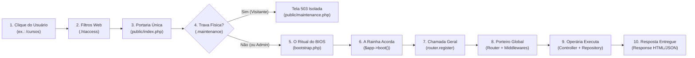

# Capítulo 00 — Introdução: O Mapa do Sistema e a Filosofia da Arquitetura

> 🇧🇷 **Português** | [🇺🇸 English version](en/00-introduction.md)  
> 🏠 [Voltar ao Índice](README.md) | ➡️ [Próximo: Capítulo 01 — O "Start" no Servidor](01-start-servidor.md)

---

## 1. A Dor que Ninguém Te Conta

Este guia não nasceu em uma sala de aula de universidade nem foi escrito para agradar bancas acadêmicas. Ele nasceu da **dor real de quem programa**:
- Da frustração de ver um código que começou simples e bonito virar, em poucos meses, um monstro incontrolável;
- Do desespero de alterar uma simples linha em um arquivo e descobrir que três telas completamente diferentes pararam de funcionar;
- Do medo de tocar em um sistema antigo porque ele parece um castelo de cartas pronto para desabar ao menor sopro.

Os livros clássicos de programação costumam ensinar conceitos teóricos com exemplos infantis e distantes da realidade: *"Animal que faz som"*, *"Cachorro que late"*, *"Gato que mia"*. Quando você vai para a vida real — construir uma loja virtual, um sistema médico ou uma plataforma de cursos com pagamentos — você não programa gatos latindo. Você lida com clientes exigindo:
> *"Hoje queremos notificar por WhatsApp. Daqui a duas semanas, queremos trocar por e-mail. No próximo mês, queremos os dois juntos e mais SMS. E no fim do ano, queremos aceitar Pix, cartão e boleto sem que o sistema saia do ar."*

Se o seu código cria as coisas de forma engessada (uma classe instanciando a outra diretamente dentro de si), cada nova vontade do cliente vira um pesadelo de dezenas de `if/else`, arquivos gigantes e acoplamento desastroso.

Para resolver isso de verdade, não precisamos decorar siglas difíceis em inglês. **Precisamos entender a física e a biologia das coisas**.

---

## 2. As Grandes Viradas de Chave: A Tomada, o Arduino e a Natureza

Como ensinado no livro [**Entendendo Arquitetura SOLID: Do Objeto ao Contrato, do Acoplamento à Arquitetura**](https://www.amazon.com.br/dp/B0H74L5GFL) (disponível na Amazon Kindle), a arquitetura de software não é sobre linhas de código — **é sobre conexões entre partes**.

### 🔌 A Tomada e o Plugue: "Primeiro a fêmea, depois os machos"

Pense na tomada da parede da sua casa:
1. **A tomada na parede é a Interface (o Contrato):** ela define as regras imutáveis — o formato dos furos, a voltagem (110V/220V) e a frequência. Ela **nunca muda**.
2. **Os aparelhos são as Classes Concretas (os Plugues):** você pode ligar um ventilador, uma geladeira, uma televisão ou o carregador do seu celular. Cada um tem um circuito interno completamente diferente, mas todos respeitam o mesmo formato de pinos.
3. **A Injeção de Dependência é o Encaixe:** a parede não "fabrica" o ventilador. O ventilador já vem pronto e é simplesmente plugado na tomada.

> **A Regra de Ouro:** *"A tomada nunca muda. Os plugues sempre mudam. O sistema depende da tomada (do contrato), jamais do plugue."*

### 🤖 O Arduino e a Placa-Mãe

Quando você espeta um LED ou um sensor no pino de uma placa Arduino:
- A placa não sabe se está acendendo uma lâmpada na sala, girando o motor de um robô ou tocando uma buzina.
- Ela só sabe que existe um componente conectado ao pino que respeita o padrão elétrico (0V ou 5V).
- O **Kernel do sistema é a placa-mãe**. Os **módulos e plugins são os componentes**. E as **conexões são as interfaces**.

### 🐝 A Natureza como Arquiteta Original (Alan Kay e a Biologia)

Alan Kay, o criador da Programação Orientada a Objetos, não se inspirou na matemática — ele se inspirou na **biologia**:
- Células têm membrana (**interface**) e núcleo com estado interno (**encapsulamento**);
- Organismos se comunicam por mensagens químicas chamadas **feromônios**.

Pense em uma **Colmeia**:
- **A Rainha é o Singleton da Natureza:** só pode existir **uma** rainha. Se duas rainhas acordarem ao mesmo tempo, a colmeia entra em colapso e guerra civil. A rainha não faz trabalho pesado; ela orquestra e coordena.
- **As Operárias (Eager Loading):** nascem constantemente para manter a estrutura viva (coleta, proteção, manutenção). Elas são essenciais e estão prontas a todo momento.
- **Os Zangões (Lazy Loading):** nascem sob demanda apenas na época da reprodução e são descartados depois.
- **Os Feromônios (Interfaces e Eventos):** quando uma abelha encontra comida, ela libera um feromônio de rastro no ar. Ela **não sabe quem vai ler** e não precisa telefonar para cada companheira. Quem tiver o receptor compatível escuta e reage. Isso é o **desacoplamento perfeito**!

---

## 3. O que é o SOLID na Vida Real?

O SOLID (formalizado por Robert C. Martin, o Uncle Bob) não é um mantra acadêmico para decorar para provas. É um estojo de socorro para problemas que você já sentiu na pele:

| Letra | Princípio | O que diz na prática | A Analogia Física | A Dor que ele cura |
| :---: | :--- | :--- | :--- | :--- |
| **S** | **SRP** (*Single Responsibility*) | Uma classe deve ter uma única razão para mudar. | Cada operária da colmeia faz apenas seu papel (a guardiã defende, a nutriz alimenta). | A classe "faz-tudo" de 3.000 linhas que quebra por qualquer motivo. |
| **O** | **OCP** (*Open-Closed*) | Aberto para extensão, fechado para alteração. | A tomada na parede ou a catraca do metrô: você conecta aparelhos novos sem precisar quebrar a parede. | Ter que abrir o código antigo e enfiar mais um `elseif` toda vez que surge uma novidade. |
| **L** | **LSP** (*Liskov Substitution*) | Objetos devem poder ser trocados por outros que seguem o mesmo contrato sem quebrar nada. | Qualquer plugue de 3 pinos funciona na mesma tomada sem dar curto-circuito na casa. | Trocar um provedor de envio e o sistema travar porque o novo não tem os mesmos métodos. |
| **I** | **ISP** (*Interface Segregation*) | Ninguém deve ser forçado a assinar contratos cheios de regras que não vai usar. | Uma tomada elétrica padrão tem apenas 3 pinos — não tem 50 pinos inúteis para a maioria dos aparelhos. | Uma interface gigante com 20 métodos onde seu plugin só precisava de um. |
| **D** | **DIP** (*Dependency Inversion*) | O sistema principal depende de abstrações (contratos), nunca de classes concretas engessadas. | A casa depende da tomada (padrão universal), não da marca do fabricante do ventilador. | Ficar refém de uma biblioteca ou banco de dados específico espalhado pelo código todo. |

---

## 4. O Domain System: A Natureza em Código

O **Domain System (v2.8.3)** é a materialização viva dessa filosofia. Ele foi construído em **PHP 8.2+ puro** para funcionar como um verdadeiro **Sistema Operacional Web**:

```
┌────────────────────────────────────────────────────────┐
│             O ECOSSISTEMA DO DOMAIN SYSTEM             │
├────────────────────────────────────────────────────────┤
│ 👑 KERNEL (Application)    → A Rainha / Placa-Mãe      │
│ 📦 CONTAINER (DI)          → O Almoxarifado Central    │
│ 📡 EVENT DISPATCHER        → Os Feromônios / Mensagens │
│ 🚪 ROUTER                  → O Porteiro Global (Catraca│
│ 🔌 PLUGINS & APPS          → As Castas e Componentes   │
│ 🛡️ CIRCUIT BREAKER        → O Sistema Imunológico     │
└────────────────────────────────────────────────────────┘
```

- **A Portaria Única (`public/index.php`):** nenhuma requisição entra pelos fundos. Tudo bate na recepção oficial.
- **O BIOS de Ignição (`bootstrap.php`):** prepara o terreno físico, confere fusos e credenciais (`.env`), arma os disjuntores de erro e dá à luz ao Kernel.
- **A Rainha Única (`src/Core/Application.php`):** o Kernel é um **Singleton blindado** (construtor controlado, proteção contra clonagem e desserialização). Só existe um, e ele se distribui para o sistema todo através do Container DI.
- **Os Módulos Vitais (`src/SystemApps/`):** o coração do prédio (Autenticação, Banco de Dados, Painel Admin, Atualizador).
- **Os Módulos de Negócio (`src/Plugins/`):** os plugues intercambiáveis (Loja Dropshipping com AliExpress, Escola LMS de Cursos, Checkout com Pix e Mercado Pago, Construtor Visual).
- **O Disjuntor Imortal (`CircuitBreaker`):** se um plugin defeituoso tentar explodir o sistema com um erro fatal, o disjuntor desarma apenas aquele plugin no `config/plugins.json` e a colmeia continua viva!

---

## 5. Onde Fica Cada Coisa no Projeto (Mapa das Pastas)

Ao abrir o repositório (`D:\xampp\htdocs\domain-system`), você encontrará esta organização clara de pastas:

| Pasta ou Arquivo | O que é na analogia | Papel real no sistema |
| :--- | :--- | :--- |
| `.htaccess` e `public/.htaccess` | Os portões externos e as catracas | Garantem que o visitante nunca acesse arquivos internos e direcionam o fluxo para `public/index.php`. |
| `public/index.php` | A Portaria do Prédio (*Front Controller*) | O primeiro arquivo PHP a ser executado a cada requisição. |
| `bootstrap.php` | O BIOS / Ritual de Ignição | Lê o `.env`, ativa os autoloaders, prepara o tratamento de erros e instancia a Rainha (`Application`). |
| `src/Core/` | A Placa-Mãe e os Circuitos Centrais | Contém a Rainha (`Application`), o Almoxarifado (`Container`), o Roteador (`Router`), o Rádio (`EventDispatcher`) e os Contratos (`Contracts`). |
| `src/SystemApps/` | Órgãos Vitais do Sistema | Módulos obrigatórios para o Kernel respirar: autenticação, banco de dados, administração e atualizações. |
| `src/Plugins/` | Os Componentes / Plugues | Módulos de negócio independentes que podem ser ligados e desligados sem quebrar o motor. |
| `themes/` | A Pintura e Decoração | Layouts visuais (CSS/HTML). O tema muda a aparência sem encostar em regras de negócio. |
| `config/` | O Painel de Chaves Elétricas | Arquivos `.json` que guardam quais plugues estão energizados ou desarmados pelo disjuntor. |
| `tests/` | A Bancada de Testes Automatizada | Bateria de centenas de testes unitários que garantem que nenhuma tomada ou plugue quebrou. |

---

## 6. A Jornada Completa de 1 Clique

No PHP, um sistema não fica ocupando memória de processo contínuo como um aplicativo desktop comum. A cada clique do usuário, um ciclo completo de vida nasce, floresce e encerra em milissegundos:



---

## 7. Como Essa Leitura Ajuda a Encontrar Falhas e Brechas?

A maior parte dos problemas graves em software não vem de códigos misteriosos, mas de **falhas elementares nas conexões**:
- Uma porta que ficou destrancada na pasta pública permitindo que qualquer pessoa acione rotas sensíveis;
- Uma peça que tenta ler dados antes de o ambiente ter sido ligado;
- Um texto que veio da rua e é desenhado na tela sem filtro, gerando vulnerabilidades como **XSS**;
- Uma rota crítica que não passa pelo segurança de permissões ou pelo carimbo anti-fraude (**CSRF**).

Por isso, cada capítulo desta documentação termina com uma **🔍 Lupa de Auditoria**, mostrando de forma transparente o que foi auditado, as falhas encontradas e a cura para cada uma delas.

---

> 🏠 [Voltar ao Índice](README.md) | ➡️ [Próximo: Capítulo 01 — O "Start" no Servidor](01-start-servidor.md)
