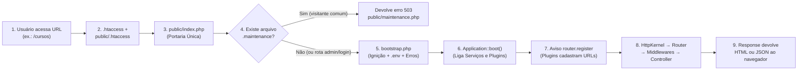

# Capítulo 00 — Introdução: O Mapa do Sistema (sem palavras difíceis)

> 🏠 [Voltar ao Índice](README.md) | ➡️ [Próximo: Capítulo 01 — O "Start" no Servidor](01-start-servidor.md)

---

## 1. Afinal, o que é o Domain System?

O **Domain System (v2.7.0)** é um sistema web completo feito em **PHP 8.2+ puro** — ou seja, construído na mão, sem usar frameworks gigantes de terceiros (como Laravel ou Symfony) no seu miolo.

Com ele, um mesmo site pode ter:
- páginas e blog (CMS),
- loja virtual e dropshipping (`domain_drop`),
- pagamentos com Pix, cartão e PayPal (`commerce`),
- escola de cursos online (`academy`),
- editor visual de páginas (`flextheme`).

### Por que dizemos que ele funciona como um "Sistema Operacional"?

Pense no seu celular ou no seu computador (Windows/Linux):
- O **Windows** não vem com Photoshop, Spotify e WhatsApp embutidos dentro do mesmo arquivo.
- Ele vem com um **núcleo** (que cuida de memória, tela, internet e senhas) e permite **instalar aplicativos** por cima. Se o Spotify travar, o Windows continua funcionando.

O Domain System foi construído com **exatamente essa mesma ideia**. Em vez de jogar loja, escola, login e banco de dados tudo misturado nos mesmos arquivos, ele separa o projeto em camadas claras — como um **prédio comercial bem organizado**:

- **A Portaria Única (`public/index.php`):** ninguém entra pelos fundos nem pela janela. Toda pessoa que acessa o site passa primeiro pela recepção.
- **A Administração do Prédio (`src/Core/Application.php`):** existe apenas **uma** administração comandando tudo (é isso que chamam de *Kernel*).
- **Água, Luz e Fechaduras (`src/SystemApps/`):** coisas obrigatórias para o prédio abrir: login (`auth`), banco de dados (`Database`), instalador (`installer`), painel do dono (`SystemAdmin`) e atualizador (`SystemUpdater`).
- **As Salas Alugadas (`src/Plugins/`):** a loja virtual, a escola de cursos e o módulo de pagamentos funcionam como lojas dentro do prédio. Você pode ligar ou desligar uma sala sem derrubar as outras.
- **A Pintura e Fachada (`themes/`):** cuida só do visual (HTML/CSS). Você muda a cara do site sem mexer nas regras do sistema.
- **O Disjuntor Elétrico (`src/Core/Error/CircuitBreaker.php`):** se uma loja der curto-circuito (erro grave repetido), o disjuntor desliga só aquela sala e mantém o resto do prédio funcionando.

---

## 2. Onde fica cada coisa no projeto (Mapa das Pastas)

Se você abrir a pasta do projeto no computador (por exemplo `D:\xampp\htdocs\domain-system`), vai ver várias pastas. Você **não** precisa entender todas hoje — basta saber o papel das principais:

| Pasta ou Arquivo | O que faz, em português claro |
| :--- | :--- |
| `.htaccess` e `public/.htaccess` | Regras para o servidor web (Apache/XAMPP). Dizem: *"se o usuário não pediu uma imagem ou CSS real, mande tudo para `public/index.php`"* e protegem as pastas internas. |
| `public/index.php` | **A porta de entrada.** É o primeiro código PHP que roda quando alguém abre qualquer página do site. |
| `bootstrap.php` | **A chave de ignição.** Lê o arquivo `.env` (senhas e configurações), liga o localizador automático de classes, ativa a rede contra erros e cria o cérebro do sistema (`Application`). |
| `src/Core/` | **O motor central.** Aqui ficam o cérebro (`Application`), o roteador de endereços (`Router`), o guardador de peças (`Container`), o rádio de avisos (`EventDispatcher`), a segurança e os contratos. |
| `src/SystemApps/` | **Os módulos obrigatórios do sistema.** Login, banco de dados, instalador, painel admin, monitor e atualizador. |
| `src/Plugins/` | **Os módulos opcionais (negócio).** Loja (`domain_drop`), escola (`academy`), pagamentos (`commerce`), construtor visual (`flextheme`), páginas (`pages`), SEO (`seo`), etc. |
| `themes/` | **As telas visuais.** Layouts do painel administrativo (`themes/admin/`) e temas públicos do site. |
| `config/` | **Arquivos de estado.** Pequenos arquivos `.json` dizendo quais plugins estão ligados ou quais foram desarmados pelo disjuntor. |
| `composer.json` | **O mapa de endereços das classes.** Ensina ao PHP onde está cada arquivo de classe para você não precisar escrever 200 linhas de `require_once`. |
| `tests/` | **Os robôs de teste.** Mais de 600 testes automáticos (PHPUnit) que conferem se nada quebrou quando o código muda. |

---

## 3. Tradutor de Nomes Técnicos (para nunca mais travar lendo código)

No mundo da programação, as pessoas adoram dar nomes difíceis em inglês para ideias bem simples. Aqui está a tradução honesta dos termos que você vai ver nos próximos capítulos:

### 1. Front Controller = "Portaria Única"
Em sites muito antigos em PHP, cada página era um arquivo separado: `sobre.php`, `contato.php`, `produto.php`, `admin.php`. O problema? Se você precisasse colocar uma checagem de segurança ou modo manutenção, teria que copiar e colar o mesmo código em 50 arquivos — e sempre esqueceria algum!

Com o **Front Controller**, **todas** as páginas passam primeiro por **um único arquivo**: `public/index.php`. Ele faz a segurança, liga o sistema e depois decide qual pedaço de código vai responder.

### 2. Bootstrap = "Chave de Ignição"
Antes de o carro andar, você gira a chave: a bateria liga, o painel acende, o motor dá partida. No Domain System, o arquivo `bootstrap.php` faz exatamente isso: carrega o `.env`, configura fuso horário, liga o tratamento de erros e monta o cérebro do sistema.

### 3. Singleton = "Só pode existir UM"
Imagine uma escola com **dois diretores** dando ordens opostas ao mesmo tempo, ou uma colmeia com **duas rainhas**. Vira caos.

**Singleton** é apenas uma técnica para garantir que uma classe muito importante (no nosso caso, `Application`, o cérebro do sistema) só possa ter **1 exemplar vivo** durante a requisição. Quem precisar dela recebe sempre **a mesma**.

### 4. Container de Injeção de Dependências (DI) = "O Almoxarifado"
Imagine um mecânico que precisa de uma chave de fenda. Existem dois jeitos:
- **Jeito bagunçado:** toda vez que precisa de uma chave, o mecânico sai da oficina e compra uma nova (`new ConexaoBanco()`). No fim do dia existem 40 conexões abertas gastando memória.
- **Jeito organizado (Container):** existe um **Almoxarifado** (`src/Core/Container/Container.php`). Quando uma parte do código precisa do banco de dados ou da sessão, ela pede ao Almoxarifado — e ele entrega a ferramenta pronta (reutilizando a mesma sempre que fizer sentido).

### 5. Interface / Contrato (`src/Core/Contracts/`) = "A Tomada de 3 Pinos"
Você nunca precisou abrir a parede da sua casa para ligar um liquidificador novo, certo? Por quê? Porque a parede e o liquidificador combinam no **formato da tomada**.

Uma **Interface** (que o Domain System chama de **Contrato**) é exatamente isso: uma lista curta de regras combinadas (por exemplo: *"todo banco de dados precisa ter os métodos `query()` e `execute()`"*). Assim, o núcleo do sistema funciona tanto com **SQLite** quanto com **MySQL** sem precisar mudar uma linha do motor!

### 6. Event Dispatcher = "O Rádio Comunicador da Empresa"
Em vez de o núcleo do sistema saber o nome de cada plugin instalado, ele pega o rádio e avisa no alto-falante:
> *"Atenção, pessoal! Acabei de iniciar (`kernel_post_boot`). Quem quiser cadastrar URLs, pode mandar agora (`router.register`)!"*

Cada plugin que estiver ligado escuta o rádio e responde. Se você apagar um plugin, o núcleo nem sente falta e não dá erro.

### 7. Router e Middleware = "A Recepcionista e os Seguranças do Corredor"
- **Router (`src/Core/Routing/Router.php`):** olha o endereço digitado (ex.: `/admin/usuarios`) e consulta a lista de salas: *"Ah, `/admin/usuarios` é atendido pelo `AdminController`!"*.
- **Middleware:** são seguranças parados no corredor **antes** da sala. Um confere: *"Você está logado?"*. Outro confere: *"Esse formulário tem o selo anti-fraude (CSRF)?"*. Se algum segurança barrar, o usuário nem chega na sala.

### 8. E o famoso "SOLID", o que é isso sem enrolação?
Muita gente faz drama com a sigla **SOLID**, mas ela é só **5 regras de bom senso** para o código não virar uma bola de fios emaranhados:

1. **S (Uma coisa só):** cada arquivo/classe tem uma tarefa clara. Quem desenha tela de erro não fica conectando no banco de dados.
2. **O (Crescer sem quebrar):** para adicionar uma loja ou curso novo, você cria um plugin novo — em vez de ficar remendando o núcleo o tempo todo.
3. **L (Substituto de verdade):** se uma peça promete fazer o mesmo papel de outra (seguir o mesmo contrato), ela não pode dar surpresa quando você fizer a troca.
4. **I (Contratos enxutos):** melhor ter vários combinados pequenos e diretos do que um contratão gigante obrigando todo mundo a fazer o que não precisa.
5. **D (Depender da tomada, não da marca):** o motor do sistema depende do *formato da tomada* (Interface), não de uma marca específica de peça.

---

## 4. Visão Geral: a viagem completa de 1 clique no navegador

No PHP, o site **não fica "rodando parado na memória" esperando** como um jogo de videogame. A cada clique do usuário, o servidor faz tudo isso em poucos milissegundos e depois limpa a memória:

Nos próximos capítulos, vamos dar **zoom em cada caixinha desse desenho**, lendo o código real do Domain System linha por linha.

---

## 5. Como essa leitura ajuda a caçar bugs e brechas de segurança?

A maior parte das invasões e bugs sérios **não** acontece por fórmulas mirabolantes. Ela acontece por descuidos simples na costura entre uma peça e outra, como:
- um arquivo `.php` esquecido dentro de `public/` que **pula** a portaria e não pede senha;
- uma checagem que roda **antes** do `.env` ser lido;
- um texto vindo da URL impresso direto no HTML sem proteção (permitindo injetar `<script>`);
- uma rota administrativa sem o segurança (middleware) de login ou sem proteção contra formulário falso (CSRF).

Por isso, ao final de **cada capítulo**, teremos uma seção chamada **🔍 Lupa de Auditoria** listando exatamente os riscos e falhas reais encontrados naquela etapa!

---

> 🏠 [Voltar ao Índice](README.md) | ➡️ [Próximo: Capítulo 01 — O "Start" no Servidor](01-start-servidor.md)
