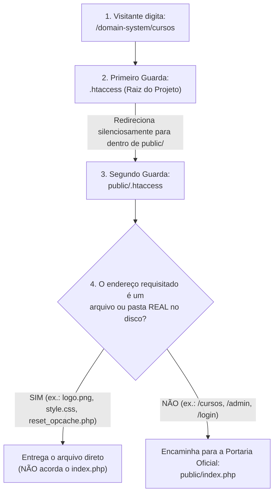

# Capítulo 01 — O "Start": O Nascimento da Requisição e a Portaria Única

> 🇧🇷 **Português** | [🇺🇸 English version](en/01-server-start.md)  
> ⬅️ [Anterior: Capítulo 00 — Introdução](00-introducao.md) | 🏠 [Voltar ao Índice](README.md) | ➡️ [Próximo: Capítulo 02 — O Ritual do Bootstrap](02-o-ritual-do-bootstrap.md)

---

## 🎬 Visão Cinematográfica: O Silêncio Antes do Big Bang

Imagine a cena:
> *Tela preta. Nenhum som. Apenas o cursor piscando silenciosamente no terminal, como uma vela no escuro.*  
> *De repente, um comando é executado no servidor:*  
> `php -S localhost:8000` *(ou o Apache é iniciado no XAMPP).*  
>  
> *Longe dali, um usuário abre o navegador e digita:*  
> `http://localhost/domain-system/cursos`  
>  
> *O navegador grita pela rede mundial: "Ei, alguém aí?"*  
> *O servidor web acorda, intercepta o pacote e coloca uma grande máquina em movimento.*

Neste capítulo, vamos dissecar o **primeiro segundo de vida** de uma requisição — o momento exato em que a porta da frente se abre, as catracas de segurança são ativadas e o sistema começa a respirar.

Os arquivos reais e componentes que atuam nesta etapa:
- `.htaccess` *(na raiz do projeto)*
- `public/.htaccess` *(na pasta pública)*
- `public/index.php` *(a Portaria Única / Front Controller)*
- `public/maintenance.php` *(a Escotilha de Isolamento)*
- `public/reset_opcache.php` *(guarde esse nome — ele é o réu da nossa Lupa de Auditoria!)*

---

## 1. O Portão de Entrada: Os Filtros do Servidor Web (`.htaccess`)

Antes mesmo de qualquer linha de PHP ser interpretada na memória, o primeiro porteiro a agir é o **Servidor Web** (o Apache no XAMPP ou LiteSpeed/Nginx em servidores de produção).

Em sistemas arcaicos de PHP (a "era das trevas" do acoplamento), cada página era um arquivo solto na raiz: `sobre.php`, `cursos.php`, `painel.php`. Se você precisasse aplicar uma regra de segurança ou checagem de login, tinha que copiar e colar o mesmo código em 80 arquivos — e invariavelmente esquecia um, abrindo uma brecha mortal.

No **Domain System**, a regra de ouro é **uma única portaria para todo mundo**. Para garantir isso, dois arquivos `.htaccess` trabalham como filtros em cascata:



### 1.1. O Primeiro Guarda: `.htaccess` na raiz do projeto

Veja o trecho real em `.htaccess`:

```apache
<IfModule mod_rewrite.c>
    RewriteEngine On
    RewriteRule ^(.*)$ public/$1 [L]
</IfModule>

<IfModule php_module>
    php_value upload_max_filesize 128M
    php_value post_max_size 135M
    php_value memory_limit 256M
</IfModule>
```

#### O que isso faz, sem complicação:
1. `RewriteRule ^(.*)$ public/$1 [L]`: qualquer pedido que chegue na raiz da pasta é imediatamente empurrado para dentro do subdiretório `public/`.
2. **Por que isso protege a sua vida?**  
   Na raiz do projeto moram os arquivos mais sensíveis de todo o ecossistema: o arquivo `.env` (onde ficam senhas de banco e chaves de criptografia), a base de dados `database.sqlite` e os manifestos `config/plugins.json`. Se o visitante pudesse navegar na raiz, bastaria digitar `http://seusite.com/.env` para roubar todas as credenciais do servidor! Esse primeiro guarda impede o acesso direto à raiz.
3. As diretivas de PHP elevam os limites de memória e upload para 128MB/135MB/256MB, garantindo que apostilas, mídias e produtos de dropshipping pesados possam trafegar sem estouro de buffer.

### 1.2. O Segundo Guarda: `public/.htaccess`

Quando o pedido entra na pasta `public/`, o segundo guarda entra em ação:

```apache
<IfModule mod_rewrite.c>
    RewriteEngine On
    RewriteCond %{REQUEST_FILENAME} !-f
    RewriteCond %{REQUEST_FILENAME} !-d
    RewriteRule ^(.*)$ index.php [QSA,L]
</IfModule>
```

- `!-f` (*not a file*) e `!-d` (*not a directory*): se o visitante estiver pedindo uma imagem existente (`logo.png`) ou uma folha de estilo (`theme.css`), o Apache entrega o arquivo estático **direto do disco**. Não faz sentido gastar memória do PHP para entregar uma foto!
- Se **não for** um arquivo real (como `/cursos`, `/admin` ou `/checkout`), o Apache aciona a regra: manda tudo para **`public/index.php`**, mantendo os parâmetros originais (`QSA` = *Query String Append*).

---

## 2. A Portaria Oficial: `public/index.php` (*Front Controller*)

O arquivo `public/index.php` (com suas ~124 linhas) tem uma responsabilidade sagrada no padrão **SRP (Single Responsibility Principle)**: ele **não** processa regras de negócio, **não** consulta o banco de dados e **não** renderiza HTML de tela.

Sua única responsabilidade é **receber o visitante, preparar a passagem e acionar os órgãos vitais do sistema**. Ele faz isso em 5 atos cirúrgicos:

### Ato 1 — O Decodificador de Caminhos (`$resolveAgnosticPath`, linhas 10–54)

Todo desenvolvedor já sofreu ao migrar um site do ambiente local para o servidor de produção:
- No XAMPP local: `http://localhost/domain-system/admin`
- Na nuvem (domínio próprio): `https://meudominio.com.br/admin`
- Em subdiretórios ou aliases de teste: `http://localhost/domain-system/public/admin`

Se o código do sistema precisasse conhecer de antemão onde está instalado, teríamos um acoplamento severo de infraestrutura. Por isso, a closure `$resolveAgnosticPath` entra em ação logo no início: ela inspeciona as variáveis de ambiente e a URI e divide a rota em dois elementos puros:
1. **`BASE_URL`**: o prefixo da pasta onde o sistema está hospedado (`/domain-system` ou vazio `""`);
2. **`$route`**: a rota limpa e normalizada (sempre `/admin`).

### Ato 2 — A Escotilha de Isolamento (`.maintenance`, linhas 59–77)

Antes de carregar qualquer classe pesada ou tocar no banco de dados, o sistema inspeciona se existe um arquivo físico chamado `.maintenance` na raiz:

```php
$maintenanceFile = dirname(__DIR__) . '/.maintenance';
if (file_exists($maintenanceFile)) {
    [$earlyBase, $cleanPath] = $resolveAgnosticPath();

    // Rotas essenciais continuam autorizadas
    if (!preg_match('#^/(admin|login|logout|api|setup)(/|$)#', $cleanPath)) {
        header('Retry-After: 3600');
        http_response_code(503);
        require $maintenancePage;
        exit;
    }
}
```

#### Por que isso é vital para a resiliência?
Se o sistema estiver em processo de atualização (baixando uma nova versão pelo atualizador automático ou aplicando migrações no banco), qualquer requisição que tentasse carregar arquivos incompletos explodiria na cara do visitante com um erro fatal feio.  
Ao colocar essa checagem na primeiríssima linha, o visitante recebe imediatamente uma resposta limpa **HTTP 503**, visualizando a tela estática e leve `public/maintenance.php`, enquanto o administrador ainda consegue acessar `/admin` ou `/login` para acompanhar e concluir a manutenção.

### Ato 3 — A Passagem de Bastão: O Ritual do Bootstrap (linhas 80–92)

Uma vez superada a trava inicial, a Portaria dá o comando mais importante do início de vida do sistema:

```php
$app = require_once dirname(__DIR__) . '/bootstrap.php';
```

O `index.php` não tenta criar o Kernel sozinho. Ele delega isso para o ritual do `bootstrap.php` (o BIOS do sistema, que dissecaremos detalhadamente no Capítulo 02). O `bootstrap.php` retorna o Kernel do sistema guardado em `$app`.

Em seguida, o `index.php` dispara o primeiro feromônio no ar:
```php
$app->getDispatcher()->dispatch('kernel_pre_boot');
```
É o rádio comunicador avisando: *"O sistema está prestes a acordar as operárias!"*.

### Ato 4 — O Pacote da Requisição (`Request::capture`) e o Despertar da Colmeia

O navegador enviou um emaranhado de superglobais brutas do PHP (`$_GET`, `$_POST`, `$_SERVER`, `$_COOKIE`). O Domain System encapsula tudo isso em um objeto limpo e imutável através da classe `Request`:

```php
$earlyRequest = \DomainSystem\Core\Http\Request::capture();
// Normaliza o REQUEST_URI com a rota limpa
$earlyRequest->server['REQUEST_URI'] = $routeUri;

// Acorda a colmeia!
$app->boot();

// Avisa que todos os plugins e módulos essenciais acordaram
$app->getDispatcher()->dispatch('kernel_post_boot');

// Distribui o caderno de rotas para que as operárias registrem suas salas
$app->getDispatcher()->dispatch('router.register', $app->getRouter());
```

Com `$app->boot()`, os `SystemApps` e os `Plugins` ativos são convocados. Pelo evento `router.register`, cada plugin adiciona suas rotas na catraca do roteador sem que o Kernel precise saber o que cada plugin faz! Isso é o **OCP (Open-Closed Principle)** na prática.

### Ato 5 — A Entrega ao HttpKernel e o Envio da Resposta (linhas 104–123)

Por fim, o `public/index.php` cria o condutor HTTP (`HttpKernel`), que reúne o Roteador, o Container DI (o almoxarifado) e o WorkspaceManager:

```php
$httpKernel = new \DomainSystem\Core\Http\HttpKernel(
    $app->getRouter(),
    $app->getContainer(),
    $app->getWorkspaceManager()
);

$response = $httpKernel->handle($request, file_exists($maintenanceFile), __DIR__ . '/maintenance.php');
$response->send();
```

O `HttpKernel` despacha o pedido pelo Roteador, valida seguranças e permissões, invoca o Controller adequado e devolve uma `Response`. O método `$response->send()` cospe os cabeçalhos e o conteúdo final (HTML ou JSON) para o navegador do cliente. Ciclo encerrado!

---

## 3. 🔍 Lupa de Auditoria: 4 Achados Reais de Segurança e Lógica

A utilidade de dissecar o sistema passo a passo é desmascarar fragilidades que passariam invisíveis aos olhos desatentos. Durante a revisão minuciosa desta primeira etapa de entrada, identificamos **4 pontos de atenção críticos**:

---

### 🔴 Achado 1 (Segurança — Crítico/Médio): `public/reset_opcache.php` exposto sem autenticação

- **Arquivo:** `public/reset_opcache.php` (linhas 1–8)
- **O que há no arquivo:**
  ```php
  <?php
  if (function_exists('opcache_reset')) {
      opcache_reset();
      echo "OPcache reset successfully!";
  } else {
      echo "OPcache is not enabled.";
  }
  ```
- **A Brecha:**  
  Lembra da regra do `public/.htaccess`? *"Se o arquivo existir fisicamente na pasta `public/`, o servidor entrega direto sem passar pelo `index.php`"*.  
  Como `reset_opcache.php` é um arquivo real solto dentro de `public/`, **qualquer pessoa ou bot na internet pode requisitar `https://seusite.com/reset_opcache.php` a qualquer momento**.
- **O Impacto:**  
  1. **Negação de Serviço (DoS por exaustão de CPU):** Um atacante pode disparar 200 requisições simultâneas por segundo para esse script. Como o OPcache mantém os scripts PHP pré-compilados na memória RAM para dar velocidade, resetá-lo continuamente força o servidor a reinterpretar do disco e recompilar todo o código a cada milissegundo, levando o uso de CPU a 100% e derrubando o servidor.
  2. **Vazamento de Informação:** Revela se o OPcache está ativo ou inativo no ambiente.
  3. **Risco de Empacotamento:** O arquivo não estava isolado na esteira de exclusão de releases (`release/exclude.txt`), correndo o risco de subir para ambientes de produção.
- **A Solução Arquitetural:**  
  Remover o arquivo estático solto em `public/`. Essa funcionalidade deve ser um botão administrativo protegido dentro do painel, operando via requisição `POST`, com token anti-CSRF e restrito estritamente a usuários com perfil de Super Administrador.

---

### 🟠 Achado 2 (Segurança — Médio): Exibição crua de exceção 404 sem escape contra XSS

- **Onde ocorre:**
  - `src/Core/Routing/Router.php`: ao não encontrar uma rota, lança:  
    `throw new Exception("Rota não encontrada: $uri", 404);`
  - `public/index.php` (linha 117): captura e imprime direto:  
    `$errorResponse = new Response("404 Not Found: " . $e->getMessage(), 404);`
  - `src/Core/Http/Response.php` (linha 30): envia como `Content-Type: text/html` e faz `echo` direto da mensagem.
- **A Brecha:**  
  Se um usuário mal-intencionado envia uma URI contendo payload malicioso (ex.: `/<script>alert(1)</script>`), e o texto da mensagem de erro for refletido cruamente em uma resposta HTML sem `htmlspecialchars()`, cria-se um vetor de **Reflected XSS (Cross-Site Scripting)**.
- **A Solução Arquitetural:**  
  Sanitizar sempre a saída com `htmlspecialchars($e->getMessage(), ENT_QUOTES, 'UTF-8')` ou, preferencialmente, carregar um template amigável e fixo de erro 404 que não reflita strings arbitrárias da requisição sem sanitização.

---

### 🟡 Achado 3 (Lógica — Baixo/Médio): Condição de Corrida entre `.maintenance` e `.env`

- **Onde ocorre:** `public/index.php` (linhas 16 e 61) em contraste com `bootstrap.php` (linhas 164–207).
- **O Problema:**  
  A função `$resolveAgnosticPath()` tenta capturar variáveis de ambiente (`BASE_URL` ou `APP_URL`) na linha 16 para normalizar a rota. Porém, o arquivo de ambiente `.env` só é lido dentro de `bootstrap.php` (na **linha 80**).
- **O Impacto:**  
  Quando o arquivo `.maintenance` está ativo no disco, a checagem de permissão da linha 61 roda **antes** do carregamento do `.env`. Se uma instalação depender exclusivamente de variáveis declaradas no `.env` para resolver a raiz de subdiretório, o cálculo de rotas no modo de manutenção pode falhar, bloqueando indevidamente até o acesso administrativo (`/admin` ou `/login`).
- **A Solução Arquitetural:**  
  Garantir que a leitura antecipada do arquivo `.env` (ou a detecção de caminho base) seja executada previamente à verificação de manutenção.

---

### 🟡 Achado 4 (Arquitetura e Portabilidade): Duplicação de Regras de Manutenção e Diretivas Nginx

- **Duplicação de Regras:**  
  A expressão regular de rotas permitidas na manutenção (`#^/(admin|login|logout|api|setup)(/|$)#`) está escrita em dois lugares diferentes (`public/index.php` linha 64 e `src/Core/Http/MaintenancePolicy.php` linha 57). Se no futuro alguém adicionar uma rota de contingência em um lugar e esquecer o outro, teremos comportamentos inconsistentes.
- **Portabilidade para Servidores Nginx:**  
  Arquivos `.htaccess` são interpretados exclusivamente por servidores Apache e LiteSpeed. Em ambientes Nginx, esses arquivos são ignorados sumariamente. Se o administrador de um servidor Nginx apontar a raiz do servidor para a pasta principal em vez de apontar para a subpasta `public/`, os arquivos `.env` e `database.sqlite` ficariam abertos para download! Por contrato de deploy, o DocumentRoot em Nginx deve ser sempre configurado rigidamente para a pasta `/public`.

---

## 📌 Resumo em Uma Frase

> *"A Portaria Única (`public/index.php`) e os guardas do servidor (`.htaccess`) não existem para fazer o trabalho pesado, mas para proteger a casa, limpar o chão e garantir que toda requisição passe pelo mesmo ritual de segurança antes de acordar o Kernel."*

---

> ⬅️ [Anterior: Capítulo 00 — Introdução](00-introducao.md) | 🏠 [Voltar ao Índice](README.md) | ➡️ [Próximo: Capítulo 02 — O Ritual do Bootstrap](02-o-ritual-do-bootstrap.md)
