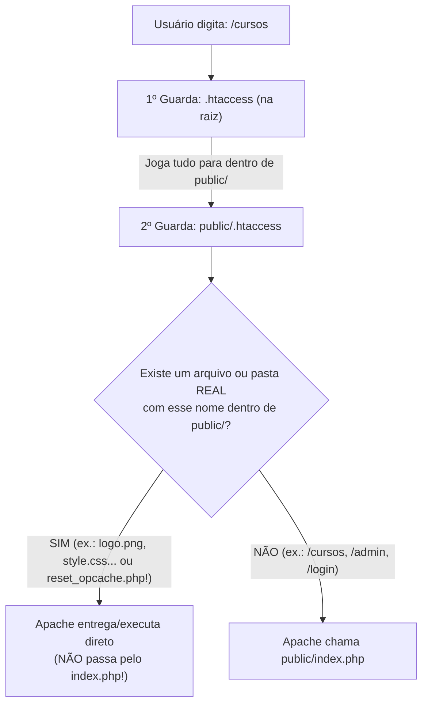

# Capítulo 01 — O "Start": o que acontece quando alguém abre o site

> ⬅️ [Anterior: Capítulo 00 — Introdução](00-introducao.md) | 🏠 [Voltar ao Índice](README.md)

Neste capítulo vamos acompanhar o **primeiro segundo de vida** de uma requisição — desde o momento em que alguém digita um endereço no navegador até o sistema começar a responder.

Os arquivos reais envolvidos nesta etapa são:
- `.htaccess` (na raiz do projeto)
- `public/.htaccess`
- `public/index.php`
- `public/maintenance.php`
- `public/reset_opcache.php` *(guarde esse nome — ele aparece na nossa auditoria no final!)*

---

## 1. Antes mesmo do PHP rodar: o trabalho do Servidor Web (`.htaccess`)

Quando você abre `http://localhost/domain-system/cursos` no XAMPP (ou `https://seusite.com/cursos` na hospedagem), **o PHP ainda está dormindo**.

Quem atende a porta primeiro é o **Servidor Web** (o **Apache** no XAMPP, ou o **LiteSpeed** na Hostinger). Antes de fazer qualquer coisa, o Apache olha se existem arquivos chamados `.htaccess` com instruções.

No Domain System, existem **dois `.htaccess`** que trabalham em dupla:



### 1.1. O primeiro guarda: `.htaccess` (na raiz do projeto)

Veja o conteúdo real dele (`.htaccess`, linhas 1–10):

```apache
<IfModule mod_rewrite.c>
    RewriteEngine On
    RewriteRule ^(.*)$ public/$1 [L]
</IfModule>

<IfModule php_module>
    php_value upload_max_filesize 128M
    php_value post_max_size 135M
    php_value memory_limit 256M
</IfModule>
```

**Traduzindo para português normal:**
- `RewriteRule ^(.*)$ public/$1 [L]` significa: *"Qualquer coisa que o usuário pedir, jogue silenciosamente para dentro da pasta `public/`."*
- **Por que o autor fez isso?** Pense no seu XAMPP (`D:\xampp\htdocs\domain-system`). Na raiz do projeto existem arquivos secretos que **ninguém pode baixar**, como `.env` (senhas), `database.sqlite` (banco de dados) e `config/plugins.json`. Empurrando todo acesso para `public/`, o visitante não consegue pedir `http://localhost/domain-system/.env` direto!
- As três linhas lá embaixo (`128M`, `135M`, `256M`) aumentam o limite de tamanho de arquivo para permitir subir PDFs e apostilas grandes na escola de cursos.

### 1.2. O segundo guarda: `public/.htaccess`

Agora que o pedido entrou na pasta `public/`, o Apache lê o segundo arquivo (`public/.htaccess`, linhas 1–6):

```apache
<IfModule mod_rewrite.c>
    RewriteEngine On
    RewriteCond %{REQUEST_FILENAME} !-f
    RewriteCond %{REQUEST_FILENAME} !-d
    RewriteRule ^(.*)$ index.php [QSA,L]
</IfModule>
```

**Traduzindo linha por linha:**
1. `RewriteCond %{REQUEST_FILENAME} !-f` → *"Esse endereço **NÃO** é um arquivo real que existe no disco?"* (Exemplo: `logo.png` existe no disco; `/cursos` não existe como arquivo.)
2. `RewriteCond %{REQUEST_FILENAME} !-d` → *"Esse endereço também **NÃO** é uma pasta real?"*
3. `RewriteRule ^(.*)$ index.php [QSA,L]` → *"Se não é arquivo nem pasta real, entregue o pedido para o `public/index.php`! E mantenha o que veio depois do `?` na URL (ex.: `?pagina=2`) — é isso que a sigla `QSA` faz."*

**Por que não mandar TUDO (inclusive imagens) para o `index.php`?**
Por velocidade! Se a página tem 20 imagens e 3 arquivos CSS, o Apache entrega esses arquivos estáticos direto do disco sem precisar acordar o PHP 23 vezes. O PHP só acorda para páginas dinâmicas de verdade (`/`, `/cursos`, `/admin`, `/login`).

O restante de `public/.htaccess` faz três favores extras:
- **Compactação (Gzip/Deflate):** diminui o tamanho do HTML/CSS/JS antes de enviar pela internet.
- **Cache no navegador:** avisa ao navegador que imagens/fontes podem ficar guardadas por 1 ano e CSS/JS por 1 mês.
- **Proteção básica:** `Options -Indexes` proíbe mostrar a lista de arquivos se alguém abrir uma pasta sem `index.php`, e `X-Content-Type-Options: nosniff` impede o navegador de tentar "adivinhar" e executar um arquivo disfarçado.

---

## 2. Entrando no PHP: `public/index.php` (a Portaria Única)

Agora sim o PHP acordou e começou a ler **`public/index.php`** (124 linhas).

Ele foi construído de propósito para ser curto e organizado. Em vez de fazer trabalho pesado aqui dentro, ele apenas **coordena 5 passos em fila**:

### Passo 1 — Descobrir o endereço limpo (`$resolveAgnosticPath`, linhas 10–54)

Pense num problema bem chato que todo iniciante enfrenta ao mover um site do computador para a internet:
- No seu XAMPP, o link do painel é: `http://localhost/domain-system/admin`
- No seu domínio na internet, o link é: `https://minhaloja.com/admin`
- Se alguém acessar sem `.htaccess`, o link pode vir: `http://localhost/domain-system/public/admin`

Se o restante do código precisasse lidar com essas 3 variações o tempo todo, tudo quebraria!

Por isso, logo no começo de `public/index.php`, existe a função `$resolveAgnosticPath`. O trabalho dela é fatiar a URL em **dois pedaços limpos**:
1. **`BASE_URL` (onde o site mora):** `/domain-system` no XAMPP, ou vazio `""` na raiz do domínio.
2. **`$route` (o destino puro):** sempre `/admin`!

Como ela descobre isso?
- **Tentativa 1 (linha 16):** pergunta se você definiu `BASE_URL` ou `APP_URL` nas configurações do ambiente (`getenv`).
- **Tentativa 2 (linhas 28–53):** se não houver, faz a conta comparando onde o arquivo `index.php` está (`$_SERVER['SCRIPT_NAME']`) com o que o usuário digitou (`$_SERVER['REQUEST_URI']`), e limpa `/public` se ele aparecer na URL.

### Passo 2 — O "cadeado de manutenção" antes do sistema acordar (linhas 59–77)

```php
$maintenanceFile = dirname(__DIR__) . '/.maintenance';
if (file_exists($maintenanceFile)) {
    [$earlyBase, $cleanPath] = $resolveAgnosticPath();

    // Libera a passagem apenas para rotas de sistema crítico (Admin/Login/Logout/API/Setup)
    if (!preg_match('#^/(admin|login|logout|api|setup)(/|$)#', $cleanPath)) {
        ...
        header('Retry-After: 3600');
        http_response_code(503);
        require $maintenancePage;
        exit;
    }
}
```

**Por que essa trava fica AQUI em cima, antes de carregar o resto do sistema?**
Imagine que o sistema está se atualizando sozinho e substituindo arquivos PHP na pasta `src/`. Se um visitante entrasse e o PHP tentasse carregar o sistema pela metade, apareceria uma tela feia de erro fatal!

Com esse cadeado físico:
- Basta existir um arquivo vazio chamado `.maintenance` na raiz do projeto.
- Qualquer visitante comum é parado **na porta** imediatamente, recebe o código HTTP **503 (Serviço temporariamente indisponível)**, vê a tela bonita e isolada `public/maintenance.php` (que é só HTML+CSS, sem depender de nada do sistema) e o PHP encerra com `exit`.
- Só passam dessa porta inicial endereços que comecem com `/admin`, `/login`, `/logout`, `/api` ou `/setup` — assim o dono do site ainda consegue entrar para destravar tudo.

### Passo 3 — Girar a chave de ignição (`bootstrap.php`) e empacotar o pedido (linhas 80–92)

```php
$app = require_once dirname(__DIR__) . '/bootstrap.php';

$app->getDispatcher()->dispatch('kernel_pre_boot');

$earlyRequest = \DomainSystem\Core\Http\Request::capture();

[$baseUrl, $routeUri] = $resolveAgnosticPath($earlyRequest->uri());
if (!defined('BASE_URL')) {
    define('BASE_URL', $baseUrl);
}
$earlyRequest->server['REQUEST_URI'] = $routeUri;
```

Veja a sequência acontecendo como uma linha de montagem:
1. **Linha 80:** chama `bootstrap.php` (que vamos abrir em detalhes no **Capítulo 02**). O `bootstrap.php` prepara o ambiente e devolve o cérebro do sistema dentro da variável `$app`.
2. **Linha 83:** usa o "rádio comunicador" (`getDispatcher()->dispatch(...)`) para avisar: *"Vou começar o boot!"* (`kernel_pre_boot`).
3. **Linha 85:** `Request::capture()` pega todos os dados bagunçados que o navegador enviou (`$_GET`, `$_POST`, `$_SERVER`, cabeçalhos) e guarda tudo num pacote organizado chamado `$earlyRequest`.
4. **Linhas 88–92:** calcula de novo a URL limpa, cria a constante global `BASE_URL` (usada para montar links de CSS, imagens e botões no site inteiro) e troca a URL dentro de `$earlyRequest` pela rota limpa (`$routeUri`).

### Passo 4 — Acordar todos os módulos e cadastrar todas as URLs (linhas 95–101)

```php
$app->boot();

$app->getDispatcher()->dispatch('kernel_post_boot');

$app->getDispatcher()->dispatch('router.register', $app->getRouter());
```

1. **`$app->boot()`:** acorda os serviços básicos do sistema, liga os `SystemApps` (login, banco, admin) e carrega os `Plugins` ativos (loja, escola, pagamentos).
2. **`kernel_post_boot`:** avisa no rádio que todos os módulos já acordaram.
3. **`router.register`:** passa o caderno de rotas (`$app->getRouter()`) no rádio. Cada módulo aproveita esse momento para anotar suas páginas: *"Ei Router, quando pedirem `/cursos`, chame a escola! Quando pedirem `/checkout`, chame a loja!"*

### Passo 5 — Atender o pedido e devolver a resposta (linhas 104–123)

```php
try {
    $request = $earlyRequest;

    $httpKernel = new \DomainSystem\Core\Http\HttpKernel(
        $app->getRouter(),
        $app->getContainer(),
        $app->getWorkspaceManager()
    );
    $response = $httpKernel->handle($request, file_exists($maintenanceFile), __DIR__ . '/maintenance.php');
    $response->send();
    
} catch (Exception $e) {
    if ($e->getCode() == 404) {
        $errorResponse = new \DomainSystem\Core\Http\Response("404 Not Found: " . $e->getMessage(), 404);
        $errorResponse->send();
    } else {
        throw $e;
    }
}
```

1. Cria o `HttpKernel` (o coordenador de requisições HTTP) e chama `$httpKernel->handle(...)`.
   - **Detalhe legal:** dentro do `HttpKernel` existe uma **2ª checagem de manutenção** (`MaintenancePolicy::shouldBlock`). Por que checar duas vezes? Porque agora o sistema já ligou a sessão e consegue saber quem está logado! Se você ativou a manutenção pelo painel (sem arquivo `.maintenance`), o `admin` logado consegue navegar e testar o site inteiro normalmente, enquanto os visitantes veem a tela 503.
2. O `HttpKernel` passa o pedido para o `Router`, que executa os seguranças (`Middlewares`) e o `Controller`, devolvendo um objeto `$response`.
3. `$response->send()` envia os cabeçalhos HTTP e imprime o HTML (ou JSON) na tela do usuário.
4. **Se der erro no meio do caminho (`catch`):**
   - Se o erro tiver código `404` (página não encontrada), devolve uma resposta `404 Not Found`.
   - Se for qualquer outro erro, ele joga o erro para cima (`throw $e`) para que o sistema oficial de erros (`ErrorHandler`, que veremos no Capítulo 02) registre no log e mostre uma tela segura.

---

## 3. 🔍 Lupa de Auditoria — 4 Problemas Reais que Encontramos no Capítulo 01

Olha como entender o fluxo desde o primeiro arquivo já revela problemas reais que passam despercebidos quando a gente só olha telas prontas:

### 🔴 Achado 1 (Segurança — Alto/Médio): `public/reset_opcache.php` totalmente aberto na internet

- **Onde está:** `public/reset_opcache.php` (linhas 1–8).
- **O que existe lá dentro:**
  ```php
  <?php
  if (function_exists('opcache_reset')) {
      opcache_reset();
      echo "OPcache reset successfully!";
  } else {
      echo "OPcache is not enabled.";
  }
  ```
- **Por que isso é uma brecha?** Lembra do `public/.htaccess` que acabamos de ler? Ele diz: *"Se o arquivo existir de verdade dentro de `public/`, execute direto sem passar pelo `index.php`!"*
- Como `reset_opcache.php` está solto dentro de `public/`, **qualquer pessoa no mundo** pode abrir `https://seusite.com/reset_opcache.php` **sem senha, sem login e até com o site em manutenção**.
- **O que pode dar ruim?**
  1. Um invasor pode rodar um script chamando esse link 100 vezes por segundo. O OPcache é o cache que deixa o PHP rápido — zerar esse cache sem parar obriga o servidor a recompilar todos os arquivos PHP o tempo todo, podendo deixar o site lento ou derrubá-lo por excesso de CPU.
  2. Revela informação interna do servidor (se OPcache está ligado ou não).
  3. Esse arquivo **não** está na lista de exclusão `release/exclude.txt`, ou seja, pode acabar indo parar na versão publicada em produção!
- **Como corrigir depois:** apagar `public/reset_opcache.php` (ou transformar em um botão dentro do painel Admin protegido por login + `POST` + token CSRF) e adicionar o arquivo em `release/exclude.txt`.

---

### 🟠 Achado 2 (Segurança — Médio): Erro 404 imprime texto da exceção como HTML sem proteção

- **Onde está:**
  - `src/Core/Routing/Router.php` (linhas 61 e 82): quando não acha a página, dispara `throw new Exception("Rota não encontrada: $uri", 404);`
  - `public/index.php` (linha 117): pega essa mensagem e devolve direto em `new Response("404 Not Found: " . $e->getMessage(), 404);`
  - `src/Core/Http/Response.php` (linha 30): por padrão, envia o cabeçalho `Content-Type: text/html; charset=utf-8` e faz `echo` cru do texto.
- **Por que isso é arriscado?** Sempre que um site pega algo que veio da URL do usuário (`$uri`) e joga dentro de um HTML sem passar por `htmlspecialchars()`, existe risco de **XSS (Cross-Site Scripting)** — quando alguém consegue injetar código HTML/JavaScript malicioso na página.
  - Navegadores modernos costumam trocar `<` e `>` na URL por `%3C` e `%3E`, o que reduz o risco no caso comum, **mas** confiar no navegador para se proteger nunca é seguro (proxies, requisições especiais ou qualquer outra exceção 404 no sistema que reflita texto do usuário viram XSS na hora).
- **Como corrigir depois:** sempre limpar com `htmlspecialchars($e->getMessage(), ENT_QUOTES, 'UTF-8')` — ou melhor ainda, mostrar uma página 404 fixa sem exibir a mensagem crua da exceção.

---

### 🟡 Achado 3 (Lógica): A checagem de manutenção roda ANTES do `.env` ser lido

- **Onde está:** `public/index.php` (linhas 16 e 61) vs `bootstrap.php` (linhas 164–207).
- **O que acontece:** a função `$resolveAgnosticPath()` tenta ler `BASE_URL` e `APP_URL` na linha 16. Porém, o arquivo `.env` só é aberto dentro de `bootstrap.php` — que só roda na **linha 80**!
- **Qual é o bug?** Quando `.maintenance` está ativo, a checagem da linha 61 roda **antes** do `.env` existir na memória. Se um servidor depender de `BASE_URL` configurada apenas no `.env`, o sistema pode calcular a rota errada durante a manutenção e acabar bloqueando até o `/admin` ou `/login`!
- **Como corrigir depois:** manter o comportamento documentado ou ler apenas `BASE_URL`/`APP_URL` do `.env` antes da checagem de manutenção.

---

### 🟡 Achado 4 (Arquitetura e Servidor): Regra de manutenção copiada em dois lugares + cuidado com Nginx

1. **Código duplicado:** a lista de endereços liberados na manutenção (`#^/(admin|login|logout|api|setup)(/|$)#`) está escrita duas vezes: em `public/index.php` (linha 64) e em `src/Core/Http/MaintenancePolicy.php` (linha 57). Se um dia você alterar em um arquivo e esquecer o outro, cria uma brecha silenciosa.
   - Repare também que **todo `/api/...` fica aberto durante a manutenção** — isso significa que nenhuma rota de API pode confiar que o modo manutenção vai protegê-la; cada endpoint de API precisa ter sua própria autenticação!
2. **Cuidado em produção fora do Apache:** o `.htaccess` da raiz só funciona em Apache/LiteSpeed com `mod_rewrite` ligado. Em servidores **Nginx** (que ignoram arquivos `.htaccess`), apontar o site para a pasta raiz em vez de `public/` deixaria `.env` e `database.sqlite` expostos para download público! Em produção, a pasta pública do servidor (**DocumentRoot**) deve apontar **sempre direto para `public/`**.

---

## Resumo Rápido do Capítulo 01

- **Caminho da entrada:** Navegador → `.htaccess` (raiz) → `public/.htaccess` → `public/index.php`.
- **O que `public/index.php` faz:** limpa a URL → checa `.maintenance` → chama `bootstrap.php` → captura a `Request` → faz `$app->boot()` → pede para os módulos registrarem rotas → entrega ao `HttpKernel` → envia a resposta ao navegador.
- **Placar de auditoria até aqui:** 4 achados reais registrados (1 arquivo aberto sem login em `public/`, 1 falta de escape HTML no erro 404, 1 problema de ordem de leitura do `.env` na manutenção e 2 cuidados de arquitetura/servidor).

---

> ⬅️ [Anterior: Capítulo 00 — Introdução](00-introducao.md) | 🏠 [Voltar ao Índice](README.md) | ➡️ *Próximo: Capítulo 02 — Acordando o Sistema (`bootstrap.php`)*
