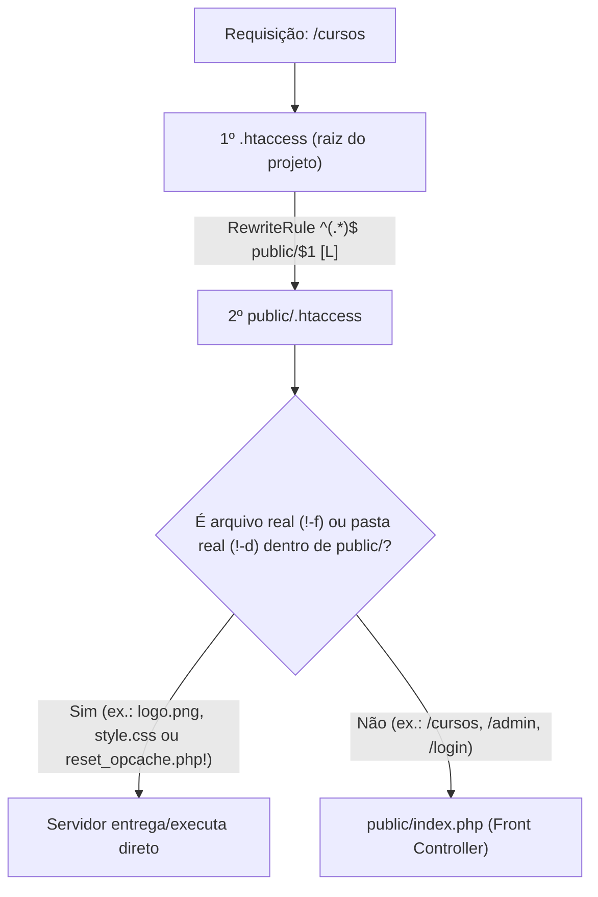

# Capítulo 01 — O "Start" no Servidor: `.htaccess`, Front Controller e `public/index.php`

> ⬅️ [Anterior: Capítulo 00 — Introdução](00-introducao.md) | 🏠 [Índice](README.md)

---

## 1. O milissegundo zero: o que acontece ANTES do PHP acordar

Quando um usuário digita no navegador `http://localhost/domain-system/cursos` (no XAMPP) ou `https://seusite.com/cursos` (em produção), o primeiro software que recebe o pedido **não é o PHP** — é o **Servidor Web** (Apache no XAMPP ou LiteSpeed/Apache em hospedagens).

O Apache lê os arquivos ocultos `.htaccess` para decidir o que fazer com a URL. No Domain System, existem **dois `.htaccess` trabalhando em dupla**:



### 1.1. O primeiro guarda: `.htaccess` (na raiz do projeto)

```apache
<IfModule mod_rewrite.c>
    RewriteEngine On
    RewriteRule ^(.*)$ public/$1 [L]
</IfModule>

<IfModule php_module>
    php_value upload_max_filesize 128M
    php_value post_max_size 135M
    php_value memory_limit 256M
</IfModule>
```

- **O que ele faz:** empurra silenciosamente **tudo** o que chega na raiz para dentro da pasta `public/`.
- **Por que isso existe:** em ambientes como XAMPP (`D:\xampp\htdocs\domain-system`), a raiz do projeto fica acessível na web. Esse redirecionamento impede que visitantes acessem diretamente arquivos sensíveis da raiz como `.env`, `database.sqlite`, `bootstrap.php` ou `config/plugins.json`.
- **Limites do PHP:** libera uploads maiores (128 MB) para apostilas/PDFs do módulo Academy.

### 1.2. O segundo guarda: `public/.htaccess` (O padrão Front Controller)

```apache
<IfModule mod_rewrite.c>
    RewriteEngine On
    RewriteCond %{REQUEST_FILENAME} !-f
    RewriteCond %{REQUEST_FILENAME} !-d
    RewriteRule ^(.*)$ index.php [QSA,L]
</IfModule>
```

Leia essas 3 regras como um porteiro falando em voz alta:
1. `RewriteCond %{REQUEST_FILENAME} !-f` → *"Esse endereço **não** é um arquivo físico real no disco?"*
2. `RewriteCond %{REQUEST_FILENAME} !-d` → *"E também **não** é uma pasta física real?"*
3. `RewriteRule ^(.*)$ index.php [QSA,L]` → *"Então mande tudo para `public/index.php`, preservando a query string (`?pagina=2`, via flag `QSA`) e pare de avaliar regras (`L`)."*

Além disso, `public/.htaccess` também configura:
- **Performance:** compressão Gzip (`mod_deflate`) e cache no navegador (`mod_expires`: 1 ano para imagens/fontes, 1 mês para CSS/JS).
- **Segurança básica:** `Options -Indexes` (proíbe listar arquivos de diretórios vazios) e cabeçalhos `X-XSS-Protection` e `X-Content-Type-Options: nosniff`.

> **Analogia da Portaria:** pense numa empresa onde o cofre (`.env`, banco de dados, código) fica nos fundos e a recepção fica em `public/`. O `.htaccess` da raiz é o muro externo que direciona todo mundo para a recepção; o `public/.htaccess` é a porta giratória: quem só quer um folheto pronto no balcão (uma imagem `.png` ou `.css` real) pega direto; qualquer outro pedido vai para o recepcionista-chefe (`public/index.php`).

---

## 2. Por dentro da Portaria Única: `public/index.php` passo a passo

O arquivo `public/index.php` tem apenas **124 linhas** e funciona como um maestro enxuto dividido em **5 fases**:

### Fase 1 — O Tradutor de URL (`$resolveAgnosticPath`, linhas 10–54)

Por que o sistema precisa traduzir a URL? Porque ele pode rodar em lugares diferentes sem mudar uma linha de código:
- No seu XAMPP: `http://localhost/domain-system/admin`
- Em produção na raiz: `https://seusite.com/admin`
- Acessado direto com `/public`: `http://localhost/domain-system/public/admin`

O roteador interno (`Router`) sempre quer enxergar apenas **`/admin`**. Por isso, `$resolveAgnosticPath` devolve um par `[$baseUrl, $route]`:
1. Primeiro verifica se existe `BASE_URL` ou `APP_URL` nas variáveis de ambiente (`getenv`).
2. Se não existir, compara `$_SERVER['SCRIPT_NAME']` com `$_SERVER['REQUEST_URI']`, remove o prefixo da subpasta e limpa `/public` caso apareça na URL.

### Fase 2 — Trava Física de Manutenção (`.maintenance`, linhas 59–77)

```php
$maintenanceFile = dirname(__DIR__) . '/.maintenance';
if (file_exists($maintenanceFile)) {
    [$earlyBase, $cleanPath] = $resolveAgnosticPath();

    // Libera a passagem apenas para rotas de sistema crítico (Admin/Login/Logout/API/Setup)
    if (!preg_match('#^/(admin|login|logout|api|setup)(/|$)#', $cleanPath)) {
        ...
        header('Retry-After: 3600');
        http_response_code(503);
        require $maintenancePage;
        exit;
    }
}
```

- Se o arquivo `.maintenance` existir na raiz, **visitantes comuns são barrados antes mesmo de `bootstrap.php` rodar**.
- O navegador recebe HTTP **503 (Service Unavailable)** com `Retry-After: 3600` e vê a página `public/maintenance.php` — um HTML 100% autossuficiente que funciona mesmo se o banco de dados ou os arquivos PHP do núcleo estiverem no meio de uma atualização.
- Apenas caminhos começando com `/admin`, `/login`, `/logout`, `/api` ou `/setup` passam dessa barreira inicial.

### Fase 3 — Ignição do Kernel e Captura do Pedido (linhas 80–92)

```php
$app = require_once dirname(__DIR__) . '/bootstrap.php';

$app->getDispatcher()->dispatch('kernel_pre_boot');

$earlyRequest = \DomainSystem\Core\Http\Request::capture();

[$baseUrl, $routeUri] = $resolveAgnosticPath($earlyRequest->uri());
if (!defined('BASE_URL')) {
    define('BASE_URL', $baseUrl);
}
$earlyRequest->server['REQUEST_URI'] = $routeUri;
```

1. Chama `bootstrap.php` (Capítulo 2), que devolve a instância única de `Application` (`$app`).
2. Dispara o evento `kernel_pre_boot` (antes dos módulos carregarem).
3. Empacota o pedido bruto do PHP em um objeto `Request` (`Request::capture()`).
4. Define a constante global `BASE_URL` e substitui `REQUEST_URI` dentro do objeto `$earlyRequest` pela rota limpa (`$routeUri`), garantindo que todo o resto do sistema trabalhe com URLs padronizadas.

### Fase 4 — Boot do Sistema e Cadastro de Rotas (linhas 95–101)

```php
$app->boot();
$app->getDispatcher()->dispatch('kernel_post_boot');
$app->getDispatcher()->dispatch('router.register', $app->getRouter());
```

1. `$app->boot()` acorda os serviços essenciais (`CoreServiceProvider`), os `SystemApps` e os `Plugins` ativos.
2. Dispara `kernel_post_boot` avisando que o núcleo está de pé.
3. Dispara `router.register` entregando o `Router` para que cada app/plugin cadastre suas URLs.

### Fase 5 — Despacho HTTP e Envio da Resposta (linhas 104–123)

```php
$httpKernel = new \DomainSystem\Core\Http\HttpKernel(
    $app->getRouter(),
    $app->getContainer(),
    $app->getWorkspaceManager()
);
$response = $httpKernel->handle($request, file_exists($maintenanceFile), __DIR__ . '/maintenance.php');
$response->send();
```

1. Cria o `HttpKernel` e entrega a requisição para `$httpKernel->handle(...)`.
2. Dentro do `HttpKernel`, existe a **2ª barreira de manutenção** (`MaintenancePolicy::shouldBlock()`): agora que o sistema já acordou, ele consulta a sessão (`SessionManagerInterface`) e o estado do site (`SiteStateInterface`). Assim, um administrador logado (`user_role === 'admin'`) consegue navegar normalmente pelo site mesmo durante manutenção.
3. O `HttpKernel` chama o `Router`, recebe a `Response` e `$response->send()` envia cabeçalhos + corpo ao navegador.
4. No `catch (Exception $e)`: se `$e->getCode() == 404`, devolve `404 Not Found`; qualquer outro erro é relançado (`throw $e`) para o `ErrorHandler` oficial.

---

## 3. Lupa de Auditoria — Achados Reais no Capítulo 01 (Lógica & Segurança)

Ao auditar todos os arquivos reais de entrada do servidor (`.htaccess`, `public/.htaccess`, `public/index.php` e demais arquivos dentro de `public/`), encontramos **4 pontos reais e verificados no código**:

### 🔴 Achado 1 [SEGURANÇA — ALTO/MÉDIO]: `public/reset_opcache.php` exposto sem autenticação

- **Onde está:** `public/reset_opcache.php` (linhas 1–8).
- **Código atual:**
  ```php
  <?php
  if (function_exists('opcache_reset')) {
      opcache_reset();
      echo "OPcache reset successfully!";
  } else {
      echo "OPcache is not enabled.";
  }
  ```
- **Por que é uma brecha:** no `public/.htaccess`, a regra `RewriteCond %{REQUEST_FILENAME} !-f` manda o Apache **ignorar** `public/index.php` sempre que o arquivo existir fisicamente em `public/`. Logo, qualquer visitante anônimo pode chamar `https://seusite.com/reset_opcache.php` sem login, sem CSRF e até durante manutenção!
- **Impacto:**
  1. Um atacante pode fazer requisições em loop e zerar o cache de bytecode PHP do servidor inteiro repetidamente (degradação de performance / mini-DoS por consumo de CPU).
  2. Vazamento de informação de infraestrutura (confirma se OPcache está habilitado).
  3. O arquivo **não** consta em `release/exclude.txt`, podendo ser empacotado em versões de produção.
- **Sugestão de correção:** remover `public/reset_opcache.php` (ou mover a funcionalidade para uma rota autenticada do `SystemAdmin` via `POST` + CSRF) e incluir `public/reset_opcache.php` em `release/exclude.txt`.

---

### 🟠 Achado 2 [SEGURANÇA — MÉDIO]: Resposta 404 renderizada como HTML sem escape (`htmlspecialchars`)

- **Onde está:**
  - `src/Core/Routing/Router.php` (linhas 61 e 82): `throw new Exception("Rota não encontrada: $uri", 404);`
  - `public/index.php` (linhas 116–118): `$errorResponse = new Response("404 Not Found: " . $e->getMessage(), 404);`
  - `src/Core/Http/Response.php` (linha 30): define `Content-Type: text/html; charset=utf-8` por padrão e faz `echo $this->content`.
- **Por que é um risco:** a mensagem da exceção 404 inclui `$uri` (entrada controlada pelo usuário) e é impressa como **HTML puro sem escape**. Embora navegadores modernos costumem URL-encodar `<` e `>` na barra de endereço, proxies, clientes customizados ou outras exceções 404 que reflitam entrada podem abrir espaço para **Reflected XSS** ou exposição de detalhes internos.
- **Sugestão de correção:** escapar `$e->getMessage()` com `htmlspecialchars($e->getMessage(), ENT_QUOTES, 'UTF-8')` ou renderizar uma página 404 padronizada sem ecoar texto cru de exceção.

---

### 🟡 Achado 3 [LÓGICA]: `.env` ainda não foi carregado na checagem antecipada de manutenção

- **Onde está:** `public/index.php` (linha 16 chamada na linha 61) vs `bootstrap.php` (linhas 164–207).
- **Como ocorre:** `$resolveAgnosticPath()` consulta `getenv('BASE_URL')` / `getenv('APP_URL')`. Porém, o `.env` só é lido dentro de `bootstrap.php` (chamado só na linha 80). Quando `.maintenance` existe, a checagem na linha 61 roda **antes** do `.env` ser carregado — então `BASE_URL` definida apenas no `.env` é ignorada nessa primeira checagem.
- **Impacto:** em instalações que dependem exclusivamente de `BASE_URL` no `.env` (por exemplo atrás de proxy reverso com prefixo), o `$cleanPath` pode ficar errado durante manutenção e bloquear indevidamente `/admin` ou `/login`.
- **Sugestão de correção:** manter a resolução consistente ou ler apenas `BASE_URL`/`APP_URL` do `.env` de forma leve antes da checagem de `.maintenance`.

---

### 🟡 Achado 4 [ARQUITETURA / INFRAESTRUTURA]: Regex de manutenção duplicada e dependência do `.htaccess` raiz

1. **Regra duplicada:** a regex `#^/(admin|login|logout|api|setup)(/|$)#` existe repetida em `public/index.php` (linha 64) e em `src/Core/Http/MaintenancePolicy.php` (linha 57). Alterar uma e esquecer a outra cria inconsistência. Além disso, **todo o prefixo `/api` fica aberto durante `.maintenance`** — o que exige garantir que cada endpoint `/api` valide autenticação/assinatura própria (verificaremos nos Capítulos 6 e 7).
2. **DocumentRoot em produção:** o `.htaccess` da raiz só funciona em Apache/LiteSpeed com `mod_rewrite` e `AllowOverride All`. Em servidores **Nginx** (que ignoram `.htaccess`) ou Apache mal configurado, apontar o servidor para a raiz exporia `.env`, `database.sqlite` e `config/`. Em produção, o DocumentRoot do servidor web deve apontar **diretamente para `public/`**.

---

## Resumo do Capítulo 01

- O pedido entra pelo servidor web → `.htaccess` (raiz) → `public/.htaccess` → `public/index.php`.
- `public/index.php` limpa a URL (`BASE_URL` + `$route`), aplica a trava física `.maintenance`, chama `bootstrap.php`, captura a `Request`, executa `$app->boot()`, dispara `router.register` e entrega tudo ao `HttpKernel`.
- Já na porta de entrada, nossa auditoria encontrou **1 brecha real imediata** (`public/reset_opcache.php` aberto), **1 risco de XSS em 404**, **1 bug sutil de ordem do `.env` na manutenção** e **2 cuidados de arquitetura/infraestrutura**.

---

> ⬅️ [Anterior: Capítulo 00 — Introdução](00-introducao.md) | 🏠 [Índice](README.md) | ➡️ *Próximo: Capítulo 02 — A Ignição do SO (`bootstrap.php`)*
