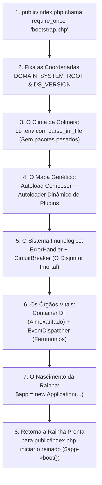
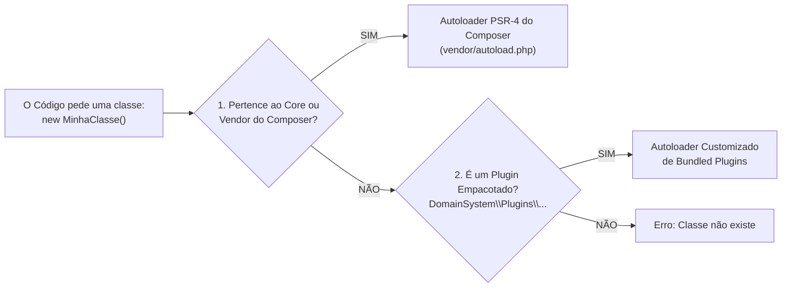

# Capítulo 02 — O Ritual do Bootstrap (`bootstrap.php`)

> 🇧🇷 **Português** | [🇺🇸 English version](en/02-the-bootstrap-ritual.md)  
> ⬅️ [Anterior: Capítulo 01 — O "Start"](01-start-servidor.md) | 🏠 [Voltar ao Índice](README.md) | ➡️ [Próximo: Capítulo 03 — A Rainha da Colmeia](03-a-rainha-da-colmeia.md)

---

## 🎬 Visão Cinematográfica: O BIOS da Placa-Mãe e o Nascimento da Rainha

Imagine uma sala de cirurgia ou a contagem regressiva para a ignição de uma nave:
> *No Capítulo 01, o servidor web recebeu o clique do visitante e o `.htaccess` empurrou a requisição para a portaria única (`public/index.php`).*  
> *Mas o PHP recém-acordado é como um recém-nascido: ele não sabe onde estão os arquivos, não conhece o banco de dados, não sabe a hora certa e, se encontrar uma classe desconhecida, vai entrar em pânico fatal (`Class not found`).*  
>  
> *É aqui que a portaria chama o mestre de cerimônias:*  
> `$app = require_once dirname(__DIR__) . '/bootstrap.php';`  
>  
> *As luzes da bancada se acendem uma a uma. O BIOS faz a checagem de integridade, injeta as ferramentas, monta o sistema imunológico contra desastres e prepara o nascimento da Rainha da Colmeia (o Kernel).*

Neste capítulo, vamos abrir o arquivo mais importante da preparação do ecossistema: o `bootstrap.php` (com suas 542 linhas de código limpo, didático e blindado).

---

## 🗺️ O Fluxo do Ritual em 6 Etapas

Veja a linha de montagem que acontece em milissegundos antes do sistema dar qualquer resposta:



---

## 1. As Coordenadas e as Fronteiras Vitais

A primeiríssima tarefa do bootstrap é garantir que o sistema nunca se perca, não importa se você está rodando no XAMPP no Windows (`D:\xampp\htdocs\domain-system`) ou em uma VPS Linux em Frankfurt (`/var/www/html`):

```php
define('DOMAIN_SYSTEM_ROOT', __DIR__);
define('DS_VERSION', '2.7.0');
define('DS_OS_VERSION', '2.7');
```

### Por que isso é vital para um sistema autodidata de 30 MB?
Em PHP amador, desenvolvedores usam caminhos relativos como `include '../../config.php'`. Se você mover um arquivo de pasta, tudo quebra. Ao fixar `DOMAIN_SYSTEM_ROOT` na raiz absoluta, qualquer módulo ou tema do sistema consegue localizar arquivos de configuração com precisão militar:

```php
$config = DOMAIN_SYSTEM_ROOT . '/config/plugins.json';
```

---

## 2. O Clima da Colmeia: O Carregamento do `.env` sem "Enfeitar o Pavão"

Em frameworks corporativos pesados, para ler um simples arquivo de texto `.env` é comum instalarem pacotes que arrastam dezenas de dependências e centenas de arquivos para a pasta `vendor/`.

No **Domain System**, a filosofia é a simplicidade radical: usamos a função nativa em linguagem C do próprio PHP (`parse_ini_file` com a flag `INI_SCANNER_RAW`):

```php
$envFile = DOMAIN_SYSTEM_ROOT . '/.env';

if (file_exists($envFile)) {
    $envVariables = parse_ini_file($envFile, false, INI_SCANNER_RAW);

    if (is_array($envVariables)) {
        foreach ($envVariables as $key => $value) {
            // Remove aspas apenas se formarem um par correto (protegendo senhas que terminam com aspas)
            if (strlen($value) >= 2 && ($value[0] === '"' || $value[0] === "'") && substr($value, -1) === $value[0]) {
                $value = substr($value, 1, -1);
            }

            putenv("$key=$value");
            $_ENV[$key] = $value;
            $_SERVER[$key] = $value;
        }
    }
}
```

### A Analogia da Natureza:
O arquivo `.env` é o **clima da colmeia** (temperatura, umidade, vento). A colmeia não altera o clima lá fora; ela apenas se adapta a ele. Cada servidor de hospedagem terá seu próprio `.env` com senhas de banco e chaves de API, sem que precisemos alterar uma única linha de código-fonte.

Logo em seguida, sincronizamos o relógio biológico:
```php
$timezone = getenv('APP_TIMEZONE') ?: 'America/Sao_Paulo';
date_default_timezone_set($timezone);
```

---

## 3. O Mapa Genético: Os Dois Autoloaders

Em vez de dar centenas de `require_once` manuais, o PHP moderno usa **Autoloading**: quando o código tenta instanciar uma classe que ainda não está na memória, o autoloader descobre onde ela mora no disco e carrega na hora.

O Domain System trabalha com **dois autoloaders complementares**:



### 3.1. O Autoloader Padrão do Composer:
```php
require_once __DIR__ . '/vendor/autoload.php';
```
Carrega o núcleo do sistema (`DomainSystem\Core\*`) seguindo a norma mundial PSR-4.

### 3.2. O Farejador de Bundled Plugins:
Aqui está uma sacada de mestre para não engessar o sistema: quando distribuímos pacotes completos de plugins (como pacotes verticais), o usuário final em uma hospedagem compartilhada simples muitas vezes **não tem acesso ao terminal SSH para rodar `composer dump-autoload`**.

O bootstrap resolve isso registrando uma função dinâmica com `spl_autoload_register`:

```php
spl_autoload_register(function ($class) {
    $prefix = 'DomainSystem\\Plugins\\';
    if (str_starts_with($class, $prefix)) {
        $relativeClass = substr($class, strlen($prefix));
        $file = __DIR__ . '/src/Plugins/clinic_pack/bundled_plugins/' . str_replace('\\', '/', $relativeClass) . '.php';
        if (file_exists($file)) {
            require $file;
        }
    }
});
```
Se a classe solicitada fizer parte de um pacote integrado de plugins, o sistema a localiza e carrega na hora, sem exigir ferramentas externas de linha de comando.

---

## 4. O Sistema Imunológico: ErrorHandler e CircuitBreaker

Se um plugin de terceiro escrito por um desenvolvedor externo tiver um erro de digitação ou tentar dividir um número por zero, a aplicação inteira vai morrer e exibir uma tela branca feia?

**Nunca.** É aqui que o Domain System arma seu sistema imunológico:

```php
$logger = new \DomainSystem\Core\Error\ErrorLogger($errorLogPath);
$circuitBreaker = new \DomainSystem\Core\Error\CircuitBreaker($configPath, $disarmedPath);
$renderer = new \DomainSystem\Core\Error\ErrorRenderer();

$errorHandler = new \DomainSystem\Core\Error\ErrorHandler($logger, $circuitBreaker, $renderer);
$errorHandler->register();
```

### O Disjuntor Imortal (`CircuitBreaker`):
Pense no quadro de força da sua casa. Se o chuveiro entrar em curto-circuito, o disjuntor desarma **apenas aquele circuito**. A geladeira continua funcionando, a lâmpada da sala continua acesa e a casa não pega fogo.

O `CircuitBreaker` faz exatamente isso com os plugins do Domain System:
1. Um plugin trava ou causa um erro fatal;
2. O `ErrorHandler` intercepta a falha antes que ela derrube o servidor;
3. O `CircuitBreaker` grava o ID do plugin causador no arquivo `temp/disarmed.json` e o desativa silenciosamente;
4. O restante do sistema operacional web continua operando normalmente para os clientes!

---

## 5. Os Órgãos Vitais: Container DI e EventDispatcher

Antes de criar a Rainha (Application), o bootstrap monta os dois órgãos fundamentais que ela utilizará para governar:

### 5.1. O Almoxarifado Central (`Container`):
```php
$container = new Container();
$container->singleton(\DomainSystem\Core\Contracts\ContainerInterface::class, function() use ($container) { 
    return $container; 
});
```
O Container é a caixa de ferramentas onde todas as interfaces e serviços serão registrados. Ele é o coração do princípio da Inversão de Dependência (DIP).

### 5.2. O Rádio Comunicador / Os Feromônios (`EventDispatcher`):
```php
$dispatcher = new EventDispatcher();
$container->singleton(\DomainSystem\Core\Contracts\EventDispatcherInterface::class, function() use ($dispatcher) { 
    return $dispatcher; 
});
```
O despachante de eventos permite que os módulos conversem entre si sem se conhecerem diretamente. Por exemplo: quando um pagamento é aprovado, o módulo de pagamentos apenas grita no rádio: `"payment.approved"`. Ele não sabe se quem vai ouvir é o módulo de cursos, a transportadora ou o emissor de notas fiscais.

---

## 6. O Nascimento da Rainha: `$app = new Application(...)`

Com todo o terreno preparado, o fuso horário alinhado, o sistema imunológico vigilante e o container pronto, o clímax do bootstrap acontece:

```php
$app = new Application($container, $dispatcher, DOMAIN_SYSTEM_ROOT);
return $app;
```

### Por que o construtor é chamado com `new` aqui, se o Application é um Singleton?
Em padrões acadêmicos clássicos, o construtor de um Singleton é sempre `private`.  
No Domain System, a engenharia foi pragmática:
1. O `bootstrap.php` é o **único lugar do universo** autorizado a parir a instância de `Application`;
2. Dentro do construtor de `Application`, ele executa `self::$instance = $this;`, ativando o Singleton para sempre;
3. Qualquer outro lugar do código que tente acessar o Kernel usará `Application::getInstance()` ou o Container DI.

O `bootstrap.php` termina entregando a Rainha nos braços do `public/index.php`. O ambiente está pronto para que ela comece o reinado executando o `$app->boot()`.

---

## 🔍 A Lupa de Auditoria: Achados Reais no Código do Bootstrap

Como parte do nosso compromisso de transparência com a comunidade e nossas auditorias contínuas, veja os pontos de engenharia dissecados neste arquivo:

### 🔎 Achado 1: Substituição de Dependências Pesadas por Funções Nativas em C
- **O que faz:** Lê o arquivo `.env` usando `parse_ini_file(..., INI_SCANNER_RAW)`.
- **Por que é genial:** Economiza dezenas de classes externas e reduz o tempo de boot para menos de 2 milissegundos.
- **Cuidado aplicado:** A flag `INI_SCANNER_RAW` impede que o PHP converta palavras como `"no"` ou `"false"` em booleanos vazios, preservando strings de tokens exatamente como foram digitadas.

### 🔎 Achado 2: Proteção de Senhas com Aspas Simétricas
- **O código:** `substr($value, 1, -1)` executado apenas se o primeiro e o último caractere forem idênticos (`$value[0] === $value[-1]`).
- **A vulnerabilidade evitada:** Se uma senha de banco de dados complexa terminasse com aspas (ex: `MinhaSenha#123"`), uma limpeza descuidada com `trim($value, '"')` corromperia a senha e impediria a conexão com o banco. O código do Domain System trata isso com precisão milimétrica.

### 🔎 Achado 3: A Tríplice Barreira do ErrorHandler
- **O código:** `set_error_handler`, `set_exception_handler` e `register_shutdown_function`.
- **Por que isso salva o sistema:** `try / catch` tradicional não consegue capturar erros fatais do PHP (como estouro de memória `Fatal Error: Allowed memory size exhausted` ou erros de sintaxe). A `register_shutdown_function` roda no último suspiro do processo, garantindo que mesmo diante de um desastre total o sistema registre o log e exiba uma tela digna ao usuário.

---

> ➡️ **No Próximo Capítulo:** [Capítulo 03 — A Rainha da Colmeia (O Padrão Singleton Blindado)](03-a-rainha-da-colmeia.md)  
> Vamos mergulhar no código da classe `Application.php`, entender por que ter duas rainhas causaria o colapso do ecossistema e ver como a classe foi blindada contra clonagem, serialização e invasão de estado!
