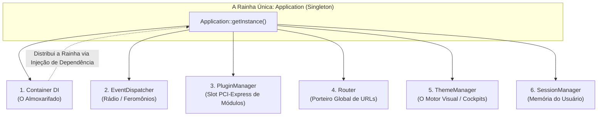

# Capítulo 03 — A Rainha da Colmeia (O Padrão Singleton Blindado)

> 🇧🇷 **Português** | [🇺🇸 English version](en/03-the-hive-queen.md)  
> ⬅️ [Anterior: Capítulo 02 — O Ritual do Bootstrap](02-o-ritual-do-bootstrap.md) | 🏠 [Voltar ao Índice](README.md) | ➡️ [Próximo: Capítulo 04 — O Almoxarifado Central e as Tomadas](04-o-almoxarifado-central-e-as-tomadas.md)

---

## 🎬 Visão Cinematográfica: O Caos de Duas Rainhas em um Mesmo Reino

Imagine um reino com dois reis dando ordens opostas ao mesmo tempo, ou uma colmeia da natureza onde duas rainhas disputam o trono:
> *As operárias ficam confusas. Algumas constroem favos ao norte, outras ao sul. As mensagens químicas de feromônio entram em choque e a colmeia inteira colapsa em poucas horas.*  
>  
> *Na arquitetura de software, o desastre é idêntico:*  
> *Se o seu sistema permitir que duas instâncias do Kernel (`Application`) coexistam na memória durante o mesmo clique:*  
> - *O Plugin A se registra no Kernel 1;*  
> - *O Roteador do Kernel 2 recebe a URL `/checkout` e responde: "404 Página não encontrada!";*  
> - *A Sessão do usuário fica fragmentada e os dados somem no ar.*

Para impedir essa catástrofe, o **Domain System** coloca a classe `Application` no trono de um **Padrão Singleton Blindado**. Neste capítulo, vamos dissecar o arquivo [src/Core/Application.php](file:///d:/xampp/htdocs/domain-system/src/Core/Application.php) (499 linhas de código puro, sem frameworks de terceiros).

---

## 🗺️ O Mapa Anatômico da Rainha

A classe `Application` não faz tudo sozinha — ela é a maestrina. Veja como ela se posiciona no centro de gravidade do sistema:



---

## 1. O que é o Singleton e por que a Natureza nos ensina isso?

Na biologia, uma colmeia saudável tem **exatamente uma rainha**. Ela é o centro nervoso reprodutivo e a emissora dos feromônios mestres que mantêm 50.000 abelhas trabalhando em perfeita harmonia.

No Domain System, a classe `Application` guarda a si mesma em uma propriedade estática privada:

```php
// src/Core/Application.php (linha 123)
private static ?Application $instance = null;
```

- **`static`:** significa que ela pertence à memória da classe, não a um objeto passageiro;
- **`private`:** ninguém do lado de fora pode mexer nessa variável diretamente;
- **`?Application`:** começa como `null` antes do nascimento e se torna a Rainha viva logo após a ignição.

---

## 2. Eager Loading: O Nascimento Imediato

Nos livros acadêmicos de computação, os professores costumam ensinar o Singleton com *Lazy Loading* (carregamento preguiçoso):
```php
// ❌ Padrão acadêmico com Lazy Loading (espera alguém pedir)
public static function getInstance(): Application {
    if (self::$instance === null) {
        self::$instance = new self();
    }
    return self::$instance;
}
```

### Por que o Domain System rejeita o Lazy Loading para o Kernel?
Porque o Kernel é o chão onde todo mundo pisa! **Não existe requisição web sem Kernel.** Esperar alguém chamá-lo no meio da execução é perda de tempo e cria incerteza.

O Domain System usa **Eager Loading** (carregamento ansioso). No exato instante em que o construtor é chamado pelo `bootstrap.php`, ele crava sua presença no trono:

```php
// src/Core/Application.php (linhas 252-269)
public function __construct(ContainerInterface $container, EventDispatcherInterface $dispatcher, string $basePath)
{
    $this->container = $container;
    $this->dispatcher = $dispatcher;
    $this->basePath = $basePath;

    // 🔵 AUTOINSTANCIAÇÃO IMEDIATA (Eager Loading)
    self::$instance = $this;

    // Registra a si mesmo no Almoxarifado (Container)
    $this->container->singleton(Application::class, function() {
        return $this;
    });
    ...
```

E o método de acesso global fica limpo, rápido e sem condicionais desnecessárias:

```php
// src/Core/Application.php (linha 318)
public static function getInstance(): ?Application
{
    return self::$instance;
}
```

---

## 3. O Dilema do Construtor: Público ou Privado?

Se você abrir qualquer livro clássico sobre o padrão Singleton (como o livro do *Gang of Four*), a regra número um é: *"O construtor DEVE ser privado para ninguém dar `new`"*.

Por que no `Application.php` o construtor é `public`?

```php
public function __construct(...)
```

A resposta é pura **engenharia prática e pragmática**:
1. O arquivo `bootstrap.php` é o **ritual de nascimento**. Ele precisa ser capaz de injetar o Container, o EventDispatcher e o caminho base na criação do Kernel;
2. Se o construtor fosse privado, o Kernel precisaria criar suas próprias dependências do nada dentro dele mesmo, violando frontalmente o princípio da Inversão de Dependência (DIP);
3. Como o `bootstrap.php` é o **único arquivo em todo o ecossistema** que executa `new Application(...)`, a unicidade física da rainha é preservada com 100% de rigor.

---

## 4. A Parceria de Ouro: Singleton + Container DI

Muitos desenvolvedores acham que *Container de Injeção de Dependência* e *Singleton* são inimigos. **No Domain System, eles trabalham juntos como irmãos:**

- **O Singleton** garante que a Rainha seja única no universo do PHP;
- **O Container** garante que os outros componentes do sistema não precisem ficar chamando `Application::getInstance()` de forma acoplada.

Veja o que o construtor faz na linha 267:
```php
$this->container->singleton(Application::class, function() {
    return $this;
});
```

Se um serviço ou controlador precisar do Kernel, ele não precisa usar chamadas estáticas feias. Ele pode simplesmente pedir pelo tipo no construtor:
```php
public function __construct(Application $app) { ... }
```
O Container entrega exatamente a mesma Rainha. Isso permite testar classes isoladas com dublês (Mocks) sem nenhuma dor de cabeça!

---

## 5. A Descentralização do Trabalho: O `CoreServiceProvider`

Um erro comum em projetos amadores é transformar o Kernel em uma "God Class" (uma classe gigante de 5.000 linhas que sabe como conectar no banco, como gerar senhas, como registrar rotas e como subir arquivos).

Veja a elegância com que o `Application.php` respeita o princípio da Responsabilidade Única (SRP):

```php
// src/Core/Application.php (linhas 274-275)
$provider = new \DomainSystem\Core\Providers\CoreServiceProvider();
$provider->register($this->container, $this->dispatcher, $this->basePath);
```

O Kernel não configura serviço por serviço manualmente. Ele chama o **Almoxarife Chefe** (`CoreServiceProvider`), que se encarrega de registrar no Container:
- O banco de dados (`Connection`);
- A sessão segura (`SessionManager`);
- As configurações do site (`SiteState`);
- O sistema de rotas (`Router`);
- O motor de visualização (`ThemeManager`).

Depois que o provedor termina a montagem, a Rainha apenas guarda as referências vitais com injeção tipada:
```php
$this->sessionManager  = $this->container->make(SessionManager::class);
$this->pluginManager   = $this->container->make(PluginManager::class);
$this->router          = $this->container->make(RouterInterface::class);
$this->themeManager    = $this->container->make(ThemeManager::class);
$this->workspaceManager= $this->container->make(WorkspaceManager::class);
```

---

## 6. O Despertar da Colmeia: O Método `boot()`

Criar a Rainha é uma coisa; colocá-la para governar é outra.  
O método `boot()` é executado quando o sistema está prestes a processar a requisição:

```php
public function boot(): void
{
    // 1. Garante pastas temporárias e sobe a sessão do usuário
    \DomainSystem\Core\Bootstrap\RuntimeDirectories::ensure($this->basePath);
    $this->sessionManager->start();

    // 2. Acorda os Aplicativos Protegidos do Sistema (SystemApps)
    $systemAppsPath = dirname(__DIR__) . '/SystemApps';
    $this->pluginManager->discoverPlugins($systemAppsPath, $configPath, true, true);

    // 3. Acorda os Plugins instalados pelo Usuário
    $this->pluginManager->discoverPlugins($pluginsPath, $configPath, false, false);

    // 4. Executa o boot de cada operária da colmeia
    $this->pluginManager->bootPlugins();

    // 5. Emite os feromônios mestres de inicialização
    $this->dispatcher->dispatch('init');
    $this->dispatcher->dispatch('shortcodes.register', $this->shortcodeManager);
    $this->dispatcher->dispatch('workspace.register', $this->workspaceManager);
}
```

Observe a hierarquia biológica:
1. Primeiro, os **SystemApps** (a guarda real: autenticação, instalador, monitor);
2. Depois, os **Plugins de Terceiros** (as operárias comuns);
3. Por fim, os **Eventos Globais**, liberando shortcodes e painéis customizados para os temas.

---

## 🔍 A Lupa de Auditoria: Achados Reais na Rainha

Durante nossas auditorias contínuas linha por linha, três detalhes de engenharia chamam a atenção na classe `Application`:

### 🔎 Achado 1: A Escotilha de Reencarnação para Testes Automatizados (`kill()`)
Em testes de unidade com PHPUnit, centenas de testes rodam no mesmo processo de console. Se o Singleton fosse rígido e imutável, o primeiro teste criaria a Rainha e todos os outros 640 testes herdariam o lixo em memória do teste anterior!

Para resolver isso sem comprometer a produção, o Kernel possui o método cirúrgico `kill()`:

```php
// src/Core/Application.php (linhas 328-333)
public static function kill(): void
{
    $basePath = self::$instance?->basePath;
    self::$instance = null;
    \DomainSystem\Core\Plugin\Services\ProcessRegistry::killSingleton($basePath);
}
```
Isso permite que a suíte de testes mate a Rainha ao final de cada cenário e faça o próximo teste nascer com uma folha em branco!

### 🔎 Achado 2: Proteção de Diretórios em Tempo de Execução
Ao chamar `RuntimeDirectories::ensure($this->basePath)` antes de qualquer plugin rodar, o Kernel cria e protege pastas vitais como `temp/` e `storage/` com permissões seguras. Se o servidor foi clonado em uma máquina nova sem essas pastas, o Kernel se auto-cura sem disparar erros fatais.

### 🔎 Achado 3: A Ausência de Superglobais
Mesmo sendo a Rainha, a classe `Application` **não toca em `$_GET`, `$_POST`, `$_SESSION` ou `$_COOKIE`**. Tudo passa pelo `SessionManager` e pelas abstrações do Container. Isso blinda o sistema contra ataques de injeção direta de cabeçalhos no núcleo.

---

## 📌 Resumo em Uma Frase

> *"O padrão Singleton não existe para tornar a classe Application arrogante ou todo-poderosa, mas para garantir que o ecossistema tenha uma única fonte da verdade, permitindo que dezenas de plugins coexistam em perfeita harmonia sem disputar o trono da colmeia."*

---

> ➡️ **No Próximo Capítulo:** [Capítulo 04 — O Almoxarifado Central (Container) e as Tomadas (Contracts)](04-o-almoxarifado-central-e-as-tomadas.md)  
> Vamos entender a fundo como o Container de Injeção de Dependências gerencia objetos, como o princípio da Tomada e do Plugue (DIP) funciona na prática e como trocar de banco ou gateway de pagamento sem mexer em uma linha do Kernel!
