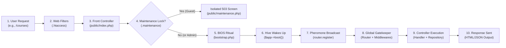

# Chapter 00 — Introduction: System Map & Architectural Philosophy

> 🇺🇸 **English** | [🇧🇷 Versão em Português](../00-introducao.md)  
> 🏠 [Back to Index](README.md) | ➡️ [Next: Chapter 01 — Server "Start"](01-server-start.md)

---

## 1. The Pain Nobody Tells You About

This guide was not born inside an academic lecture hall, nor was it written to satisfy university committees. It was forged in the **authentic trenches of programming**:
- From the frustration of seeing code that began clean and elegant devolve, over a few short months, into an uncontrollable monster;
- From the dread of tweaking a single line in a file only to realize that three unrelated screens suddenly stopped working;
- From the anxiety of touching legacy systems because they resemble a fragile house of cards waiting to crumble at the slightest breeze.

Traditional textbooks often introduce object-oriented principles through sterile, childish examples: *"Animal makes sound"*, *"Dog barks"*, *"Cat meows"*. In real-world software engineering — when building an e-commerce platform, a medical clinic portal, or an LMS with payment gateways — you don't write barking dogs. You deal with clients demanding:
> *"Today we want notifications sent via WhatsApp. Two weeks from now, we want them replaced by email. Next month, we want both along with SMS. And by the end of the year, we must accept Pix, credit cards, and PayPal without causing server downtime."*

If your classes instantiate their dependencies directly inside themselves, each change of mind results in dozens of cascading `if/else` statements, bloated files, and catastrophic coupling.

To solve this sustainably, we don't need to memorize arcane acronyms. **We need to understand the physics and biology of connections**.

---

## 2. Key Paradigm Shifts: The Wall Socket, Arduino, and Nature

As explored in the book [**Understanding SOLID Architecture: From Object to Contract, From Coupling to Architecture**](https://www.amazon.com.br/dp/B0H74L5GFL) (available on Amazon Kindle), software architecture is fundamentally about **connections between parts**, not raw syntax.

### 🔌 The Wall Socket and the Plug: "Contract First, Implementation Second"

Consider the electrical wall socket in your home:
1. **The Socket is the Interface (the Contract):** it specifies immutable rules — hole spacing, voltage (110V/220V), and current frequency. It **never changes**.
2. **Appliances are Concrete Classes (the Plugs):** you can plug in a fan, a refrigerator, a television, or a smartphone charger. Each contains completely distinct internal electronics, yet all adhere to the exact same pin standard.
3. **Dependency Injection is the Connection:** the wall never manufactures the fan. The fan arrives pre-assembled and is simply plugged into the wall.

> **The Golden Rule:** *"The socket never changes. The plugs change constantly. The core system depends strictly on the socket (contract), never on the plug."*

### 🤖 The Arduino Motherboard

When connecting an LED or a sensor to an Arduino pin:
- The microcontroller board has no awareness whether it is illuminating a room, spinning a stepper motor, or sounding a buzzer.
- It only knows that a component is connected to a standard pin honoring the electrical protocol (0V or 5V).
- The **Kernel is the motherboard**. The **modules and plugins are the components**. And the **connections are the interfaces**.

### 🐝 Nature as the Master Architect (Alan Kay & Biology)

Alan Kay, the father of Object-Oriented Programming, did not look to formal mathematics for inspiration — he looked to **biology**:
- Cells possess membranes (**interfaces**) and internal nucleus state (**encapsulation**);
- Organisms communicate across distance through chemical signals known as **pheromones**.

Consider a **Beehive Colony**:
- **The Queen is Nature's Hardened Singleton:** there can only be **one** queen in a hive. If two queens emerge simultaneously, the colony plunges into chaos and collapse. The queen doesn't perform manual labor; she orchestrates and stabilizes.
- **Worker Bees (Eager Loading):** continuously born to sustain core hive operations (foraging, defense, comb maintenance). They are indispensable and always active.
- **Drones (Lazy Loading):** produced strictly on demand for reproduction and discarded after serving their specialized lifecycle.
- **Pheromones (Interfaces & Events):** when a scout bee discovers a nectar field, she releases a trail pheromone into the air. She **does not know which bees will receive it** and does not call each companion individually. Any bee equipped with a compatible receptor detects the scent and reacts. This is **flawless decoupling**!

---

## 3. Demystifying SOLID Through Physical Analogies

SOLID (formalized by Robert C. Martin, "Uncle Bob") is an emergency toolkit designed to heal real architectural pain:

| Letter | Principle | Plain English Meaning | Physical Analogy | Pain It Solves |
| :---: | :--- | :--- | :--- | :--- |
| **S** | **SRP** (*Single Responsibility*) | A class should have only one reason to change. | Each caste in a beehive has one job (guards defend, nurses feed larvae). | The 3,000-line "god class" that breaks whenever anything in the app changes. |
| **O** | **OCP** (*Open-Closed*) | Open for extension, closed for modification. | The wall socket or subway turnstile: you plug in new devices without tearing down the wall. | Modifying core files and adding endless `elseif` branches for every new feature. |
| **L** | **LSP** (*Liskov Substitution*) | Implementations must be interchangeable without breaking expectations. | Any certified 3-prong plug works in the socket without short-circuiting the house. | Swapping payment providers and watching checkout fail because the new class misses expected behavior. |
| **I** | **ISP** (*Interface Segregation*) | Clients should never be forced to depend on methods they do not need. | Standard wall sockets have 3 pins — not 50 unused pins that clutter appliances. | Bloated interfaces with 20 methods when your simple plugin only needed one. |
| **D** | **DIP** (*Dependency Inversion*) | High-level policies depend on abstractions, not on concrete low-level details. | The room depends on standard wall sockets, not on a specific brand of fan. | Tight coupling where changing an external library or database breaks the entire system. |

---

## 4. Domain System: Nature Implemented in Code

**Domain System (v2.8.3)** is built in **pure PHP 8.2+** to serve as a modular **Web Operating System**:

```
┌────────────────────────────────────────────────────────┐
│               DOMAIN SYSTEM ECOSYSTEM                  │
├────────────────────────────────────────────────────────┤
│ 👑 KERNEL (Application)    → The Queen / Motherboard   │
│ 📦 CONTAINER (DI)          → Central Warehouse         │
│ 📡 EVENT DISPATCHER        → Chemical Pheromones       │
│ 🚪 ROUTER                  → Global Turnstile Gatekeeper│
│ 🔌 PLUGINS & APPS          → Castes & Components       │
│ 🛡️ CIRCUIT BREAKER        → Biological Immune System  │
└────────────────────────────────────────────────────────┘
```

- **Single Gateway (`public/index.php`):** zero side-doors. Every HTTP request enters through the official reception.
- **The BIOS Ritual (`bootstrap.php`):** verifies timezone, boots `.env` environment variables, registers class autoloaders, arms safety error handlers, and gives birth to the Kernel.
- **The Single Queen (`src/Core/Application.php`):** a **hardened Singleton** (guarded constructor, blocked cloning, and disabled unserialization). Only one exists, distributing itself via the Container.
- **System Applications (`src/SystemApps/`):** vital organs (Authentication, Database, Cockpit Admin, Auto-Updater).
- **Business Plugins (`src/Plugins/`):** pluggable feature units (Dropshipping with official AliExpress SDK, Academy LMS, Payments with Pix/Mercado Pago/PayPal, Flex Builder).
- **Immortal Circuit Breaker (`CircuitBreaker`):** when a faulty plugin throws a fatal error, the breaker automatically disarms it inside `config/plugins.json`, allowing the core hive to remain completely operational.

---

## 5. Directory Layout & Roles

| Directory or File | Analogy | Architectural Role |
| :--- | :--- | :--- |
| `.htaccess` & `public/.htaccess` | Perimeter fences & turnstiles | Directs all web traffic into `public/index.php` while shielding internal secrets (`.env`, SQLite). |
| `public/index.php` | The Single Front Gate (*Front Controller*) | The first PHP file executed for every web request. |
| `bootstrap.php` | System BIOS & Ignition | Loads `.env`, activates autoloading, arms error catching, and instantiates `Application`. |
| `src/Core/` | The Motherboard & Central Bus | Contains the Kernel (`Application`), Warehouse (`Container`), Router, Event Dispatcher, and Contracts. |
| `src/SystemApps/` | Vital System Organs | Mandatory modules: authentication, database layer, administration, and updates. |
| `src/Plugins/` | Pluggable Modules | Decoupled business capabilities that can be activated or deactivated without core changes. |
| `themes/` | Styling & Visual Presentation | View templates and CSS. Themes modify appearance without touching business logic. |
| `config/` | Electrical Fuse Panel | Lightweight `.json` state stores tracking active and disarmed plugins. |
| `tests/` | Automated QA Workbench | Comprehensive PHPUnit test suite ensuring contract compliance. |

---

## 6. The Request Journey in 10 Steps

PHP does not stay perpetually in memory between requests like a desktop background service. For every user click, a complete lifecycle starts and finishes in milliseconds:



---

## 7. How This Walkthrough Uncovers Real Bugs and Vulnerabilities

Real security incidents rarely stem from exotic exploits; they typically result from **oversights in component seams**:
- Publicly accessible scripts left in the web root that bypass authentication;
- Operations executed before the `.env` configuration file has been parsed;
- Raw request URIs rendered directly into HTML responses without encoding, enabling **XSS**;
- Administrative routes missing CSRF signatures or role checks.

Each chapter concludes with an **🔍 Audit Spotlight** detailing concrete vulnerabilities, risk ratings, and architectural remedies.

---

> 🏠 [Back to Index](README.md) | ➡️ [Next: Chapter 01 — Server "Start"](01-server-start.md)
