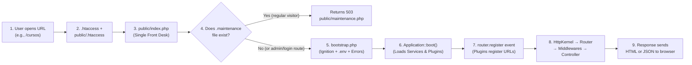

# Chapter 00 — Introduction: Map of the System (No Hard Words)

> [🇧🇷 Versão em Português](../00-introducao.md) | 🇺🇸 **English**  
> 🏠 [Back to Index](README.md) | ➡️ [Next: Chapter 01 — The "Start" on the Server](01-server-start.md)

---

## 1. What is Domain System, really?

**Domain System (v2.7.0)** is a complete web platform written in **pure PHP 8.2+** — built from scratch without heavy third-party frameworks (like Laravel or Symfony) inside its core.

With it, a single website can run:
- pages and CMS content,
- an online store and dropshipping hub (`domain_drop`),
- payments with Pix, credit cards, and PayPal (`commerce`),
- an online courses school (`academy`),
- a drag-and-drop visual page builder (`flextheme`).

### Why do we say it works like an "Operating System"?

Think about your phone or your laptop (Windows, macOS, or Linux):
- **Windows** doesn't stuff Photoshop, Spotify, and WhatsApp inside one giant file.
- It provides a small **core** (handling memory, screen, network, and passwords) and lets you **install apps** on top. If Spotify crashes, Windows keeps running.

Domain System was built with **that exact same idea**. Instead of dumping store logic, courses, login, and database queries into one tangled pile of files, it organizes the codebase like a **modern commercial building**:

- **The Single Front Desk (`public/index.php`):** nobody climbs in through a back window. Every visitor enters through reception.
- **Building Management / Kernel (`src/Core/Application.php`):** there is only **one** management office running the whole building (the *Singleton* pattern).
- **Water, Electricity & Locks (`src/SystemApps/`):** essential services required just to open the doors: login (`auth`), database (`Database`), installer (`installer`), admin panel (`SystemAdmin`), and updater (`SystemUpdater`).
- **Rented Shop Spaces (`src/Plugins/`):** the store, the online school, and payments are independent tenants. You can turn one off without bringing the others down.
- **Paint & Interior Design (`themes/`):** handles only the visual look (HTML/CSS). You can redesign the storefront without touching the wiring.
- **Circuit Breaker (`src/Core/Error/CircuitBreaker.php`):** if one shop keeps short-circuiting (throwing repeated crashes), the breaker shuts off **only that room** so the rest of the building stays lit.

---

## 2. Where Everything Lives (Folder Map)

When you open the project folder on your computer, you will see several directories. You **don't** need to memorize them all today — just know the job of the main ones:

| Folder or File | What it does, in plain English |
| :--- | :--- |
| `.htaccess` & `public/.htaccess` | Rules for the web server (Apache/XAMPP/LiteSpeed). They say: *"if the visitor didn't ask for a real image or CSS file, send the request to `public/index.php`"* and shield private folders. |
| `public/index.php` | **The front door.** The very first PHP file that runs whenever someone visits any page on the site. |
| `bootstrap.php` | **The ignition key.** Reads `.env` (secrets and settings), turns on automatic class loading, arms crash protection, and creates the system's brain (`Application`). |
| `src/Core/` | **The central engine.** Holds the brain (`Application`), URL router (`Router`), object storage (`Container`), event radio (`EventDispatcher`), security tools, and contracts. |
| `src/SystemApps/` | **Mandatory system apps.** Login, database, installer, admin dashboard, monitor, and updater. |
| `src/Plugins/` | **Optional business modules.** Store (`domain_drop`), courses (`academy`), payments (`commerce`), visual builder (`flextheme`), pages (`pages`), SEO (`seo`), etc. |
| `themes/` | **The visual screens.** Templates for the admin dashboard (`themes/admin/`) and public website themes. |
| `config/` | **State files.** Small `.json` files recording which plugins are turned on or tripped by the circuit breaker. |
| `composer.json` | **Class address book (PSR-4).** Tells PHP which folder holds each class so you don't need 200 manual `require_once` lines. |
| `tests/` | **Automated test robots.** Over 600 PHPUnit tests checking that nothing breaks when code changes. |

---

## 3. Plain-English Translator for Technical Words

Programmers love giving fancy names to very simple ideas. Here is an honest translation of the words you will run into in the next chapters:

### 1. Front Controller = "Single Front Desk"
In very old PHP websites, every page was a separate file: `about.php`, `contact.php`, `product.php`, `admin.php`. The problem? If you wanted to add a login check or maintenance lock, you had to copy-paste it into 50 files — and you would always forget one!

With a **Front Controller**, **every** page passes through **one single file**: `public/index.php`. It runs the global checks, wakes the system up, and hands the request to the right piece of code.

### 2. Bootstrap = "Ignition Key"
Before a car drives, you turn the key: the battery wakes up, dashboard lights check in, and the engine starts. In Domain System, `bootstrap.php` does that exact job: reads `.env`, sets timezone, turns on error handling, and builds the system's brain.

### 3. Singleton = "There Can Only Be One"
Imagine a school with **two principals** giving opposite orders at the same time, or a beehive with **two queens**. Total chaos.

A **Singleton** is simply a way to guarantee that a critical class (here, `Application`, the system's brain) only ever has **1 living instance** during a request. Everyone who asks for it gets **the exact same one**.

### 4. Dependency Injection (DI) Container = "The Tool Room"
Suppose a mechanic needs a screwdriver. There are two ways to work:
- **Messy way:** every time they need a screwdriver, they walk out and buy a brand-new one (`new DatabaseConnection()`). By noon you have 40 database connections eating memory.
- **Organized way (Container):** there is a **Tool Room** (`src/Core/Container/Container.php`). Whenever code needs the database or session manager, it asks the Tool Room — which hands back a ready-to-use tool (reusing the same one when appropriate).

### 5. Interface / Contract (`src/Core/Contracts/`) = "The Wall Outlet"
You never have to tear open your living room wall just to plug in a new blender. Why? Because the wall and the blender agree on the **shape of the plug**.

An **Interface** (called a **Contract** in Domain System) is just a short checklist of required methods (for example: *"any database driver must have `query()` and `execute()`"*). That lets the core work seamlessly with both **SQLite** and **MySQL** without rewriting the engine.

### 6. Event Dispatcher = "The Building Intercom"
Instead of hardcoding the names of every installed plugin inside the core, the core picks up the intercom and announces:
> *"Attention everyone! I just finished booting (`kernel_post_boot`). Anyone who wants to register URLs, do it now (`router.register`)!"*

Any active plugin listening to the intercom responds. If you delete a plugin, the core doesn't crash or even notice it's gone.

### 7. Router & Middleware = "The Receptionist and Hallway Guards"
- **Router (`src/Core/Routing/Router.php`):** looks at the requested URL (e.g., `/admin/users`) and checks the directory: *"Ah, `/admin/users` goes to `AdminController`!"*.
- **Middleware:** security guards standing in the hallway **before** the room. One checks: *"Are you logged in?"*. Another checks: *"Does this form have a valid anti-forgery token (CSRF)?"*. If any guard says no, the visitor never reaches the room.

### 8. And what is "SOLID", without the textbook hype?
People make **SOLID** sound intimidating, but it's just **5 common-sense habits** to keep code from turning into tangled wires:

1. **S (One job each):** every file/class has one clear job. The class that draws error pages doesn't also run SQL queries.
2. **O (Grow without breaking):** to add a new store or course feature, you create a new plugin — instead of constantly hacking the core.
3. **L (True substitutes):** if a replacement part promises to follow the same contract, it shouldn't surprise the rest of the system when swapped in.
4. **I (Small contracts):** several small, focused contracts are better than one giant contract forcing classes to implement methods they don't need.
5. **D (Depend on the outlet, not the brand):** the core depends on the *plug shape* (Interface), not on one hardcoded brand of tool.

---

## 4. Bird's-Eye View: The Complete Trip of 1 Browser Click

In PHP, the website does **not** sit idle in memory waiting like a video game. On every click, the server runs this entire pipeline in a few milliseconds and clears memory right after:

In the next chapters, we will **zoom into each box in this diagram**, reading the real Domain System code line by line.

---

## 5. How Does This Help Catch Bugs and Security Holes?

Most real-world hacks and nasty bugs do **not** come from Hollywood-style math. They come from tiny mistakes in the seams between pieces, such as:
- a stray `.php` file left inside `public/` that **skips** the front desk and asks for no password;
- a check that runs **before** `.env` has been loaded;
- text from the URL printed straight into HTML without escaping (allowing `<script>` injection);
- an admin route missing a login guard (middleware) or missing anti-forgery protection (CSRF).

That is why at the end of **every chapter** we include a **🔍 Audit Lens** listing the real risks and bugs found at that exact layer!

---

> 🏠 [Back to Index](README.md) | ➡️ [Next: Chapter 01 — The "Start" on the Server](01-server-start.md)
