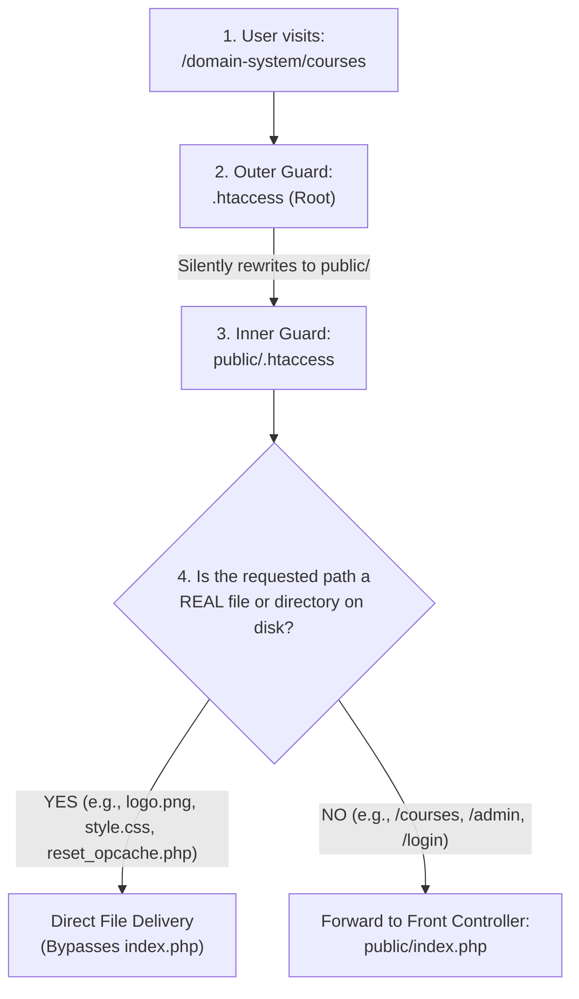

# Chapter 01 — The "Start": Request Genesis & The Single Gateway

> 🇺🇸 **English** | [🇧🇷 Versão em Português](../01-start-servidor.md)  
> ⬅️ [Previous: Chapter 00 — Introduction](00-introduction.md) | 🏠 [Back to Index](README.md) | ➡️ [Next: Chapter 02 — The Bootstrap Ritual](02-the-bootstrap-ritual.md)

---

## 🎬 Cinematic View: The Silence Before the Big Bang

Picture the scene:
> *Black screen. Complete silence. Only a terminal cursor blinking softly in the dark.*  
> *Suddenly, a server command executes:*  
> `php -S localhost:8000` *(or Apache starts in XAMPP).*  
>  
> *Elsewhere, a user enters their browser and navigates to:*  
> `http://localhost/domain-system/courses`  
>  
> *The browser sends an HTTP call across the network: "Anyone there?"*  
> *The web server awakens, intercepts the packet, and sets a powerful architectural engine in motion.*

In this chapter, we dissect the **first second of life** of an HTTP request — the exact instant the front door unlocks, security turnstiles engage, and the system begins to breathe.

Key files involved in this stage:
- `.htaccess` *(project root)*
- `public/.htaccess` *(public directory)*
- `public/index.php` *(Front Controller)*
- `public/maintenance.php` *(Isolated fallback screen)*
- `public/reset_opcache.php` *(Remember this file — it is the focus of our Audit Spotlight!)*

---

## 1. The Perimeter Gate: Web Server Rewriting (`.htaccess`)

Before a single line of PHP code is evaluated, the initial gatekeeper is the **Web Server** (Apache in XAMPP, or LiteSpeed/Nginx in production).

In legacy PHP architectures, every page was a separate script: `about.php`, `courses.php`, `admin.php`. Applying global security or maintenance mode required copy-pasting the same snippet across dozens of files — where missing a single one opened a critical vulnerability.

**Domain System** enforces a strict **single entry point** architecture. Two `.htaccess` files act as cascading filters:



### 1.1. The Outer Guard: `.htaccess` (Project Root)

```apache
<IfModule mod_rewrite.c>
    RewriteEngine On
    RewriteRule ^(.*)$ public/$1 [L]
</IfModule>

<IfModule php_module>
    php_value upload_max_filesize 128M
    php_value post_max_size 135M
    php_value memory_limit 256M
</IfModule>
```

- `RewriteRule ^(.*)$ public/$1 [L]`: transparently forwards all traffic into the `public/` directory.
- **Why this is critical:** sensitive files reside in the root, including `.env` (API keys, database passwords), `database.sqlite`, and `config/plugins.json`. Without this barrier, anyone could type `https://example.com/.env` and download your secrets!
- PHP limits are bumped to accommodate large file uploads, course attachments, and catalog media syncs.

### 1.2. The Inner Guard: `public/.htaccess`

```apache
<IfModule mod_rewrite.c>
    RewriteEngine On
    RewriteCond %{REQUEST_FILENAME} !-f
    RewriteCond %{REQUEST_FILENAME} !-d
    RewriteRule ^(.*)$ index.php [QSA,L]
</IfModule>
```

- `!-f` (*not a file*) and `!-d` (*not a directory*): static assets like images (`logo.png`) or stylesheets are served directly from disk without waking PHP.
- When an endpoint is virtual (`/courses`, `/admin`, `/checkout`), the rule forwards the request to **`public/index.php`** while preserving query parameters (`QSA`).

---

## 2. The Official Gateway: `public/index.php` (*Front Controller*)

In accordance with **SRP (Single Responsibility Principle)**, `public/index.php` (~124 lines) does not handle business logic, database queries, or UI rendering.

Its sole responsibility is to **receive the request, normalize paths, and orchestrate kernel initialization in 5 discrete acts**:

### Act 1 — The Agnostic Path Resolver (`$resolveAgnosticPath`, lines 10–54)

Whether running locally on XAMPP (`http://localhost/domain-system/admin`) or under a production root domain (`https://example.com/admin`), the closure `$resolveAgnosticPath` strips directory prefixes and normalizes the route into two clean variables:
1. **`BASE_URL`**: installation base path (`/domain-system` or empty string `""`);
2. **`$route`**: clean target route (`/admin`).

### Act 2 — The Emergency Maintenance Hatch (`.maintenance`, lines 59–77)

Before bootstrapping heavy services or connecting to databases, the gateway checks for a physical `.maintenance` file:

```php
$maintenanceFile = dirname(__DIR__) . '/.maintenance';
if (file_exists($maintenanceFile)) {
    [$earlyBase, $cleanPath] = $resolveAgnosticPath();

    // Critical paths remain accessible to staff
    if (!preg_match('#^/(admin|login|logout|api|setup)(/|$)#', $cleanPath)) {
        header('Retry-After: 3600');
        http_response_code(503);
        require $maintenancePage;
        exit;
    }
}
```

During automated updates or migrations, guests immediately receive an **HTTP 503** with the standalone, zero-dependency `public/maintenance.php` page, preventing broken partial state rendering. Meanwhile, `/admin` and `/login` remain accessible for maintenance workflows.

### Act 3 — Handing Over to the Bootstrap Ritual (lines 80–92)

```php
$app = require_once dirname(__DIR__) . '/bootstrap.php';
```

`index.php` delegates environment and kernel bootstrapping to `bootstrap.php` (the system BIOS, dissected in Chapter 02), which returns the initialized `Application` kernel.

The first pheromone is broadcast:
```php
$app->getDispatcher()->dispatch('kernel_pre_boot');
```

### Act 4 — Request Encapsulation & Waking the Hive

Raw PHP superglobals (`$_GET`, `$_POST`, `$_SERVER`) are converted into a structured `Request` object:

```php
$earlyRequest = \DomainSystem\Core\Http\Request::capture();
$earlyRequest->server['REQUEST_URI'] = $routeUri;

// Wake the hive!
$app->boot();

// Notify that all core modules and plugins are initialized
$app->getDispatcher()->dispatch('kernel_post_boot');

// Provide the routing registry for extensions to declare their endpoints
$app->getDispatcher()->dispatch('router.register', $app->getRouter());
```

Through `$app->boot()`, active plugins and system apps initialize. Via `router.register`, each extension adds routes without requiring modifications to the core kernel (**Open-Closed Principle**).

### Act 5 — HttpKernel Execution & Response Delivery (lines 104–123)

```php
$httpKernel = new \DomainSystem\Core\Http\HttpKernel(
    $app->getRouter(),
    $app->getContainer(),
    $app->getWorkspaceManager()
);

$response = $httpKernel->handle($request, file_exists($maintenanceFile), __DIR__ . '/maintenance.php');
$response->send();
```

`HttpKernel` coordinates router execution, middleware security checks, and controller invocation, returning a `Response`. `$response->send()` outputs HTTP headers and payload to the client.

---

## 3. 🔍 Audit Spotlight: 4 Concrete Vulnerabilities & Architectural Findings

A thorough architectural audit reveals subtle flaws that often go unnoticed in superficial reviews:

---

### 🔴 Finding 1 (Security — High/Medium): `public/reset_opcache.php` Publicly Accessible

- **File:** `public/reset_opcache.php` (lines 1–8)
- **Vulnerability:**  
  Because `public/.htaccess` delivers any existing file directly without executing `index.php`, **`public/reset_opcache.php` can be invoked by anyone on the internet without login or authorization**.
- **Impact:**  
  1. **Denial of Service (DoS):** Rapidly pinging this file forces the web server to invalidate bytecode cache and recompile PHP scripts on every request, spiking CPU usage to 100%.
  2. **Information Disclosure:** Leaks whether bytecode caching is enabled.
  3. **Packaging Risk:** The file was not excluded in `release/exclude.txt`, meaning it could ship to production environments.
- **Remedy:**  
  Remove `public/reset_opcache.php`. Expose OPcache invalidation exclusively through an authenticated admin action requiring `POST` and a valid CSRF token.

---

### 🟠 Finding 2 (Security — Medium): Unescaped 404 Exception Message in HTML

- **Vulnerability:**  
  `Router.php` throws `Exception("Rota não encontrada: $uri", 404)`, and `public/index.php` prints this raw exception message directly via `new Response(...)` with `text/html`.
- **Impact:**  
  Unescaped user input reflected into an HTML document opens a risk of **Reflected Cross-Site Scripting (XSS)**.
- **Remedy:**  
  Always sanitize output using `htmlspecialchars($e->getMessage(), ENT_QUOTES, 'UTF-8')` or render a static, user-friendly 404 view.

---

### 🟡 Finding 3 (Logic — Low/Medium): Execution Order Between `.maintenance` and `.env`

- **Issue:**  
  `$resolveAgnosticPath()` checks for `BASE_URL`/`APP_URL` at line 16, but `.env` is loaded inside `bootstrap.php` on line 80.
- **Impact:**  
  If a server depends solely on `.env` configuration to resolve subfolder routing, maintenance checks may evaluate route prefixes incorrectly, potentially locking admins out of `/admin`.
- **Remedy:**  
  Ensure `.env` parsing occurs prior to maintenance path evaluation.

---

### 🟡 Finding 4 (Architecture & Portability): Duplicated Rules & Nginx Configuration

- **Rule Duplication:** The maintenance whitelist regex (`#^/(admin|login|logout|api|setup)(/|$)#`) is duplicated across `public/index.php` (line 64) and `MaintenancePolicy.php` (line 57).
- **Nginx Note:** Nginx ignores `.htaccess`. If an administrator points Nginx root to the project root instead of `/public`, sensitive files (`.env`, SQLite database) become downloadable. The DocumentRoot must always be explicitly configured to `/public`.

---

## 📌 Summary in One Sentence

> *"The Single Gateway (`public/index.php`) and server guards (`.htaccess`) do not perform heavy lifting; their job is to protect core assets, sanitize paths, and ensure every request undergoes proper security rituals before waking the Kernel."*

---

> ⬅️ [Previous: Chapter 00 — Introduction](00-introduction.md) | 🏠 [Back to Index](README.md) | ➡️ [Next: Chapter 02 — The Bootstrap Ritual](02-the-bootstrap-ritual.md)
