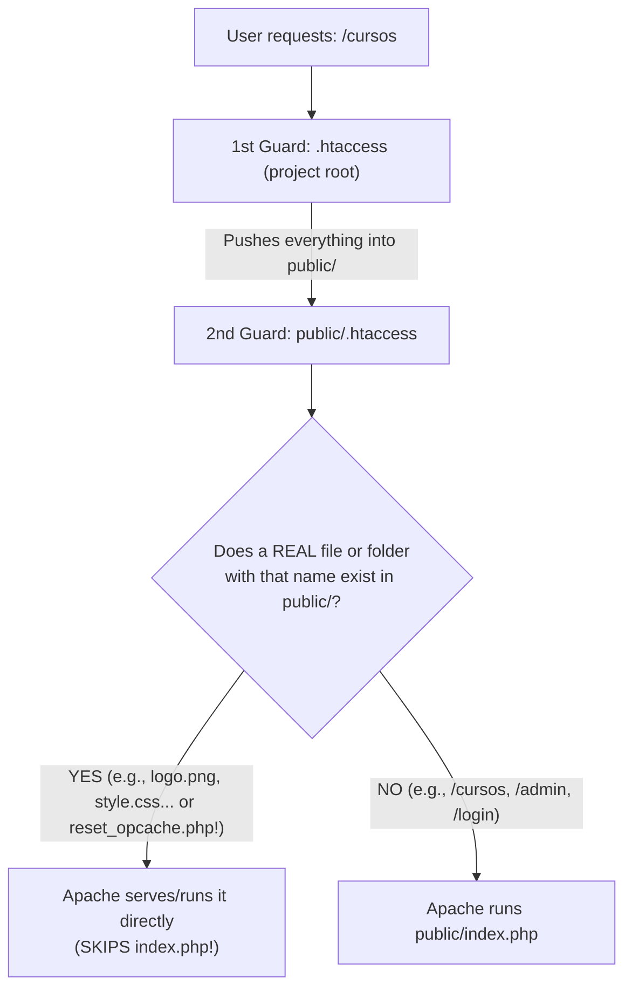

# Chapter 01 — The "Start": What Happens When Someone Opens the Site

> [🇧🇷 Versão em Português](../01-start-servidor.md) | 🇺🇸 **English**  
> ⬅️ [Previous: Chapter 00 — Introduction](00-introduction.md) | 🏠 [Back to Index](README.md)

In this chapter, we follow the **very first millisecond** of a request — from the moment someone types an address in their browser until the system hands back a response.

The real files involved at this stage are:
- `.htaccess` (at the project root)
- `public/.htaccess`
- `public/index.php`
- `public/maintenance.php`
- `public/reset_opcache.php` *(remember this filename — it shows up in our security audit at the end!)*

---

## 1. Before PHP Even Wakes Up: The Web Server's Job (`.htaccess`)

When someone opens `http://localhost/domain-system/cursos` (in XAMPP) or `https://yoursite.com/cursos` (in production), **PHP is still asleep**.

The first program to answer the door is the **Web Server** (**Apache** in XAMPP, or **LiteSpeed/Apache** on shared hosting). Before doing anything else, Apache checks for hidden `.htaccess` files containing routing instructions.

Domain System uses **two `.htaccess` files working as a pair**:



### 1.1. The first guard: `.htaccess` (project root)

Here is the real file (`.htaccess`, lines 1–10):

```apache
<IfModule mod_rewrite.c>
    RewriteEngine On
    RewriteRule ^(.*)$ public/$1 [L]
</IfModule>

<IfModule php_module>
    php_value upload_max_filesize 128M
    php_value post_max_size 135M
    php_value memory_limit 256M
</IfModule>
```

**In plain English:**
- `RewriteRule ^(.*)$ public/$1 [L]` says: *"Whatever URL the visitor asked for, silently push it inside the `public/` folder."*
- **Why was it built this way?** Think about a local XAMPP folder (`D:\xampp\htdocs\domain-system`). The project root contains private files **nobody should ever download**, like `.env` (secrets), `database.sqlite` (the database), and `config/plugins.json`. Redirecting everything into `public/` prevents visitors from directly requesting `/.env`.
- The three lines at the bottom (`128M`, `135M`, `256M`) raise PHP upload and memory limits so large PDFs/handouts can be uploaded in the Academy LMS.

### 1.2. The second guard: `public/.htaccess`

Once the request enters `public/`, Apache reads the second file (`public/.htaccess`, lines 1–6):

```apache
<IfModule mod_rewrite.c>
    RewriteEngine On
    RewriteCond %{REQUEST_FILENAME} !-f
    RewriteCond %{REQUEST_FILENAME} !-d
    RewriteRule ^(.*)$ index.php [QSA,L]
</IfModule>
```

**Line by line in plain English:**
1. `RewriteCond %{REQUEST_FILENAME} !-f` → *"Is this path **NOT** a real file on disk?"* (Example: `logo.png` is a real file; `/cursos` is not.)
2. `RewriteCond %{REQUEST_FILENAME} !-d` → *"And is it also **NOT** a real folder on disk?"*
3. `RewriteRule ^(.*)$ index.php [QSA,L]` → *"If neither, hand the request to `public/index.php`! And keep everything after `?` in the URL (like `?page=2`) — that's what `QSA` (Query String Append) does."*

**Why not send EVERY file (including images) through `index.php`?**
Speed! If a page loads 20 images and 3 CSS files, Apache serves them directly from disk without waking PHP up 23 times. PHP only wakes up for real dynamic pages (`/`, `/cursos`, `/admin`, `/login`).

The rest of `public/.htaccess` adds three helpful extras:
- **Compression (Gzip/Deflate):** shrinks HTML/CSS/JS before sending it over the network.
- **Browser caching:** tells browsers to keep images/fonts cached for 1 year and CSS/JS for 1 month.
- **Basic hardening:** `Options -Indexes` forbids showing raw folder file listings, and `X-Content-Type-Options: nosniff` stops browsers from guessing and executing disguised file types.

---

## 2. Entering PHP: `public/index.php` (The Single Front Desk)

Now PHP wakes up and executes **`public/index.php`** (124 lines).

It is intentionally short and clean. Instead of stuffing business logic here, it simply **orchestrates 5 steps in order**:

### Step 1 — Clean up the URL (`$resolveAgnosticPath`, lines 10–54)

Think about a classic headache when moving a website from your laptop to a live server:
- On XAMPP: `http://localhost/domain-system/admin`
- On a real domain: `https://mystore.com/admin`
- Without `.htaccess`: `http://localhost/domain-system/public/admin`

If every file in the project had to deal with all three shapes, links and routes would constantly break!

So right at the top of `public/index.php`, `$resolveAgnosticPath` slices the URL into **two clean pieces**:
1. **`BASE_URL` (where the app lives):** `/domain-system` on XAMPP, or empty `""` at a domain root.
2. **`$route` (the pure destination):** always `/admin`!

How does it figure that out?
- **Attempt 1 (line 16):** checks if `BASE_URL` or `APP_URL` is set in environment variables (`getenv`).
- **Attempt 2 (lines 28–53):** otherwise compares where `index.php` lives (`$_SERVER['SCRIPT_NAME']`) against what the user typed (`$_SERVER['REQUEST_URI']`), stripping `/public` if present.

### Step 2 — The Early Maintenance Padlock (`.maintenance`, lines 59–77)

```php
$maintenanceFile = dirname(__DIR__) . '/.maintenance';
if (file_exists($maintenanceFile)) {
    [$earlyBase, $cleanPath] = $resolveAgnosticPath();

    // Only critical system paths pass through (Admin/Login/Logout/API/Setup)
    if (!preg_match('#^/(admin|login|logout|api|setup)(/|$)#', $cleanPath)) {
        ...
        header('Retry-After: 3600');
        http_response_code(503);
        require $maintenancePage;
        exit;
    }
}
```

**Why does this lock sit way up here, BEFORE the rest of the system even boots?**
Imagine the auto-updater is actively replacing PHP files inside `src/`. If a visitor came in and PHP tried to boot the half-updated core, it would crash with an ugly fatal error!

With this physical file lock:
- Just dropping a `.maintenance` file in the project root stops regular visitors **at the door**, returns HTTP **503 (Service Unavailable)** with `Retry-After: 3600`, displays `public/maintenance.php` (a standalone HTML+CSS page with zero dependencies), and immediately calls `exit`.
- Only URLs starting with `/admin`, `/login`, `/logout`, `/api`, or `/setup` are allowed past this early gate so the owner can still log in and finish maintenance.

### Step 3 — Turn the Ignition (`bootstrap.php`) & Pack the Request (lines 80–92)

```php
$app = require_once dirname(__DIR__) . '/bootstrap.php';

$app->getDispatcher()->dispatch('kernel_pre_boot');

$earlyRequest = \DomainSystem\Core\Http\Request::capture();

[$baseUrl, $routeUri] = $resolveAgnosticPath($earlyRequest->uri());
if (!defined('BASE_URL')) {
    define('BASE_URL', $baseUrl);
}
$earlyRequest->server['REQUEST_URI'] = $routeUri;
```

Watch the assembly line:
1. **Line 80:** loads `bootstrap.php` (we will open it in **Chapter 02**), which prepares the environment and hands back the system's brain in `$app`.
2. **Line 83:** uses the intercom (`getDispatcher()->dispatch(...)`) to announce: *"About to boot!"* (`kernel_pre_boot`).
3. **Line 85:** `Request::capture()` gathers all the raw PHP globals (`$_GET`, `$_POST`, `$_SERVER`, headers) into one neat object called `$earlyRequest`.
4. **Lines 88–92:** computes the clean URL again, defines the global `BASE_URL` constant (used across views for CSS/images/links), and replaces `REQUEST_URI` inside `$earlyRequest` with the clean `$routeUri`.

### Step 4 — Boot Modules & Register All Routes (lines 95–101)

```php
$app->boot();

$app->getDispatcher()->dispatch('kernel_post_boot');

$app->getDispatcher()->dispatch('router.register', $app->getRouter());
```

1. **`$app->boot()`:** starts core services, wakes up `SystemApps` (login, database, admin), and loads active `Plugins` (store, academy, payments).
2. **`kernel_post_boot`:** announces on the intercom that everything has booted.
3. **`router.register`:** hands the `Router` notebook over the intercom so every app/plugin can register its URLs (*"When someone asks for `/cursos`, call Academy! When someone asks for `/checkout`, call Commerce!"*).

### Step 5 — Handle the Request & Send the Response (lines 104–123)

```php
try {
    $request = $earlyRequest;

    $httpKernel = new \DomainSystem\Core\Http\HttpKernel(
        $app->getRouter(),
        $app->getContainer(),
        $app->getWorkspaceManager()
    );
    $response = $httpKernel->handle($request, file_exists($maintenanceFile), __DIR__ . '/maintenance.php');
    $response->send();
    
} catch (Exception $e) {
    if ($e->getCode() == 404) {
        $errorResponse = new \DomainSystem\Core\Http\Response("404 Not Found: " . $e->getMessage(), 404);
        $errorResponse->send();
    } else {
        throw $e;
    }
}
```

1. Creates `HttpKernel` and runs `$httpKernel->handle(...)`.
   - **Smart detail:** inside `HttpKernel`, there is a **2nd maintenance check** (`MaintenancePolicy::shouldBlock`). Why check twice? Because now the system is booted and can read the user's session! If maintenance was toggled in settings (without the `.maintenance` file), a logged-in `admin` can browse and test the whole site normally while regular visitors get 503.
2. `HttpKernel` asks the `Router` to run the security `Middlewares` and the matching `Controller`, returning a `$response`.
3. `$response->send()` outputs the HTTP headers and HTML/JSON body to the browser.
4. **If an error happens (`catch`):**
   - If the error code is `404` (page not found), it returns `404 Not Found`.
   - Otherwise, it re-throws (`throw $e`) so the official `ErrorHandler` (Chapter 02) logs it and shows a safe error screen.

---

## 3. 🔍 Audit Lens — 4 Real Issues Found in Chapter 01

Look how walking through the entry point line by line already uncovers concrete, real-world findings:

### 🔴 Finding 1 (Security — High/Medium): `public/reset_opcache.php` is wide open to the public

- **Where:** `public/reset_opcache.php` (lines 1–8).
- **Current code:**
  ```php
  <?php
  if (function_exists('opcache_reset')) {
      opcache_reset();
      echo "OPcache reset successfully!";
  } else {
      echo "OPcache is not enabled.";
  }
  ```
- **Why is this a hole?** Remember `public/.htaccess`: `RewriteCond %{REQUEST_FILENAME} !-f` tells Apache to **skip** `public/index.php` whenever a real file exists inside `public/`. Because `reset_opcache.php` sits inside `public/`, **anyone on the internet** can hit `https://yoursite.com/reset_opcache.php` with **no login, no CSRF protection, and even during maintenance mode**.
- **What could go wrong?**
  1. An attacker can hit that URL 100 times per second. OPcache is what keeps PHP fast — constantly wiping it forces the server to recompile every PHP file nonstop, causing heavy CPU load / mini-DoS.
  2. It leaks server configuration info (whether OPcache is enabled).
  3. It is **not** listed in `release/exclude.txt`, meaning it can ship inside production release packages!
- **How to fix later:** delete `public/reset_opcache.php` (or move it behind an authenticated Admin `POST` route with CSRF) and add it to `release/exclude.txt`.

---

### 🟠 Finding 2 (Security — Medium): 404 error prints exception message as raw HTML without escaping

- **Where:**
  - `src/Core/Routing/Router.php` (lines 61 & 82): throws `new Exception("Rota não encontrada: $uri", 404);`
  - `public/index.php` (line 117): returns `new Response("404 Not Found: " . $e->getMessage(), 404);`
  - `src/Core/Http/Response.php` (line 30): sets `Content-Type: text/html; charset=utf-8` by default and echoes `$this->content` raw.
- **Why is this risky?** Anytime user-controlled input from the URL (`$uri`) is echoed into HTML without `htmlspecialchars()`, you open the door to **Reflected XSS (Cross-Site Scripting)** — letting someone inject malicious HTML/JavaScript. Modern browsers usually percent-encode `<` and `>` in URLs, which reduces casual exploitation, **but** relying on the browser is never safe (proxies, custom clients, or any other 404 exception reflecting raw text become instant XSS).
- **How to fix later:** always escape with `htmlspecialchars($e->getMessage(), ENT_QUOTES, 'UTF-8')` — or even better, show a static 404 page without echoing raw exception messages.

---

### 🟡 Finding 3 (Logic): Early maintenance check runs BEFORE `.env` is loaded

- **Where:** `public/index.php` (lines 16 & 61) vs `bootstrap.php` (lines 164–207).
- **What happens:** `$resolveAgnosticPath()` checks `getenv('BASE_URL')` and `getenv('APP_URL')` on line 16. However, `.env` is only read inside `bootstrap.php` — which isn't required until **line 80**!
- **Why it matters:** when `.maintenance` exists, line 61 runs **before** `.env` is loaded. If a deployment relies only on `BASE_URL` inside `.env` (for example behind a reverse proxy prefix), the early maintenance check may compute the wrong `$cleanPath` and accidentally block `/admin` or `/login`!
- **How to fix later:** document the requirement or lightly read only `BASE_URL`/`APP_URL` from `.env` before the `.maintenance` check.

---

### 🟡 Finding 4 (Architecture & Hosting): Duplicated maintenance regex + Nginx warning

1. **Duplicated rule:** the exempt-routes regex `#^/(admin|login|logout|api|setup)(/|$)#` is copy-pasted in `public/index.php` (line 64) and `src/Core/Http/MaintenancePolicy.php` (line 57). Updating one and forgetting the other creates silent inconsistencies. Also notice that **all `/api/...` routes stay open during `.maintenance`** — so every API endpoint must enforce its own authentication/signature check (we will audit those in Chapters 6 & 7).
2. **Production hosting outside Apache:** the root `.htaccess` only works on Apache/LiteSpeed with `mod_rewrite` and `AllowOverride All`. On **Nginx** (which ignores `.htaccess` completely), pointing the web root at the project root instead of `public/` would expose `.env` and `database.sqlite` for public download! In production, your server's **DocumentRoot** must **always** point directly to `public/`.

---

## Quick Recap of Chapter 01

- **Entry path:** Browser → `.htaccess` (root) → `public/.htaccess` → `public/index.php`.
- **What `public/index.php` does:** cleans the URL → checks `.maintenance` → runs `bootstrap.php` → captures `Request` → calls `$app->boot()` → triggers `router.register` → hands off to `HttpKernel` → sends the `Response`.
- **Audit score so far:** 4 concrete findings logged (1 unauthenticated file in `public/`, 1 unescaped HTML 404 response, 1 `.env` loading-order bug in maintenance mode, and 2 architecture/hosting cautions).

---

> ⬅️ [Previous: Chapter 00 — Introduction](00-introduction.md) | 🏠 [Back to Index](README.md) | ➡️ *Next: Chapter 02 — Waking Up the System (`bootstrap.php`)*
