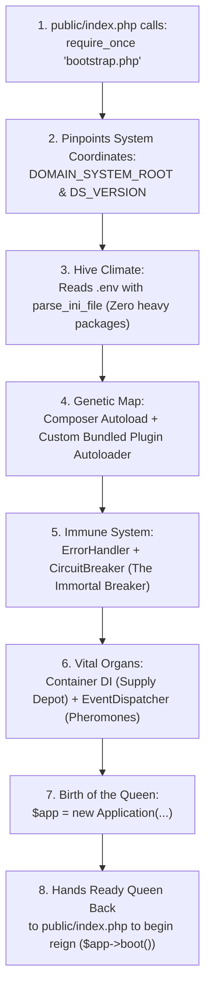
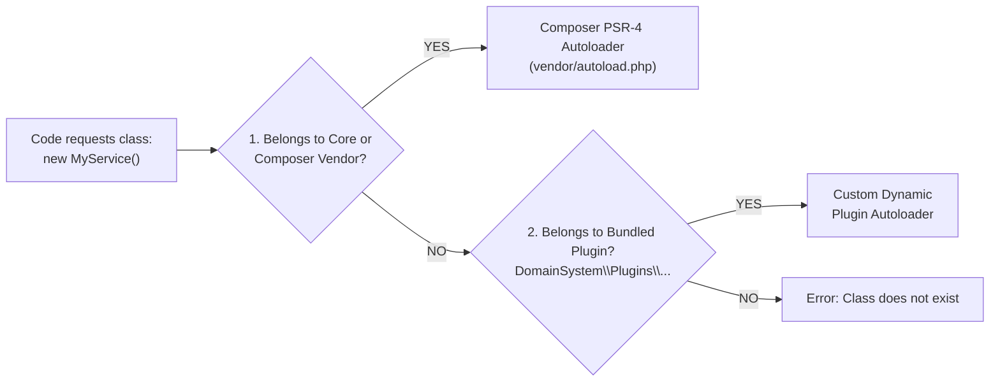

# Chapter 02 — The Bootstrap Ritual (`bootstrap.php`)

> [🇧🇷 Versão em Português](../02-o-ritual-do-bootstrap.md) | 🇺🇸 **English**  
> ⬅️ [Previous: Chapter 01 — The Server Start](01-server-start.md) | 🏠 [Back to Index](README.md) | ➡️ [Next: Chapter 03 — The Hive Queen](03-the-hive-queen.md)

---

## 🎬 Cinematic View: The Motherboard BIOS and the Birth of the Queen

Picture a spacecraft launch countdown or an operating theater:
> *In Chapter 01, the web server intercepted a visitor's click and `.htaccess` routed the request to the single entry door (`public/index.php`).*  
> *However, a newly awakened PHP process is like a newborn baby: it has no idea where files live, knows nothing about the database, doesn't know the exact time zone, and would panic fatal-style (`Class not found`) if it encountered an unimported class.*  
>  
> *This is where the front door calls the master of ceremonies:*  
> `$app = require_once dirname(__DIR__) . '/bootstrap.php';`  
>  
> *The workstation lights flick on one by one. The BIOS executes an integrity check, loads foundational tools, mounts the immune defense system against crashes, and prepares for the birth of the Hive Queen (the Kernel).*

In this chapter, we dissect the most important initialization file in the entire ecosystem: `bootstrap.php` (with its 542 lines of clean, self-documenting, and battle-tested code).

---

## 🗺️ The 6-Stage Bootstrap Assembly Line

Here is the exact lifecycle taking place in mere milliseconds before the application responds to any request:



---

## 1. Absolute Coordinates and Vital Boundaries

The very first duty of the bootstrap is ensuring the application never gets lost, whether running on local XAMPP (`D:\xampp\htdocs\domain-system`) or inside a Linux container in Frankfurt (`/var/www/html`):

```php
define('DOMAIN_SYSTEM_ROOT', __DIR__);
define('DS_VERSION', '2.7.0');
define('DS_OS_VERSION', '2.7');
```

### Why is this vital for a 30 MB system?
Beginners often use fragile relative paths like `include '../../config.php'`. The moment you move a file to another folder, everything breaks. By declaring `DOMAIN_SYSTEM_ROOT` as the absolute root anchor, every plugin and theme locates resources with military precision:

```php
$config = DOMAIN_SYSTEM_ROOT . '/config/plugins.json';
```

---

## 2. Hive Climate: Loading `.env` Without Bloatware

In heavy enterprise frameworks, reading a simple text file like `.env` often involves downloading packages that pull in dozens of dependencies and hundreds of files into the `vendor/` directory.

In **Domain-System**, our philosophy is radical simplicity: we use PHP's own native C-level engine (`parse_ini_file` with the `INI_SCANNER_RAW` flag):

```php
$envFile = DOMAIN_SYSTEM_ROOT . '/.env';

if (file_exists($envFile)) {
    $envVariables = parse_ini_file($envFile, false, INI_SCANNER_RAW);

    if (is_array($envVariables)) {
        foreach ($envVariables as $key => $value) {
            // Strip quotes ONLY if they form a matching pair (protecting passwords ending in quotes)
            if (strlen($value) >= 2 && ($value[0] === '"' || $value[0] === "'") && substr($value, -1) === $value[0]) {
                $value = substr($value, 1, -1);
            }

            putenv("$key=$value");
            $_ENV[$key] = $value;
            $_SERVER[$key] = $value;
        }
    }
}
```

### The Nature Analogy:
The `.env` file represents the **hive climate** (external temperature, humidity, wind). The bees do not alter the weather outside; they simply adapt to it. Every hosting server holds its own `.env` file with unique database credentials and API secrets, without changing a single line of application source code.

Right after, we synchronize the biological clock:
```php
$timezone = getenv('APP_TIMEZONE') ?: 'America/Sao_Paulo';
date_default_timezone_set($timezone);
```

---

## 3. The Genetic Map: Dual Autoloaders

Instead of hundreds of manual `require_once` statements, modern PHP relies on **Autoloading**: when the runtime attempts to instantiate a class not yet in memory, the autoloader looks up where that class lives on disk and loads it on the fly.

Domain-System features **two complementary autoloaders**:



### 3.1. Standard Composer Autoloader:
```php
require_once __DIR__ . '/vendor/autoload.php';
```
Loads the system core (`DomainSystem\Core\*`) adhering strictly to the PSR-4 global standard.

### 3.2. Dynamic Bundled Plugin Sniffer:
Here is an essential design choice for accessibility: when distributing complete packs of plugins, end-users on shared hosting often **do not have SSH terminal access to run `composer dump-autoload`**.

The bootstrap solves this by registering an on-demand fallback resolver with `spl_autoload_register`:

```php
spl_autoload_register(function ($class) {
    $prefix = 'DomainSystem\\Plugins\\';
    if (str_starts_with($class, $prefix)) {
        $relativeClass = substr($class, strlen($prefix));
        $file = __DIR__ . '/src/Plugins/clinic_pack/bundled_plugins/' . str_replace('\\', '/', $relativeClass) . '.php';
        if (file_exists($file)) {
            require $file;
        }
    }
});
```
If the requested class belongs to an integrated pack, the engine locates and boots it immediately without requiring command-line tooling.

---

## 4. Immune Defense: ErrorHandler and CircuitBreaker

If a third-party plugin written by an external developer has a typo or attempts to divide by zero, will the entire website crash into an ugly white screen of death?

**Never.** This is where Domain-System arms its immune defense:

```php
$logger = new \DomainSystem\Core\Error\ErrorLogger($errorLogPath);
$circuitBreaker = new \DomainSystem\Core\Error\CircuitBreaker($configPath, $disarmedPath);
$renderer = new \DomainSystem\Core\Error\ErrorRenderer();

$errorHandler = new \DomainSystem\Core\Error\ErrorHandler($logger, $circuitBreaker, $renderer);
$errorHandler->register();
```

### The Immortal Circuit Breaker:
Think of your home electrical panel. If your water heater shorts out, the breaker trips **only that specific circuit**. The refrigerator stays cold, the living room lights stay on, and the house does not burn down.

The `CircuitBreaker` does the exact same thing for Domain-System plugins:
1. A plugin crashes or encounters an unhandled fatal error;
2. `ErrorHandler` traps the failure before it brings down the web server;
3. `CircuitBreaker` logs the culprit plugin ID into `temp/disarmed.json` and silently disables it;
4. The rest of the web OS continues serving customers normally!

---

## 5. Vital Organs: Container DI and EventDispatcher

Before creating the Queen (Application), the bootstrap sets up the two primary organs she uses to govern:

### 5.1. The Supply Depot (`Container`):
```php
$container = new Container();
$container->singleton(\DomainSystem\Core\Contracts\ContainerInterface::class, function() use ($container) { 
    return $container; 
});
```
The Container is the central storehouse where interfaces and concrete services are bound, forming the bedrock of Dependency Inversion (DIP).

### 5.2. Chemical Pheromones (`EventDispatcher`):
```php
$dispatcher = new EventDispatcher();
$container->singleton(\DomainSystem\Core\Contracts\EventDispatcherInterface::class, function() use ($dispatcher) { 
    return $dispatcher; 
});
```
The event dispatcher enables modules to communicate without direct coupling. For example: when a customer payment is approved, the commerce gateway announces on the radio: `"payment.approved"`. It does not need to know whether the listener is an online course plugin, a shipping carrier, or an invoice generator.

---

## 6. Birth of the Queen: `$app = new Application(...)`

With the groundwork laid, the clock synchronized, the immune defenses active, and the container primed, the bootstrap reaches its climax:

```php
$app = new Application($container, $dispatcher, DOMAIN_SYSTEM_ROOT);
return $app;
```

### Why is the constructor called with `new` if Application is a Singleton?
In textbook computer science, a Singleton constructor is always declared `private`.  
In Domain-System, the engineering is pragmatic:
1. `bootstrap.php` is the **only place in the universe** allowed to birth the `Application` instance;
2. Inside its constructor, `Application` executes `self::$instance = $this;`, permanently activating the Singleton;
3. Any other file wishing to access the Kernel calls `Application::getInstance()` or requests it from the Container DI.

`bootstrap.php` concludes by returning the living Queen into the hands of `public/index.php`. The ecosystem is ready to begin its reign via `$app->boot()`.

---

## 🔍 The Audit Magnifier: Real Engineering Findings

In line with our commitment to open-source transparency and continuous audits:

### 🔎 Finding 1: Eliminating Heavy Libraries with Native C Functions
- **What it does:** Reads `.env` using PHP's native `parse_ini_file(..., INI_SCANNER_RAW)`.
- **Why it matters:** Saves dozens of external files and keeps bootstrap overhead under 2 milliseconds.
- **Guard applied:** The `INI_SCANNER_RAW` flag prevents PHP from casting values like `"no"` or `"false"` to empty booleans, preserving raw token strings exactly as authored.

### 🔎 Finding 2: Symmetrical Quote Stripping for Passwords
- **The code:** `substr($value, 1, -1)` runs only when the first and last characters are identical (`$value[0] === $value[-1]`).
- **Vulnerability avoided:** If a complex database password ends with a quote mark (e.g., `MySecret#123"`), a careless `trim($value, '"')` would mutilate the password and break database connectivity. Domain-System handles this with surgical precision.

### 🔎 Finding 3: The Triple Guard of the ErrorHandler
- **The code:** `set_error_handler`, `set_exception_handler`, and `register_shutdown_function`.
- **Why it saves the system:** Standard `try / catch` blocks cannot intercept fatal PHP errors (such as out-of-memory errors `Fatal Error: Allowed memory size exhausted` or syntax bugs). The `register_shutdown_function` hook runs on the process's dying breath, ensuring that even under catastrophic failures, logs are persisted and a clean recovery screen is presented to the user.

---

> ➡️ **In the Next Chapter:** [Chapter 03 — The Hive Queen (The Hardened Singleton)](03-the-hive-queen.md)  
> We dive straight into the source code of `Application.php`, explore why having two queens would collapse the hive, and see how the class is armored against cloning, serialization, and state corruption!
