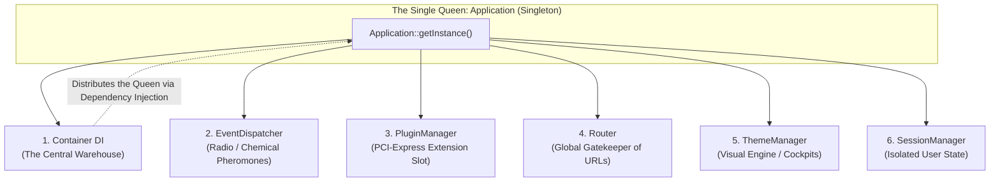

# Chapter 03 — The Hive Queen (The Hardened Singleton Pattern)

> [🇧🇷 Versão em Português](../03-a-rainha-da-colmeia.md) | 🇺🇸 **English**  
> ⬅️ [Previous: Chapter 02 — The Bootstrap Ritual](02-the-bootstrap-ritual.md) | 🏠 [Back to Index](README.md) | ➡️ [Next: Chapter 04 — The Central Warehouse and Wall Sockets](04-the-central-warehouse-and-wall-sockets.md)

---

## 🎬 Cinematic View: The Chaos of Two Queens in a Single Realm

Picture a kingdom with two monarchs issuing conflicting orders at the same moment, or a beehive in nature where two rival queens contest the throne:
> *The worker bees are thrown into confusion. Some construct honeycomb northward, others southward. Chemical pheromone signals clash, and the entire colony collapses within hours.*  
>  
> *In software architecture, the exact same disaster occurs:*  
> *If your system permits two distinct Kernel instances (`Application`) to coexist in memory during a single request:*  
> - *Plugin A registers its routes inside Kernel 1;*  
> - *The Router inside Kernel 2 receives the incoming `/checkout` URL and replies: "404 Page Not Found!";*  
> - *The user session fragments, and shopping carts vanish into thin air.*

To prevent this catastrophe, the **Domain-System** places the `Application` class upon the throne of a **Hardened Singleton Pattern**. In this chapter, we dissect [src/Core/Application.php](file:///d:/xampp/htdocs/domain-system/src/Core/Application.php) (499 lines of pure, self-contained PHP with zero third-party framework lock-in).

---

## 🗺️ Anatomical Map of the Queen

The `Application` class does not work alone—it is the master conductor. Here is how it commands the gravitational center of the runtime:



---

## 1. What is a Singleton and What Does Nature Teach Us?

In biology, a healthy beehive maintains **exactly one queen**. She serves as the reproductive nervous center and broadcasts the master pheromones that keep 50,000 individual bees operating in flawless synchronization.

In Domain-System, the `Application` class stores itself inside a private static property:

```php
// src/Core/Application.php (line 123)
private static ?Application $instance = null;
```

- **`static`:** it belongs to the class memory itself, never to an ephemeral throwaway object;
- **`private`:** external callers cannot tamper with or replace this variable directly;
- **`?Application`:** it starts as `null` before ignition, transforming into the living Queen immediately upon creation.

---

## 2. Eager Loading: Immediate Birth

In academic textbooks, professors frequently teach the Singleton pattern coupled with *Lazy Loading*:
```php
// ❌ Academic Lazy Loading anti-pattern (waits until someone asks)
public static function getInstance(): Application {
    if (self::$instance === null) {
        self::$instance = new self();
    }
    return self::$instance;
}
```

### Why does Domain-System reject Lazy Loading for its Kernel?
Because the Kernel is the very ground upon which every component stands! **No web request can ever complete without a Kernel.** Waiting for something to accidentally summon it halfway through execution introduces race conditions and unnecessary branching.

Domain-System adopts **Eager Loading**: the exact moment the constructor is summoned by `bootstrap.php`, the Queen immediately claims her seat:

```php
// src/Core/Application.php (lines 252-269)
public function __construct(ContainerInterface $container, EventDispatcherInterface $dispatcher, string $basePath)
{
    $this->container = $container;
    $this->dispatcher = $dispatcher;
    $this->basePath = $basePath;

    // 🔵 IMMEDIATE SELF-REGISTRATION (Eager Loading)
    self::$instance = $this;

    // Registers herself into the Container
    $this->container->singleton(Application::class, function() {
        return $this;
    });
    ...
```

The global access point remains blazing fast, branching-free, and clean:

```php
// src/Core/Application.php (line 318)
public static function getInstance(): ?Application
{
    return self::$instance;
}
```

---

## 3. The Constructor Dilemma: Public or Private?

If you open the classic *Gang of Four* design patterns book, the primary commandment is: *"The constructor MUST be declared private to prevent calls to `new`"*.

Why then is `Application::__construct` declared `public`?

```php
public function __construct(...)
```

The answer is **practical, unbloated engineering**:
1. `bootstrap.php` is the **ritual of inception**. It must inject the Container, the EventDispatcher, and the filesystem root when creating the Kernel;
2. Were the constructor private, the Kernel would be forced to instantiate its own dependencies out of thin air, directly violating the Dependency Inversion Principle (DIP);
3. Since `bootstrap.php` is the **only file in the entire repository** that ever calls `new Application(...)`, the physical singularity of the Queen is 100% safeguarded.

---

## 4. The Golden Partnership: Singleton + Container DI

Many developers mistakenly believe that *Dependency Injection Containers* and *Singletons* are mortal enemies. **In Domain-System, they operate as twin partners:**

- **The Singleton** guarantees that only one Queen can ever exist in PHP memory;
- **The Container** ensures that other classes do not need to scatter hardcoded static calls to `Application::getInstance()` across the codebase.

Notice line 267 inside the constructor:
```php
$this->container->singleton(Application::class, function() {
    return $this;
});
```

Whenever a service or controller requires access to the Kernel, it simply requests it via its constructor signature:
```php
public function __construct(Application $app) { ... }
```
The Container supplies the exact same living Queen. This architectural harmony allows unit tests to mock and isolate classes with zero friction!

---

## 5. Division of Labor: The `CoreServiceProvider`

An anti-pattern in amateur PHP projects is the "God Class"—a monstrous 5,000-line class that directly connects to MySQL, parses templates, generates hashes, handles routing, and uploads images.

Look at how cleanly `Application.php` honors the Single Responsibility Principle (SRP):

```php
// src/Core/Application.php (lines 274-275)
$provider = new \DomainSystem\Core\Providers\CoreServiceProvider();
$provider->register($this->container, $this->dispatcher, $this->basePath);
```

The Kernel does not wire every service by hand. It delegates the assembly line to the **Chief Quartermaster** (`CoreServiceProvider`), which registers:
- Database connectivity (`Connection`);
- Secure sessions (`SessionManager`);
- Site environment state (`SiteState`);
- URL routing (`Router`);
- Visual template switching (`ThemeManager`).

Once registered, the Queen merely stores typed references:
```php
$this->sessionManager  = $this->container->make(SessionManager::class);
$this->pluginManager   = $this->container->make(PluginManager::class);
$this->router          = $this->container->make(RouterInterface::class);
$this->themeManager    = $this->container->make(ThemeManager::class);
$this->workspaceManager= $this->container->make(WorkspaceManager::class);
```

---

## 6. Awakening the Colony: The `boot()` Method

Instantiating the Queen is one thing; setting her to rule is another.  
The `boot()` method fires right as the system prepares to handle the incoming HTTP request:

```php
public function boot(): void
{
    // 1. Ensures temporary directories exist and starts user session
    \DomainSystem\Core\Bootstrap\RuntimeDirectories::ensure($this->basePath);
    $this->sessionManager->start();

    // 2. Discovers protected core system apps (SystemApps)
    $systemAppsPath = dirname(__DIR__) . '/SystemApps';
    $this->pluginManager->discoverPlugins($systemAppsPath, $configPath, true, true);

    // 3. Discovers third-party user plugins
    $this->pluginManager->discoverPlugins($pluginsPath, $configPath, false, false);

    // 4. Executes the boot lifecycle for every active worker
    $this->pluginManager->bootPlugins();

    // 5. Emits master pheromones for dynamic extension
    $this->dispatcher->dispatch('init');
    $this->dispatcher->dispatch('shortcodes.register', $this->shortcodeManager);
    $this->dispatcher->dispatch('workspace.register', $this->workspaceManager);
}
```

Notice the biological hierarchy:
1. First, **SystemApps** (the royal guard: auth, setup, monitors);
2. Next, **User Plugins** (general worker bees);
3. Finally, **Global Broadcast Events**, releasing shortcodes and custom workspaces to active themes.

---

## 🔍 The Audit Magnifier: Real Kernel Findings

From our ongoing, line-by-line automated audits:

### 🔎 Finding 1: The Rebirth Hatch for Automated Tests (`kill()`)
During PHPUnit test runs, hundreds of tests run sequentially inside the same console process. If the Singleton were immutable, the first test would instantiate the Queen and the remaining 640+ tests would inherit contaminated state!

To solve this cleanly, the Kernel exposes a surgical reset method:

```php
// src/Core/Application.php (lines 328-333)
public static function kill(): void
{
    $basePath = self::$instance?->basePath;
    self::$instance = null;
    \DomainSystem\Core\Plugin\Services\ProcessRegistry::killSingleton($basePath);
}
```
This enables test suites to terminate the Queen at the end of each scenario, letting the next test start with a completely fresh slate!

### 🔎 Finding 2: Self-Healing Runtime Directories
By invoking `RuntimeDirectories::ensure($this->basePath)` prior to booting any plugin, the Kernel automatically scaffolds and permissions critical paths like `temp/` and `storage/`. When cloned to a new environment without these folders, the Kernel heals itself without fatal warnings.

### 🔎 Finding 3: Zero Raw Superglobals
Despite being the Queen, `Application` **never touches `$_GET`, `$_POST`, `$_SESSION`, or `$_COOKIE`**. Everything routes through isolated providers (`SessionManager`, `Request`). This insulates the system against parameter injection vulnerabilities in the core.

---

## 📌 Summary in One Sentence

> *"The Singleton pattern does not exist to make the Application class an almighty monolith, but to guarantee that the ecosystem possesses a single source of truth, enabling dozens of independent plugins to coexist without fighting over the throne."*

---

> ➡️ **In the Next Chapter:** [Chapter 04 — The Central Warehouse (Container) and Wall Sockets (Contracts)](04-the-central-warehouse-and-wall-sockets.md)  
> We examine how the Dependency Injection Container manages objects, how the Wall Socket and Plug principle (DIP) works in real code, and how to swap databases or payment gateways without touching a single line of the Kernel!
