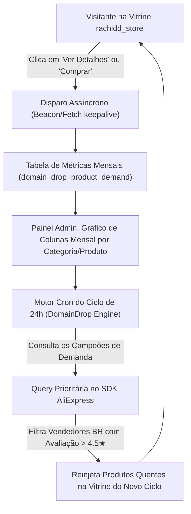

# 🧠 Arquitetura do Motor de Demanda Autônomo & Curadoria Prioritária (DomainDrop)

> **Documento Estratégico:** Especificação técnica e modelo de dados para rastreamento de comportamento de compra, gráficos mensais de interesse e realimentação automática do ciclo autônomo de 24h via SDK AliExpress.

---

## 1. Visão Geral do Ciclo Fechado (Feedback Loop)

A loja opera em um **ciclo dinâmico de 24 horas**, trocando a vitrine para testar nichos. Em vez de uma rotação puramente aleatória, o rastreamento de cliques cria um **ciclo de aprendizado contínuo**:



---

## 2. Eventos de Rastreamento (Front-End)

Os dois pontos de maior valor de intenção são:
1. **`click_details` ("Ver Detalhes" / Card do Produto):** Demonstra curiosidade ativa e consideração.
2. **`click_buy` ("Comprar Agora"):** Demonstra intenção direta de checkout (fundo de funil).

### Disparo Inteligente via JavaScript (Sem travamento de página):
```javascript
function trackDropEngagement(productId, productTitle, categorySlug, actionType) {
    if (!productId) return;
    
    // Beacon garante entrega mesmo se a página estiver mudando para o checkout
    const payload = JSON.stringify({
        product_id: productId,
        title: productTitle,
        category: categorySlug,
        action: actionType, // 'view_details' ou 'buy_click'
        timestamp: Math.floor(Date.now() / 1000)
    });

    if (navigator.sendBeacon) {
        navigator.sendBeacon('/api/drop/track-demand', payload);
    } else {
        fetch('/api/drop/track-demand', {
            method: 'POST',
            headers: { 'Content-Type': 'application/json' },
            body: payload,
            keepalive: true
        }).catch(() => {});
    }
}
```

---

## 3. Modelo de Banco de Dados (Agrupamento Mensal & Multi-Vendedor)

Para permitir a montagem do **gráfico de colunas mês a mês** e não estourar o banco com milhões de linhas pontuais:

```sql
CREATE TABLE IF NOT EXISTS `domain_drop_product_demand` (
    `id` BIGINT UNSIGNED AUTO_INCREMENT PRIMARY KEY,
    `product_id` VARCHAR(64) NOT NULL COMMENT 'ID base do produto ou SKU minerado',
    `product_title` VARCHAR(255) NOT NULL,
    `category_slug` VARCHAR(64) NOT NULL,
    `period_year_month` VARCHAR(7) NOT NULL COMMENT 'Formato YYYY-MM (ex: 2026-11)',
    `detail_clicks` INT UNSIGNED NOT NULL DEFAULT 0,
    `buy_clicks` INT UNSIGNED NOT NULL DEFAULT 0,
    `conversions` INT UNSIGNED NOT NULL DEFAULT 0 COMMENT 'Vendas pagas confirmadas via webhook',
    `demand_score` INT UNSIGNED NOT NULL DEFAULT 0,
    `last_searched_at` DATETIME NOT NULL,
    UNIQUE KEY `uk_product_period` (`product_id`, `period_year_month`),
    INDEX `idx_period_score` (`period_year_month`, `demand_score` DESC),
    INDEX `idx_category` (`category_slug`)
) ENGINE=InnoDB DEFAULT CHARSET=utf8mb4 COLLATE=utf8mb4_unicode_ci;
```

### Cálculo do Score Ponderado:
$$\text{Demand Score} = (\text{conversions} \times 10) + (\text{buy\_clicks} \times 4) + (\text{detail\_clicks} \times 1)$$

---

## 4. O Painel Administrativo com Gráfico de Colunas

No painel do `DomainDrop` (`Admin > DomainDrop > Inteligência de Demanda`):
- **Seletor de Mês/Ano:** Exibe a evolução mês a mês.
- **Gráfico de Colunas Interativo:**
  - Eixo X: Categorias ou Top 10 Produtos Mais Clicados.
  - Eixo Y: Volume de cliques em "Comprar" vs "Ver Detalhes".
- **Identificação do Perfil do Comprador:**
  - Indica se a audiência do site é majoritariamente compradora de *Eletrônicos/Acessórios*, *Utilidades Domésticas*, *Vestuário/Kits*, etc.

---

## 5. A Reinjeção Automática no Motor do Ciclo de 24h (O Pulo do Gato)

Quando o ciclo autônomo de 24 horas for rodar o update diário da vitrine:
1. O cron consulta os **Top 5 Produtos/Termos de Maior Demanda** dos últimos 30 dias na tabela de inteligência.
2. O `AliExpressSdkClient` executa a busca garantindo vagas cativas para esses itens:
   - **Critério de Seleção do Vendedor:**
     - Armazém local no Brasil (`ship_from: 'BR'`);
     - Avaliação da loja $\ge 4.5\bigstar$;
     - Maior volume de vendas recente (`sales_volume`).
3. Se um vendedor pausar o anúncio ou ficar sem estoque, o motor busca o **próximo vendedor bem avaliado** que ofereça o mesmo produto exato.
4. **Resultado na Loja:** A vitrine de 24h sempre traz novidades para girar o catálogo, mas **os produtos validados pelo público nunca somem**, garantindo alta conversão contínua.

---

> 📌 **Status:** Especificação registrada para guiar a implementação dessa inteligência no módulo `DomainDrop`.
