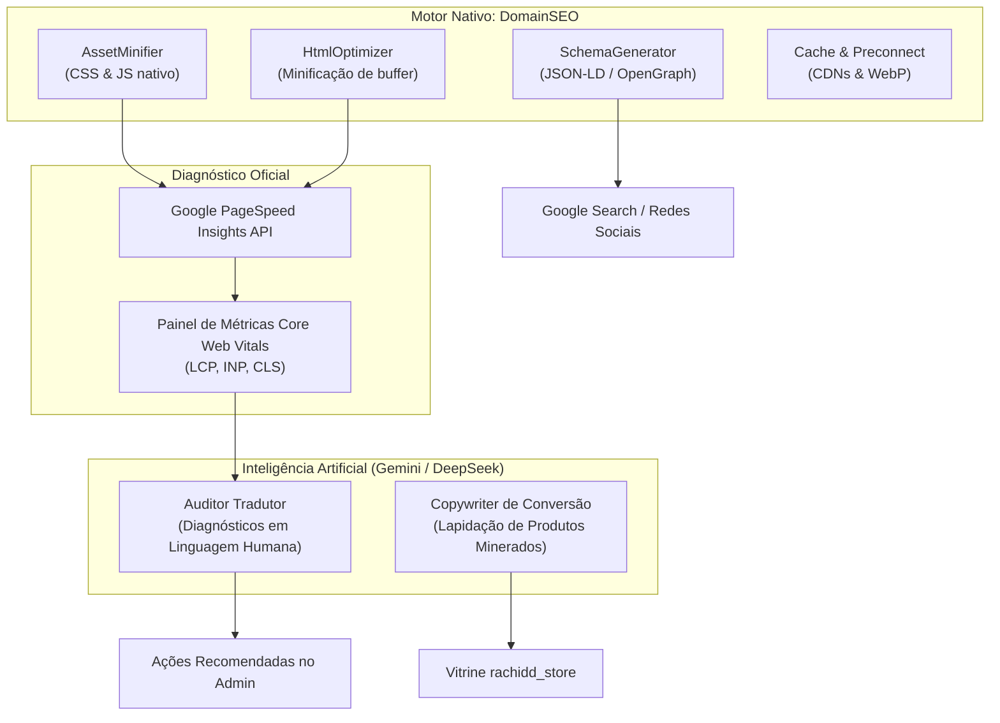

# 🚀 Especificação & Roteiro Estratégico: DomainSEO, Performance & I.A.

> **Objetivo:** Documento arquitetural para guiar a futura implementação do módulo de **Alta Performance, Otimização de SEO Orgânico, Auditoria Automatizada via Google PageSpeed Insights e Enriquecimento Inteligente via I.A. (Gemini / DeepSeek)** no ecossistema Domain System (`DomainDrop`, `DomainEcommerce`, `Academy` e tema `rachidd_store`).

---

## 🧭 Visão Geral da Locomotiva

Quando a loja virtual e a academia estiverem tracionando tráfego e vendas, três pilares sustentam o crescimento orgânico:
1. **Velocidade Extrema (Core Web Vitals):** Páginas que carregam em menos de 1.5s convertem até 3x mais e ganham prioridade no ranqueamento mobile do Google.
2. **Dados Estruturados Ricos (Rich Snippets):** Preço, estoque em BRL, estrelas de avaliação e estrutura de cursos expostos diretamente nos resultados de busca do Google.
3. **Copywriting & SEO Inteligente:** Títulos e descrições de produtos minerados do AliExpress lapidados para alta persuasão e clique (CTR).

---

## 1. Núcleo Técnico do DomainSEO & Performance

O plugin `seo` já possui fundações registradas no sistema via Ring 3 / `OsRuntime`. As próximas expansões cobrirão:

### 1.1. Minificação e Otimização de Assets (CSS/JS)
- **`NativeAssetMinifier`**:
  - Remoção de espaços em branco, quebras de linha e comentários de folhas de estilo e scripts compilados.
  - Agrupamento ou geração de versões `.min.css` e `.min.js` persistidas no diretório `public/cache/assets/`.
- **Injeção de Atributos de Renderização**:
  - `defer` ou `async` automático em scripts não críticos para liberar a thread principal.
  - `<link rel="preconnect">` e `<link rel="dns-prefetch">` prioritários para:
    - Fontes Google (`fonts.googleapis.com`, `fonts.gstatic.com`);
    - CDN de imagens do AliExpress (`ae01.alicdn.com`);
    - Gateways de pagamento (`api.mercadopago.com`, `www.paypalobjects.com`).

### 1.2. Otimização de HTML e Imagens
- **`HtmlOptimizer`**:
  - Strip de espaços vazios redundantes entre nós do DOM antes de descarregar a resposta HTTP.
- **Carregamento Responsivo & Lazy-loading**:
  - Atributo nativo `loading="lazy"` e `decoding="async"` em todas as imagens da vitrine, cursos e galerias.
  - Prioridade máxima (`fetchpriority="high"`) exclusivamente para o banner principal da primeira dobra (LCP).

### 1.3. Microdados & Rich Snippets (JSON-LD)
Geração automática de blocos `<script type="application/ld+json">`:
- **Produtos (`Product` + `Offer` + `AggregateRating`)**:
  - Nome, imagem principal, SKU, descrição curta.
  - Preço em `BRL`, disponibilidade (`https://schema.org/InStock`).
  - Nota média e contagem de avaliações mineradas do fornecedor.
- **Cursos (`Course` + `EducationalOccupationalCredential`)**:
  - Nome do curso, instrutor, modalidade de ensino, carga horária e módulos.
- **Redes Sociais (OpenGraph & Twitter Cards)**:
  - Tags dinâmicas para compartilhamento no WhatsApp, Facebook e Instagram com imagem atraente e preço visível.

---

## 2. Auditoria Automatizada: Google PageSpeed Insights API

### 2.1. Como funcionará a integração
- O Google oferece a **PageSpeed Insights API v5** (gratuita com chave de API do Google Cloud Console).
- No painel administrativo (`Admin > SEO > Auditoria de Performance`):
  - Botão de **"Escanear Loja Agora"** ou agendamento diário/semanal via cron.
  - Execução contra 3 páginas-chave: **Home**, **Página de Produto** e **Página de Curso**.

### 2.2. Métricas Extraídas & Exibição no Dashboard
1. **Pontuação Geral (0 a 100)** para Mobile e Desktop (com velocímetro visual colorido: Verde 90-100, Laranja 50-89, Vermelho 0-49).
2. **Core Web Vitals Oficiais**:
   - **LCP (Largest Contentful Paint):** Tempo para a maior imagem/bloco carregar (Ideal: < 2.5s).
   - **INP (Interaction to Next Paint):** Tempo de resposta a cliques do usuário (Ideal: < 200ms).
   - **CLS (Cumulative Layout Shift):** Índice de elementos saltando na tela (Ideal: < 0.1).
3. **Checklist de Oportunidades:**
   - Lista exata das imagens que precisam de compressão.
   - Recursos que estão bloqueando a renderização da tela.

---

## 3. Inteligência Artificial (Gemini / DeepSeek): Os Dois Grandes Pilares

Embora a compressão de código seja mecânica, a **I.A.** entra como o diferencial estratégico de alto retorno:

### Pilar A: O "Engenheiro de Performance Virtual"
- A API do PageSpeed gera relatórios técnicos densos em JSON com dezenas de páginas.
- **Ação da I.A.:** Lê a resposta bruta da API e sintetiza em **recomendações práticas em português** para o lojista:
  > *"Identifiquei 3 pontos críticos hoje:*  
  > *1. O banner principal está em formato PNG com 3.2MB. Converta para WebP de até 180KB.*  
  > *2. O script do player de rádio pode ser adiado para não travar a primeira visualização no celular.*  
  > *3. Com essas duas correções, sua nota estimada subirá de 68 para 94 no mobile."*

### Pilar B: Copywriting e SEO de Conversão para Produtos Minerados
Produtos vindos de APIs de dropshipping (AliExpress) chegam com textos traduzidos literalmente e títulos confusos.
- **Fluxo do Botão "✨ Otimizar com I.A." no Admin de Produtos:**
  1. O operador clica no botão ao minerar ou editar o produto.
  2. O prompt envia os atributos brutos para a I.A. (Gemini ou DeepSeek).
  3. A I.A. retorna uma estrutura pronta para salvar:
     - **Título Comercial Atraente:** Curto, magnético e adaptado à cultura de compra brasileira.
     - **Descrição Persuasiva:** Estruturada com problemas, benefícios, especificações claras e garantia.
     - **SEO Title & Meta Description:** Encaixados rigorosamente nos limites do Google (máx. 60 e 160 caracteres).
     - **Sugestão de Tags & Categoria:** Palavras-chave com alto volume de busca.

---

## 4. Roteiro de Implementação Futura (Etapas)

| Fase | Foco | Entregáveis |
| :--- | :--- | :--- |
| **Fase 1** | **Base de Performance & Schema** | Ativação do `NativeAssetMinifier`, geração de tags JSON-LD (Product e Course) e injeção de OpenGraph completo. |
| **Fase 2** | **Conexão com Google PageSpeed** | Criação do serviço `PageSpeedApiClient`, tela de auditoria no Admin e leitura de notas Mobile/Desktop. |
| **Fase 3** | **Integração de I.A. (Gemini / DeepSeek)** | Conector de API de I.A., prompt de diagnóstico inteligente de performance e botão de lapidação de copy/SEO nos produtos minerados. |

---

> 📌 **Nota:** Este documento serve como especificação oficial e fica arquivado no ecossistema do projeto para execução no momento oportuno da escala da loja e dos cursos.
