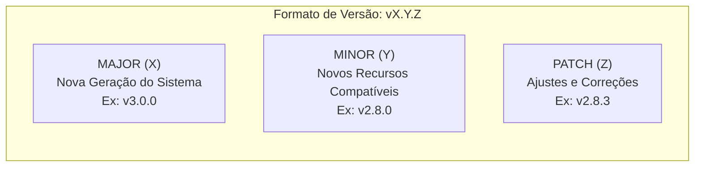

# 📐 Política Oficial de Versionamento SemVer & Ciclo de Entregas

> **Padrão Normativo:** Semantic Versioning 2.0.0 (SemVer)  
> **Escopo:** Núcleo (Core), Plugins Agregados e Temas  
> **Distribuição:** GitHub Releases Automatizadas com SHA-256

---

## 1. Princípio Fundamental

O ecossistema **Domain System** adota o **Versionamento Semântico (SemVer 2.0.0)** para manter a evolução do software transparente, previsível e segura.

Nossos objetivos:
1. **Risco Zero em Produção:** Atualizações aplicadas em servidores de produção (como na Hostinger ou VPS) nunca devem quebrar dados ou telas.
2. **Clareza de Impacto:** O número da versão comunica na hora se a novidade é uma correção simples, um recurso novo ou uma mudança estrutural.
3. **Independência dos Três Pilares:** O Core, os Plugins de negócio e os Temas possuem seus próprios ciclos de vida.

---

## 2. A Estrutura das Versões (`vMAJOR.MINOR.PATCH`)

Toda versão oficial é identificada pelo formato canônico:

$$\text{v} \, \mathbf{X} \, . \, \mathbf{Y} \, . \, \mathbf{Z}$$

Exemplo atual do Core: **`v2.8.4`**

---

### 2.1. O Dígito `PATCH` (Z) — Ajustes e Correções
*Exemplo: `v2.8.0` ➔ `v2.8.1` ➔ `v2.8.2` ➔ `v2.8.3`*

* **Quando muda:**
  * Correções de bugs, exceções e pequenas falhas;
  * Ajustes de telas visuais, layouts em celular e tamanhos de botões;
  * Correções em conexões de APIs externas (AliExpress, Mercado Pago);
  * Melhorias que não alteram o funcionamento de código já existente.
* **Impacto em Produção:** Risco nulo. Seguro para atualizar a qualquer momento.

---

### 2.2. O Dígito `MINOR` (Y) — Novos Recursos Compatíveis
*Exemplo: `v2.8.3` ➔ `v2.8.0`*

* **Quando muda:**
  * Lançamento de grandes ferramentas ou novos fluxos (ex: Construtor Flex Builder, motor de pagamentos);
  * Novas rotas, novas tabelas no banco de dados e novas opções de configuração;
  * Melhorias estruturais mantendo total compatibilidade com versões anteriores da mesma série.
* **Zera o Patch:** Ao incrementar `MINOR`, o dígito `PATCH` volta a zero (ex: `v2.8.0`).

---

### 2.3. O Dígito `MAJOR` (X) — Nova Geração da Plataforma
*Exemplo: `v1.0.0` ➔ `v2.0.0` ➔ `v3.0.0`*

* **Quando muda:**
  * Reformulação profunda da arquitetura do Kernel;
  * Alterações intencionais que exigem migração planejada de código;
  * Exigência de versões superiores de dependências de infraestrutura (ex: nova versão mínima do PHP).
* **Zera Minor e Patch:** Ao incrementar `MAJOR`, ambos os dígitos subsequentes voltam a zero (ex: `v3.0.0`).

---

## 3. O Versionamento nos Três Pilares

Para evitar que uma melhoria em uma extensão force um novo release de todo o sistema, o projeto foi estruturado em três repositórios independentes:

| Repositório | Escopo | Quem acompanha a versão |
| :--- | :--- | :--- |
| **`domain-system`** (Core) | Sistema Operacional, Kernel e painel Cockpit | `SystemApps` e plugins vitais (`core: true`). Atual: `v2.8.3`. |
| **`domain-system-plugins`** | Módulos de negócio (`domain_drop`, `commerce`, `academy`, etc.) | Cada plugin tem seu próprio SemVer livre e independente no catálogo `marketplace.json`. |
| **`domain-system-themes`** | Temas visuais e templates de loja | Cada tema tem sua versão no `theme.json`, iniciando no `rachidd_store` v1.0.0. |

---

## 4. Checklist para Lançamento de Novas Versões

Antes de qualquer tag ser publicada no GitHub:

1. **Consistência do Core:**  
   A versão da tag deve ser igual ao `DS_VERSION` no `bootstrap.php` e ao `"version"` no `composer.json`.
2. **Suíte Completa no Verde:**  
   Os **760 testes automatizados no PHPUnit** devem passar com zero erros e zero falhas no GitHub Actions.
3. **Geração do Pacote:**  
   O script de build empacota o arquivo ZIP com o hash de integridade SHA-256 correspondente.
4. **Atualização no Painel:**  
   O painel administrativo identifica a nova versão e permite aplicar o update com 1 clique, criando backup automático de segurança antes de iniciar.
