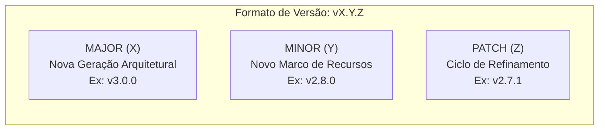
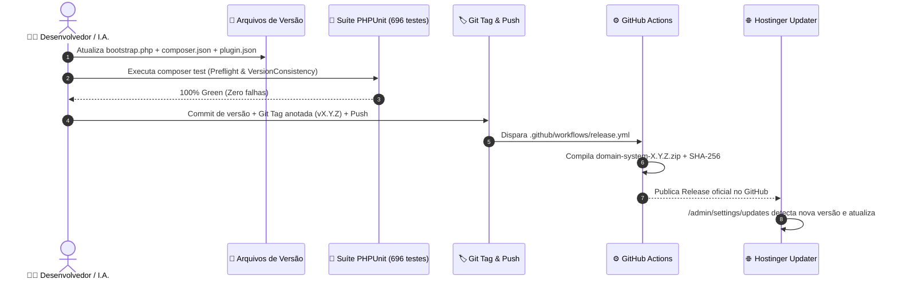

# 📐 Política Oficial de Versionamento SemVer & Ciclo Progressivo de Entregas

> **Padrão Normativo:** Semantic Versioning 2.0.0 (SemVer)  
> **Escopo:** Núcleo do Domain-System OS, Plugins Oficiais (Ring 3), SystemApps (Ring 0) e Temas  
> **Distribuição:** GitHub Releases Automatizadas (Modelo A — Monorepo)  

---

## 1. Princípio Fundamental

O **Domain-System OS** adota rigorosamente a metodologia de **Versionamento Semântico (SemVer 2.0.0)** combinada com um **Ciclo Progressivo de Entregas Contínuas**. 

O objetivo desta política é garantir:
1. **Zero Quebras em Produção:** Qualquer atualização aplicada em servidores de produção (ex: Hostinger) deve ser previsível, segura e reversível.
2. **Clareza para o Desenvolvedor e Administrador:** O número da versão comunica instantaneamente o impacto da atualização (se é um polimento, uma nova funcionalidade ou uma mudança estrutural).
3. **Consistência Sistêmica Total:** O núcleo e todas as extensões oficiais acompanham a mesma versão em seus manifestos e contratos.

---

## 2. Estrutura das Versões (`vMAJOR.MINOR.PATCH`)

Toda versão oficial é identificada pelo formato canônico:

$$\text{v} \, \mathbf{X} \, . \, \mathbf{Y} \, . \, \mathbf{Z}$$

Exemplo: **`v2.7.1`**

---

### 2.1. O Dígito `PATCH` (Z) — Ciclo de Refinamento & Polimento
*Exemplo: `v2.7.0` ➔ `v2.7.1` ➔ `v2.7.2`*

O último dígito representa o **ciclo progressivo de melhorias e correções** da versão atual.

- **Quando incrementar:**
  - Correções cirúrgicas de bugs e exceções;
  - Refinamentos de interface visual (UI/UX), ajustes responsivos em mobile/tablet e correções de corte de botões;
  - Limpeza de código, minificação de CSS/JS e consolidação de assets no AssetPipeline;
  - Ajustes de estabilidade em integrações (Mercado Pago, AliExpress, Google PageSpeed);
  - Correções que **não alteram contratos de API**, não criam quebras de compatibilidade e não removem métodos existentes.
- **Impacto em Produção:** Risco nulo de quebra. Recomendado para atualização imediata na Hostinger.

---

### 2.2. O Dígito `MINOR` (Y) — Novo Marco Funcional
*Exemplo: `v2.6.0` ➔ `v2.7.0` ➔ `v2.8.0`*

O segundo dígito é incrementado quando um **novo ciclo de grandes melhorias é concluído**, introduzindo novos subsistemas e ferramentas ao ecossistema.

- **Quando incrementar:**
  - Lançamento de um novo módulo ou plugin oficial (ex: entrada do `DomainDrop` ou do Hub de PageSpeed do `DomainSEO`);
  - Criação de novos contratos e novas interfaces no Core (`src/Core/Contracts/`);
  - Novas tabelas de banco de dados e migrações estruturadas;
  - Expansão substancial de capacidades mantendo compatibilidade com as versões anteriores da mesma série `MAJOR`.
- **Zera o Patch:** Ao incrementar `MINOR`, o dígito `PATCH` retorna a zero (ex: de `v2.7.3` para `v2.8.0`).

---

### 2.3. O Dígito `MAJOR` (X) — Salto de Geração Arquitetural
*Exemplo: `v1.0.0` ➔ `v2.0.0` ➔ `v3.0.0`*

O primeiro dígito é reservado para **grandes revoluções estruturais** no sistema operacional.

- **Quando incrementar:**
  - Reformulação radical da arquitetura do Kernel (ex: migração para o Domain-System OS 2.0 com isolamento Ring 0 / Ring 3 e Inversão de Dependência);
  - Alterações incompatíveis em contratos fundamentais do sistema;
  - Requisitos de ambiente incompatíveis com a geração anterior (ex: salto obrigatório de versão maior do PHP ou refatoração profunda de banco de dados).
- **Zera Minor e Patch:** Ao incrementar `MAJOR`, ambos os dígitos subsequentes retornam a zero (ex: `v3.0.0`).

---

## 3. Checklist Obrigatório para Emissão de Release

Antes de disparar qualquer nova tag ou versão para o GitHub e para a Hostinger, o seguinte protocolo determinístico deve ser cumprido:

### Regras de Ouro de Consistência:
1. **Regra da Quádrupla Consistência:**  
   O valor da tag Git (`vX.Y.Z`) deve ser rigorosamente idêntico a:
   - `define('DS_VERSION', 'X.Y.Z');` em [bootstrap.php](file:///d:/xampp/htdocs/domain-system/bootstrap.php);
   - `"version": "X.Y.Z"` em [composer.json](file:///d:/xampp/htdocs/domain-system/composer.json);
   - `"version": "X.Y.Z"` em todos os manifestos `src/Plugins/*/plugin.json` e `src/SystemApps/*/plugin.json`.
2. **Suíte Completa 100% Verde:**  
   Nenhuma tag pode ser gerada se houver testes quebrados. O comando `php phpunit.phar --no-coverage` deve retornar 100% de aprovação.
3. **Build Determinístico:**  
   O pacote ZIP oficial deve ser gerado pelo utilitário [tools/build-release.php](file:///d:/xampp/htdocs/domain-system/tools/build-release.php) contendo o hash criptográfico `.sha256` correspondente.

---

## 4. Integração com o Auto-Updater da Hostinger

O atualizador nativo do sistema ([src/SystemApps/SystemUpdater/](file:///d:/xampp/htdocs/domain-system/src/SystemApps/SystemUpdater/)) consulta a API do GitHub (`/repos/hadelrachid/domain-system/releases/latest`):

- **Detecção:** Compara a versão instalada no servidor com a versão publicada na Release mais recente usando `SemverComparator`.
- **Gatilho de Atualização:** Sempre que `Versão da Release > Versão Instalada`, o botão **"🔔 Nova versão disponível"** é ativado.
- **Execução Atômica:** O instalador realiza backup preventivo do código e do banco de dados, valida a assinatura SHA-256, aplica a substituição dos arquivos preservando diretórios locais protegidos (`.env`, `storage/`, `uploads/`, `config/`), executa as migrations pendentes e valida a saúde do sistema. Em caso de qualquer anormalidade, o rollback automático restaura o estado anterior instantaneamente.
