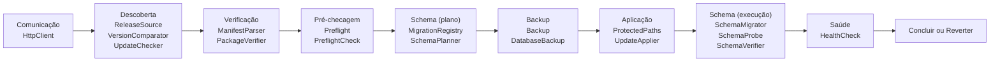

# Contratos do Sistema de Atualização (Núcleo + Plugins)

Complemento do [plano do atualizador](file:///C:/Users/Rachid-PC/.gemini/antigravity/brain/6e198b60-6509-426b-bbbc-c48760cae655/plano_atualizador_github.md). Este documento fixa **as assinaturas** antes de qualquer código, porque são a parte mais cara de mudar depois.

> **Premissa:** o orquestrador (`CoreUpdater`, `PluginUpdater`) só conhece **interfaces**. Rede, ZIP, arquivos, banco, backup e manutenção são **implementações injetadas**. Trocar uma peça (ex.: GitHub por outra origem) não toca no fluxo.

Namespace proposto: `DomainSystem\Core\Contracts\Update\` (subpasta, porque são ~20 contratos e `Core/Contracts/` hoje é plana). Requer **PHP ≥ 8.1** (enums, `readonly`).

---

## 1. Achados no código atual que condicionam o desenho

| # | Achado | Consequência |
|---|---|---|
| 1 | `MigrationRunner::runForPlugin()` **continua** para as próximas migrations quando uma falha (só acumula em `$errors`) | Em atualização, uma migration dependente poderia rodar depois de uma falha. O contrato exige **parar na primeira falha** (corrigir na Fase 0; o Auto-Heal do monitor usa o mesmo método) |
| 2 | `MigrationRunner` instancia a tabela `kernel_migrations` no construtor (efeito colateral) e conhece `sqlite`/`mysql` | O *plano* de schema precisa ser **somente leitura**: usa `MigrationRegistryInterface`, não o runner. O updater nunca vê o runner |
| 3 | `kernel_migrations` tem chave `(plugin, migration)` | O núcleo pode usar o escopo reservado `__core__`, **sem alterar a tabela** |
| 4 | O modo manutenção está no plugin `settings` (**Ring 3**) | Um SystemApp (Ring 0) não pode depender de plugin. Precisa de `MaintenanceModeInterface` implementada no Core |
| 5 | MySQL **não faz rollback de DDL** (`CREATE`/`ALTER` confirmam sozinhos) | Migrations são **somente para frente**; backup do banco antes é obrigatório; regra de migrações **aditivas** (seção 6) |
| 6 | `StateSnapshotManager` copia `database.sqlite` direto | Não serve para MySQL. Backup de banco passa a ser contrato (`DatabaseBackupInterface`) |
| 7 | `ZipArchiveExtractor` exige `plugin.json` e bloqueia pacotes `core` | Reaproveitado só na trilha de plugins; o núcleo usa extração guiada pelo `manifest.json` |
| 8 | `composer.json` exige `php >=8.0`, mas `StateSnapshotManager` usa `new` em valor padrão de parâmetro (PHP 8.1) | Ajustar para `>=8.1` (o badge do README já diz 8.2+) |

---

## 2. Visão geral: contrato por etapa



Transversais: `UpdateStateStore`, `UpdateLock`, `MaintenanceMode`, `InstalledStateProvider`, eventos e notificações.

---

## 3. Tipos compartilhados

```php
namespace DomainSystem\Core\Contracts\Update;

enum UpdateKind: string   { case Core = 'core'; case Plugin = 'plugin'; }
enum UpdateStatus: string { case UpToDate = 'up_to_date'; case Available = 'available';
                            case Incompatible = 'incompatible'; case Unknown = 'unknown'; }
enum CheckLevel: string   { case Ok = 'ok'; case Warn = 'warn'; case Block = 'block'; }
enum UpdateStep: string {
    case Idle = 'idle';           case Checked = 'checked';       case Downloaded = 'downloaded';
    case Verified = 'verified';   case Preflighted = 'preflighted'; case BackedUp = 'backed_up';
    case MaintenanceOn = 'maintenance_on'; case Applied = 'applied';  case Migrated = 'migrated';
    case SchemaVerified = 'schema_verified'; case HealthChecked = 'health_checked';
    case Done = 'done';           case RollingBack = 'rolling_back'; case RolledBack = 'rolled_back';
    case Failed = 'failed';
}
```

**Objetos de valor imutáveis** (`final readonly class`, `declare(strict_types=1)`; só dados, sem comportamento):

| Classe | Campos principais |
|---|---|
| `UpdateTarget` | `kind`, `slug` (`core` para o núcleo), `repository` (`owner/repo`), `installedVersion`, `channel` (`stable`) |
| `ReleaseInfo` | `version`, `tag`, `publishedAt`, `changelog`, `assetUrl`, `assetName`, `sizeBytes`, `sha256`, `etag` |
| `DownloadedPackage` | `release`, `archivePath`, `sizeBytes` |
| `VerifiedPackage` | `release`, `manifest`, `extractedPath` (quarentena) |
| `UpdateManifest` | `protocol` (int), `kind`, `slug`, `version`, `requires` (`php`, `extensions[]`, `osVersion`), `files[]` (`path`, `sha256`, `size`), `removed[]`, `migrations[]` (`name`, `sha256`, `type`: `additive`/`destructive`), `expects` (`tabela => colunas[]`), `minUpdaterProtocol` |
| `UpdateCheckResult` | `status`, `target`, `release`, `reasons[]`, `checkedAt` |
| `PreflightCheck` | `id`, `level`, `message` |
| `PreflightReport` | `checks[]`; `canProceed()` (falso se existir `Block`) |
| `SchemaPlan` | `scope`, `pending[]`, `blocked[]`, `destructive` (bool), `requiresDatabaseBackup` (bool) |
| `SchemaResult` | `executed[]`, `failed` (nome ou `null`), `error` |
| `SchemaVerification` | `ok`, `missingTables[]`, `missingColumns[]`, `unrecorded[]` |
| `BackupScope` | `kind`, `slug` |
| `BackupRecord` | `id`, `scope`, `label`, `createdAt`, `codePath`, `dumpPath?` |
| `ApplyResult` | `backup`, `written[]`, `removed[]`, `skippedProtected[]` |
| `HealthReport` | `ok`, `checks[]` |
| `UpdateState` | `updateId`, `target`, `step`, `release?`, `etag?`, `lastCheckAt?`, `context[]`, `error?`, `updatedAt` |

---

## 4. Contratos

### 4.1 Comunicação

```php
interface HttpClientInterface
{
    /** @throws TransportException  Falha de rede, HTTP não-HTTPS ou host fora da allowlist. */
    public function get(string $url, array $headers = [], int $timeoutSeconds = 10): HttpResponse;

    /** Baixa em streaming para arquivo; aborta se exceder $maxBytes.
     *  @throws TransportException */
    public function download(string $url, string $destinationFile, int $maxBytes,
                             array $headers = [], int $timeoutSeconds = 60): HttpResponse;
}
// HttpResponse (VO): statusCode, headers, body, etag, isNotModified()
```
Obrigações da implementação: **somente HTTPS**, **allowlist de hosts injetada** (`api.github.com`, `github.com`, `*.githubusercontent.com`), timeout, limite de tamanho e limite de redirecionamentos.

### 4.2 Descoberta de versão

```php
interface ReleaseSourceInterface
{
    /** Última Release **estável** (nunca pre-release). `null` = não modificado (ETag/304).
     *  @throws SourceUnavailableException */
    public function latest(UpdateTarget $target, ?string $knownEtag = null): ?ReleaseInfo;

    /** @throws TransportException */
    public function fetchPackage(ReleaseInfo $release, string $destinationDir): DownloadedPackage;
}

interface VersionComparatorInterface
{
    public function isValid(string $version): bool;               // SemVer estrito
    public function compare(string $a, string $b): int;           // -1, 0, 1
    public function isNewer(string $candidate, string $installed): bool;
}

interface UpdateCheckerInterface
{
    /** Usa cache (TTL) salvo no estado; `$force` ignora o cache. Nunca lança: falha vira `Unknown`. */
    public function check(UpdateTarget $target, bool $force = false): UpdateCheckResult;
}

interface UpdateTargetResolverInterface
{
    public function core(): UpdateTarget;                 // repositório do núcleo (configuração, não do pacote)
    /** @return UpdateTarget[]  Só plugins com `update_source` válido no plugin.json. */
    public function plugins(): array;
}
```

### 4.3 Verificação do pacote

```php
interface UpdateManifestParserInterface
{
    /** @return int[]  Versões de protocolo que este updater entende (ex.: [1]). */
    public function supportedProtocols(): array;

    /** Validação estrita: campo faltando, tipo errado ou protocolo desconhecido => exceção.
     *  @throws InvalidManifestException */
    public function parse(string $json): UpdateManifest;
}

interface UpdatePackageVerifierInterface
{
    /** Confere SHA-256 do arquivo, extrai em quarentena (anti Zip-Slip), lê o manifest e
     *  confere o hash de **cada** arquivo listado. Assinatura Ed25519 quando configurada.
     *  @throws PackageIntegrityException */
    public function verify(DownloadedPackage $package): VerifiedPackage;
}
```

### 4.4 Pré-checagem e compatibilidade

```php
interface InstalledStateProviderInterface
{
    public function coreVersion(): string;
    /** @return array<string, InstalledPlugin>  slug => (version, osVersion, isCore, isActive) */
    public function plugins(): array;
}

interface PreflightCheckInterface            // Strategy: novas checagens sem alterar o orquestrador
{
    public function id(): string;
    /** @return PreflightCheck[] */
    public function run(VerifiedPackage $package, UpdateTarget $target): array;
}

interface PreflightInterface                 // Composite: agrega todas as PreflightCheckInterface
{
    public function run(VerifiedPackage $package, UpdateTarget $target): PreflightReport;
}
```
Checagens previstas: versão do PHP, extensões, espaço em disco (≥ 3× o pacote), diretórios graváveis, `minUpdaterProtocol`, **compatibilidade cruzada** (`os_version` dos plugins × núcleo novo), **bloqueio de downgrade**, e **plano de schema** (4.5).

### 4.5 Schema do banco (verificação e atualização)

```php
interface MigrationRegistryInterface         // SOMENTE LEITURA (sem criar tabela, sem efeitos)
{
    /** @return string[]  Nomes já executados no escopo (`__core__` ou slug do plugin). */
    public function executed(string $scope): array;
}

interface SchemaPlannerInterface             // Dry-run: não altera nada
{
    /** Compara as migrations declaradas no manifest com as executadas; valida que cada arquivo
     *  existe, tem o hash do manifest e o formato esperado (`['up' => callable]`).
     *  `blocked` lista migrations executadas que NÃO existem no pacote (indício de downgrade).
     *  @throws SchemaPlanException */
    public function plan(UpdateManifest $manifest, string $extractedPath): SchemaPlan;
}

interface SchemaMigratorInterface            // Executa; SOMENTE PARA FRENTE; PARA NA PRIMEIRA FALHA
{
    public function migrate(SchemaPlan $plan): SchemaResult;
}

interface SchemaProbeInterface               // Sondagem agnóstica de banco (SQL ANSI na implementação)
{
    public function hasTable(string $table): bool;
    public function hasColumn(string $table, string $column): bool;
}

interface SchemaVerifierInterface            // Pós-migração: o banco realmente está como o pacote promete?
{
    /** Confere `expects` do manifest (tabelas/colunas) via SchemaProbe e se todas as migrations
     *  planejadas constam como executadas. */
    public function verify(UpdateManifest $manifest): SchemaVerification;
}
```
Por que `expects` além do registro de migrations: pega o caso "migration registrada, mas a coluna não existe" (ex.: falha parcial em MySQL, onde DDL não volta atrás). É o mesmo padrão `SELECT coluna FROM tabela LIMIT 1` já usado na migration do Academy.

> `SchemaDoctorInterface` (existente) **permanece** para exibir status e o Auto-Heal manual. Os contratos novos são específicos do fluxo de atualização; a mesma classe pode implementar os dois.

### 4.6 Backup

```php
interface BackupInterface                    // Código/configuração
{
    public function create(BackupScope $scope, string $label): BackupRecord;
    /** @throws RollbackFailedException */
    public function restore(BackupRecord $record): void;
    /** @return BackupRecord[] */
    public function list(?BackupScope $scope = null): array;
    public function prune(BackupScope $scope, int $keep): int;
}

interface DatabaseBackupInterface            // Implementada pela camada de banco (Ring 0 não vê o driver)
{
    public function isSupported(): bool;     // false => o fluxo exige confirmação explícita do admin
    public function dump(string $destinationFile): DumpResult;
    /** @throws RollbackFailedException */
    public function restore(string $dumpFile): void;
}
```

### 4.7 Aplicação

```php
interface ProtectedPathsInterface            // A política mora no SISTEMA INSTALADO, nunca no pacote
{
    /** @return string[]  Caminhos que nunca são sobrescritos nem removidos. */
    public function protectedPaths(UpdateKind $kind, string $slug): array;
    /** @return string[]  Únicas raízes onde o pacote pode escrever (núcleo: lista fixa; plugin: src/Plugins/<slug>). */
    public function allowedRoots(UpdateKind $kind, string $slug): array;
}

interface UpdateApplierInterface
{
    /** Escreve só arquivos do manifest dentro de `allowedRoots`, ignora `protectedPaths`,
     *  grava em arquivo temporário e troca por `rename`. Remove só o que está em `removed[]`.
     *  @throws ApplyException */
    public function apply(VerifiedPackage $package, UpdateTarget $target, BackupRecord $backup): ApplyResult;

    /** @throws RollbackFailedException */
    public function revert(ApplyResult $result): void;
}
```

### 4.8 Estado, bloqueio, manutenção e saúde

```php
interface UpdateStateStoreInterface          // Persistente: permite retomar entre requisições
{
    public function load(UpdateTarget $target): UpdateState;
    public function save(UpdateState $state): void;
}

interface UpdateLockInterface                // Impede duas atualizações simultâneas (dois admins)
{
    public function acquire(UpdateTarget $target, int $ttlSeconds): bool;
    public function release(UpdateTarget $target): void;
}

interface MaintenanceModeInterface           // Implementação no Core (não depende do plugin settings)
{
    public function enable(string $message, ?string $adminBypassToken = null): void;
    public function disable(): void;
    public function isEnabled(): bool;
}

interface HealthCheckInterface               // Roda em requisição NOVA, com o código novo carregado
{
    public function run(UpdateTarget $target): HealthReport;
}
```

### 4.9 Orquestradores (uma etapa por requisição)

```php
interface UpdaterInterface
{
    public function kind(): UpdateKind;
    public function check(UpdateTarget $target, bool $force = false): UpdateCheckResult;
    /** Cria a atualização, adquire o lock e devolve o estado inicial. */
    public function begin(UpdateTarget $target, array $options = []): UpdateState;
    /** Executa UMA etapa e devolve o novo estado (a UI chama em loop via AJAX). */
    public function advance(string $updateId): UpdateState;
    public function rollback(string $updateId): UpdateState;
    public function status(string $updateId): UpdateState;
}

interface CoreUpdaterInterface extends UpdaterInterface {}

interface PluginUpdaterInterface extends UpdaterInterface
{
    /** @return UpdateCheckResult[]  Verifica todos os plugins com origem declarada. */
    public function checkAll(bool $force = false): array;
}
```
**Mapa etapa → contrato:** `Checked` (UpdateChecker) → `Downloaded` (ReleaseSource) → `Verified` (ManifestParser + PackageVerifier) → `Preflighted` (Preflight + SchemaPlanner) → `BackedUp` (Backup + DatabaseBackup) → `MaintenanceOn` (MaintenanceMode, só núcleo) → `Applied` (UpdateApplier) → `Migrated` (SchemaMigrator) → `SchemaVerified` (SchemaVerifier) → `HealthChecked` (HealthCheck) → `Done`. Falha em qualquer etapa após `BackedUp` leva a `RollingBack` → `RolledBack`.

### 4.10 Exceções e eventos

```php
class UpdateException extends \RuntimeException {}
final class TransportException          extends UpdateException {}
final class SourceUnavailableException  extends UpdateException {}
final class InvalidManifestException    extends UpdateException {}
final class PackageIntegrityException   extends UpdateException {}
final class PreflightFailedException    extends UpdateException {}
final class SchemaPlanException         extends UpdateException {}
final class SchemaMigrationException    extends UpdateException {}
final class ApplyException              extends UpdateException {}
final class RollbackFailedException     extends UpdateException {}   // o pior caso: exige intervenção manual
```
**Eventos** (via `EventDispatcherInterface` existente; nomes e payloads fazem parte do contrato público): `update.available`, `update.started`, `update.step`, `update.completed`, `update.failed`, `update.rolled_back`. As notificações usam o `NotificationManagerInterface` existente.

---

## 5. Resolução da origem do plugin

O `plugin.json` ganha um campo opcional, lido pelo `UpdateTargetResolver`:

```json
{
  "name": "meu_plugin",
  "version": "1.2.0",
  "os_version": "2.3",
  "update_source": { "type": "github", "repository": "autor/meu-plugin" }
}
```
Sem `update_source`, o plugin aparece como "sem origem de atualização". O `os_version` já existente é a base da compatibilidade cruzada.

---

## 6. Regras que impedem o atualizador de quebrar

1. **Só contratos.** Os orquestradores não fazem `new` de classes concretas nem usam `curl`, `ZipArchive`, `PDO` ou `file_put_contents`. Um **teste de arquitetura** valida isso (mesmo estilo do `NoSuperglobalsInControllersTest`).
2. **Falha fechada (*fail-closed*).** Protocolo de manifest desconhecido, campo ausente, hash divergente ou qualquer exceção tipada aborta e reverte. Nunca "tenta seguir".
3. **A política de proteção mora no sistema instalado** (`ProtectedPathsInterface`), nunca no pacote. Um pacote malicioso não consegue liberar `.env` ou `database.sqlite`.
4. **Versionamento do protocolo.** O manifest tem `protocol` e `minUpdaterProtocol`. Se o updater instalado for antigo demais, a UI mostra "atualize manualmente/CLI" em vez de tentar. Manifests de referência de cada protocolo ficam como *fixtures* nos testes para sempre (compatibilidade para trás).
5. **O updater se atualiza por último** e a etapa de migrations roda em requisição nova, já com o código novo.
6. **Migrações aditivas** dentro da mesma versão maior (criar tabela/coluna, nunca remover ou renomear). Assim o *rollback de código* continua funcionando contra um banco já migrado, já que o MySQL não desfaz DDL. Migrations `destructive` exigem backup de banco confirmado e aparecem destacadas no aviso.
7. **Etapas idempotentes e retomáveis**, com estado persistido e `UpdateLock` contra concorrência.
8. **Objetos de valor imutáveis** e `declare(strict_types=1)` em tudo.

---

## 7. Como testar contratos sem rede

- **Testes de contrato:** uma *suite abstrata* por interface (ex.: `ReleaseSourceContractTest`); toda implementação (real e fake) herda e precisa passar.
- **Fakes entregues em `tests/`:** `ArrayHttpClient`, `InMemoryReleaseSource`, `InMemoryMigrationRegistry`, `FakeBackup`, `FakeMaintenanceMode`, pacotes ZIP gerados em memória.
- **Cenários obrigatórios:** hash adulterado rejeitado; Zip-Slip; manifest com protocolo desconhecido; downgrade bloqueado; arquivo protegido intocado; migration que falha no meio (para na primeira, reverte código, restaura dump); plugin incompatível com o núcleo novo; lock concorrente; retomada após queda entre duas etapas.
- **Banco:** o `SchemaMigrator` e o `SchemaProbe` rodam contra SQLite em memória nos testes e contra MySQL no ambiente de staging da Hostinger.

---

## 8. Decisões necessárias antes de gerar os arquivos

1. **Namespace** `Contracts\Update\` (recomendado) ou arquivos soltos em `Contracts/`?
2. **PHP ≥ 8.1** como requisito oficial (ajusta o `composer.json`)?
3. Posso **corrigir o `MigrationRunner`** para parar na primeira falha (achado 1)? Muda o comportamento do Auto-Heal atual: passa a interromper em vez de seguir.
4. `MaintenanceModeInterface` implementado **no Core** (flag em `storage/state/`, lida pelo `HttpKernel`), com o plugin `settings` passando a usá-lo?
5. O campo `update_source` no `plugin.json` como descrito na seção 5?
